# NASA Beyond Earth: what we found

This guide explains 32 things we found in NASA's "Beyond Earth" data files, in plain words, without leaving out anything important.

## How this guide works

- There are 7 parts, one for each data file.
- Each part starts with **Meet the data**. It tells you what one row of the file is and what every column we use means. Read it first!
- Then come the findings. Every finding has the same boxes:
  - **The question** we asked.
  - **The data we used**: which rows and which columns. Column names from the files look `like this`.
  - **The math**, step by step, with real numbers.
  - **The simple relationship**: the whole idea in one line, with arrows.
  - **How to read the chart**: what the bottom, the side, the bars, dots and colours mean, and what to look for.
  - **In short**: the idea with an everyday example.
  - **Our data shows** (we counted it ourselves) and **Scientists say** (known science from outside our files).
  - **Careful**: a trap to watch out for.
  - **Animation**: the finding as a moving picture, made from the same numbers. Open it on the Findings page of the app, or open the file in `animations/` in a web browser, and press ▶ Play. Before you press Play you see the finished picture.
  - **Word box**: every hard word, explained. All the words are also in the master word list at the end.
- Every number was worked out by our code and saved in the `numbers/` folder. Nobody typed a number by hand.
- Where our number is different from the field guide, a line starting with "Note:" says so.

**Our space rulers.** Space is so big that we use special rulers:

| Ruler | How long it is | What we measure with it |
|---|---|---|
| Earth-Sun distance (AU) | about 150 million km, the distance from the Sun to Earth | how far asteroids are from the Sun |
| Moon distance | 384,400 km, the distance from Earth to the Moon | how close a space rock passes by Earth |
| light-year | how far light travels in one year (light goes about 300,000 km every second) | how far away stars are |
| Earth size | 12,742 km, the width of Earth | how big planets around other stars are |

## Part A: Asteroids and comets

### Meet the data: the asteroid and comet file

**What is this file?** A giant list of every asteroid and comet whose path around the Sun is known. NASA's Jet Propulsion Laboratory (JPL) keeps it up to date.

**What is one row?** One row is one object: one asteroid or one comet. Each column is one fact about it, like its name, its size, or how it travels around the Sun.

**How big is it?** 1,582,869 rows and 29 columns. Reading one row every second, day and night, would take you about 18 days! Almost all of them (99.7%) are asteroids: 1,578,786 asteroids and only 4,083 comets.

**What is this data trying to tell us?** Where do the rocks of the Solar System live? How big are they? How fast do they spin? Could any of them come near Earth? One row tells you about one rock. Thousands of rows together show patterns that no single rock can show.

**The columns we use**

| Column (name in the file) | Nickname we use | What it tells us | How it's measured | Example (Ceres) |
|---|---|---|---|---|
| `name` | name | the object's name, if it has one (most don't) | words | Ceres |
| `kind` | kind | `an` = asteroid with a number, `au` = asteroid without a number yet, `cn` or `cu` = comet | a short code | `an` |
| `class` | neighbourhood | the group its path belongs to: `MBA` = main asteroid belt, `TJN` = shares Jupiter's path, `TNO` = beyond Neptune, `APO`, `ATE` or `AMO` = comes near Earth | a short code | `MBA` |
| `a` | distance from the Sun | its average distance from the Sun: halfway between its closest and farthest points | Earth-Sun distances (one = as far as Earth) | 2.766 |
| `q` | closest point | the closest it ever gets to the Sun | Earth-Sun distances | 2.54 |
| `e` | stretch number | how stretched its path is: zero = a circle, near one = a long, thin oval, one or more = not a closed loop at all | a number | 0.08 |
| `per_y` | year length | how long one trip around the Sun takes | Earth years | 4.60 |
| `om, w, ma` | the three angles | which way its path is turned, and where along the path it is right now | degrees | 80.2, 73.3, 274.4 |
| `H` | brightness number | how bright it would look from a set distance. Like a golf score, smaller wins: a smaller number means a bigger rock | a number | 3.34 |
| `diameter` | width | how wide it is, where someone measured it | km | 939.4 |
| `albedo` | shininess | how much sunlight its surface bounces back: zero = pitch black, one = all of it | a number from zero to one | 0.09 |
| `rot_per` | spin time | how long one full spin takes | hours | 9.07 |
| `neo` | near-Earth flag | `Y` (yes) if its path comes near Earth's path, `N` (no) if not | `Y` or `N` | `N` |
| `pha` | hazard flag | `Y` (yes) if it is called "potentially hazardous": its path comes very close to Earth's path and it is big | `Y` or `N` | `N` |
| `moid` | closest the paths get | the smallest gap between its path and Earth's path (it's about the paths, not where the rock is today) | Earth-Sun distances | 1.58 |
| `first_obs` | first sighting | the date of the earliest sighting used to work out its path | a date: year-month-day | 1995-01-05 |

**Let's read one row together (Ceres)**
- `name` is Ceres and `kind` is `an`: an asteroid with a number. Its number is 1, because it was the first asteroid ever found.
- `a` is 2.766: on average, Ceres is 2.766 times as far from the Sun as Earth is. Its closest point (`q`) is 2.54.
- `e` is 0.08. That's close to zero, so its path is almost a circle. `per_y` is 4.60: one trip around the Sun takes 4.60 of our years.
- `diameter` is 939.4 km, and `H` is 3.34: a very small brightness number, because Ceres is huge.
- `albedo` is 0.09, so Ceres is dark, like a road. `rot_per` is 9.07 hours, so it spins about 2.6 times in one of our 24-hour days.
- `neo` and `pha` are both `N` (no). The closest its path gets to Earth's path (`moid`) is 1.58 Earth-Sun distances: far away.
- `first_obs` is 1995-01-05. Ceres was really found in 1801, but the file lists the earliest sighting used for today's path, not the discovery day.
- Compare Apophis, a famous near-Earth asteroid: its `neo` is `Y` and its `pha` is `Y`. Its path comes within 16,157 km of Earth's path.

**Watch out for:** A blank cell means nobody has measured that fact yet. It does not mean zero! Only 9% of the asteroids have a measured width, 9% a measured shininess, and 2% a measured spin time. Some first-sighting dates are only partly known, like `1999-??-??` (5,829 rows). Most findings leave comets out, because many comet paths are not closed loops.

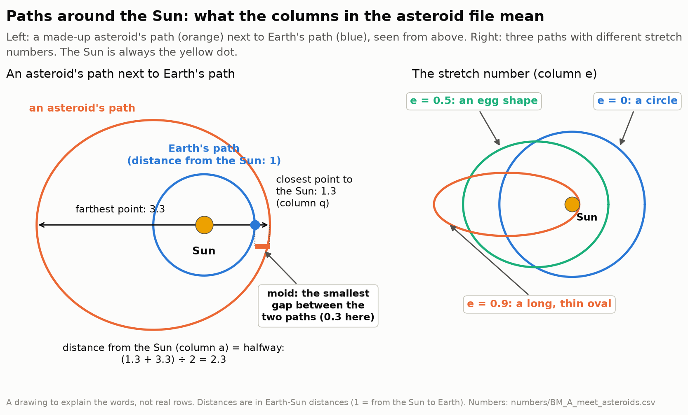

**Picture:** `charts/K00A_paths_around_the_sun.png`

**How to read the picture**
- **Left picture:** we are looking down on the Solar System from above. The yellow dot is the Sun. The blue circle is Earth's path. The orange oval is a made-up asteroid's path.
- **Closest point (`q`):** 1.3 Earth-Sun distances. **Farthest point:** 3.3. **Distance from the Sun (`a`):** halfway between them, (1.3 + 3.3) ÷ 2 = 2.3.
- **moid:** the short orange bar is the smallest gap between the two paths: 0.3 here.
- **Right picture:** three paths with different stretch numbers (`e`). 0 is a circle, 0.5 is an egg shape, 0.9 is a long, thin oval.

**Word box**
- Earth-Sun distance (AU): our space ruler for the Solar System: the distance from the Sun to Earth, about 150 million km. Scientists write it as AU. A car driving at 100 km an hour, day and night, would need about 171 years to cover it.
- asteroid: a rocky lump, much smaller than a planet, that travels around the Sun.
- comet: an icy lump that travels around the Sun. Near the Sun it heats up and grows a glowing tail.
- average: add all the values up, then divide by how many there are.
- percent (%): out of every hundred. Half is the same as fifty percent.
- degree: a small slice of a circle. A full turn is 360 degrees.
- stretch number (e): how stretched a path around the Sun is. Zero is a perfect circle; close to one is a long, thin oval; one or more means the path is not a closed loop, so the object flies off and never comes back. Scientists call it eccentricity.
- brightness number (H): how bright an asteroid would look from a set distance. Smaller means brighter, and brighter means bigger. Scientists call it absolute magnitude.
- shininess (albedo): how much sunlight a surface bounces back, from zero (pitch black) to one (all of it). Coal is close to zero; fresh snow is close to one. Scientists call it albedo.
- spin time: how long one full turn takes (column `rot_per`), like Earth's day.
- near-Earth: an asteroid or comet whose path around the Sun comes close to Earth's path.
- moid: the smallest gap between an asteroid's path and Earth's path. It is about the paths, not about where the rock is today. The letters stand for "minimum orbit intersection distance".
- giant star: a big, bright star near the end of its life.
- Neptune-size: about as big as Neptune, which is 3.9 times as wide as Earth.
- oval: a stretched circle, like an egg seen from the side. Scientists call it an ellipse.
- row: one line across a table. Here, one row is one asteroid or comet.
- column: one list going down a table. Each column holds one kind of fact, like the width.
- Y and N: the file's short way of writing yes and no.
- JPL: NASA's Jet Propulsion Laboratory in California. It keeps track of asteroids and comets.
- code: a few letters that stand for something longer, like `MBA` for main belt asteroid.

---

### 1. The asteroid belt has empty lanes

**The question:** Are the rocks in the asteroid belt spread out evenly, or are there empty places?

**The data we used**
- File: `jpl_small_bodies_asteroids_comets.csv` (see "Meet the data" for part A)
- Rows: Asteroids only (no comets), on closed loops, between 1.7 and 5.5 Earth-Sun distances from the Sun. That keeps 1,546,750 of the 1,582,869 rows.
- Exact rule, for checking: `kind in [an, au] and e < 1 and 1.7 < a < 5.5`
- Columns:

| Column | What it tells us | Unit | Example value (Ceres) |
|---|---|---|---|
| `kind` | asteroid or comet: we keep `an` and `au` (asteroids) | a code | `an` |
| `e` | stretch number: we keep paths under 1 (closed loops) | a number | 0.08 |
| `a` | distance from the Sun | Earth-Sun distances | 2.766 |
| `per_y` | year length: how long one trip around the Sun takes | years | 4.60 |

**The math**
1. We cut the distances into thin slices, each 0.01 wide, and count the asteroids in every slice.
2. We add up three boxes of four slices each. From 2.40 to 2.44: 54,292 asteroids. From 2.60 to 2.64: 86,354.
3. In between, more than 2.48 and less than 2.52: only 8,659. 54,292 ÷ 8,659 = 6.3: the box just inside has about 6.3 times as many rocks as the lane.
4. A rock in the lane takes 3.95 years to go around the Sun (column `per_y`). Jupiter takes 11.86 years. 11.86 ÷ 3.95 = 3.0: three rock trips for every one Jupiter trip.

**The simple relationship**
`rock goes around 3.0 times while Jupiter goes around once → Jupiter pulls at the same spot again and again → rock pushed out → empty lane`

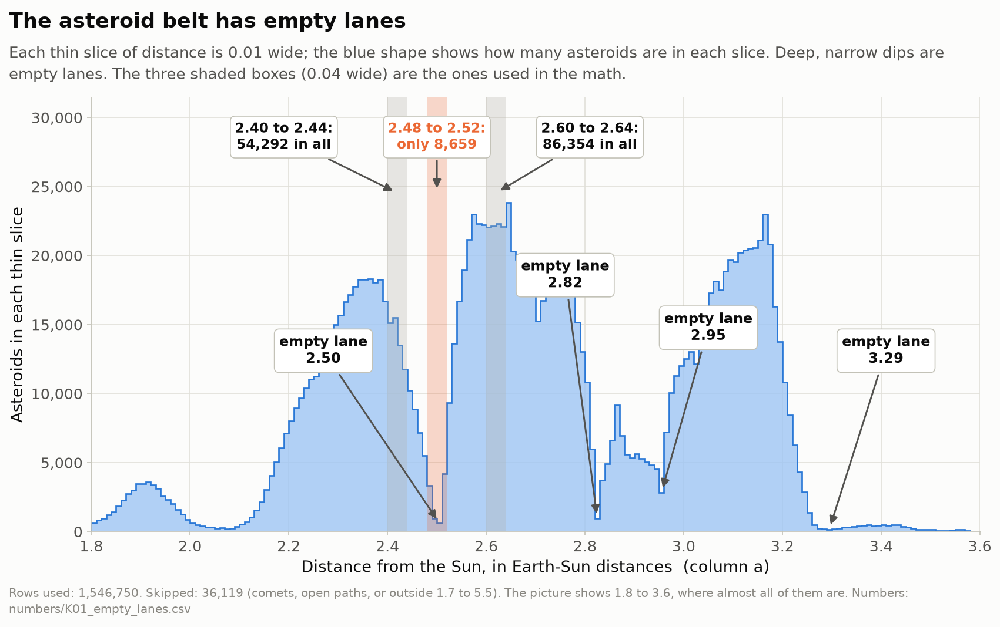

**How to read the chart**
- **Across the bottom:** distance from the Sun, in Earth-Sun distances (column `a`). Left is closer to the Sun.
- **Up the side:** how many asteroids are in each thin slice.
- **The blue shape:** the tops of many thin bars, one bar for each slice.
- **The shaded boxes:** the three boxes from the math. The orange one is the lane.
- **Look for:** the deep, narrow dips. They are the empty lanes, and the arrows point at them.

**In short**
Think of pushing a friend on a swing. If you push at the same moment every time, the swing goes higher and higher. Jupiter does that to a rock in the lane. It pulls at the same spot over and over, until the rock is pushed out of its path.

**Our data shows:** empty lanes at 2.50, 2.82, 2.95 and 3.29 Earth-Sun distances. Our code found them by looking for the emptiest slices.
**Scientists say (not from our data):** Jupiter's repeated pulls cleared these lanes. They are called Kirkwood gaps, after Daniel Kirkwood, the astronomer who noticed them.

**Careful:** the file rounds distances to the nearest thousandth, so 464 asteroids sit exactly on 2.48. Counting "from 2.48" gives 9,123, not 8,659. Open paths (stretch number 1 or more) are left out: their distance in the file is negative, which makes no sense.

Note: the guide said the last lane is at 3.28; our data gives 3.29.

**Chart:** `charts/K01_empty_lanes.png` (the detailed version: `charts/A05_a_histogram_1.7-5.5AU.png`)

**Animation:** `animations/F01_empty_lanes.html` (open it in a web browser and press ▶ Play. It is also on the Findings page of the app.)

**Word box**
- Earth-Sun distance (AU): our space ruler for the Solar System: the distance from the Sun to Earth, about 150 million km. Scientists write it as AU. A car driving at 100 km an hour, day and night, would need about 171 years to cover it.
- asteroid: a rocky lump, much smaller than a planet, that travels around the Sun.
- comet: an icy lump that travels around the Sun. Near the Sun it heats up and grows a glowing tail.
- stretch number (e): how stretched a path around the Sun is. Zero is a perfect circle; close to one is a long, thin oval; one or more means the path is not a closed loop, so the object flies off and never comes back. Scientists call it eccentricity.
- asteroid belt: the ring of rocks between Mars and Jupiter.
- Kirkwood gap: an empty lane in the asteroid belt, cleared by Jupiter's pulls.
- closed loop: a path that goes round and round the Sun. An open path swings past the Sun once and never comes back.

---

### 2. Asteroids get darker the farther they are from the Sun

**The question:** Are asteroids near the Sun the same colour as asteroids far away?

**The data we used**
- File: `jpl_small_bodies_asteroids_comets.csv` (see "Meet the data" for part A)
- Rows: Asteroids on closed loops with a measured shininess, between 1.8 and 3.6 Earth-Sun distances from the Sun: 134,725 rows.
- Exact rule, for checking: `kind in [an, au] and e < 1 and albedo is not blank and 1.8 <= a < 3.6`
- Columns:

| Column | What it tells us | Unit | Example value (Vesta) |
|---|---|---|---|
| `a` | distance from the Sun | Earth-Sun distances | 2.36 |
| `albedo` | shininess: zero = pitch black, one = bounces back all the light | a number | 0.42 |

**The math**
1. We call an asteroid "shiny" if its shininess is more than 0.15.
2. Closest zone, 1.8 to 2.5: 17,265 shiny out of 30,533. That is 57%, more than half.
3. Next zones out: 37% (2.5 to 2.82), then 15% (2.82 to 3.3).
4. Farthest zone, 3.3 to 3.6: only 29 shiny out of 1,071, just 3%.
5. Two examples: Vesta, at 2.36, has a shininess of 0.42. Hygiea, at 3.15, has only 0.07.

**The simple relationship**
`farther from the Sun → fewer shiny asteroids → darker rocks`

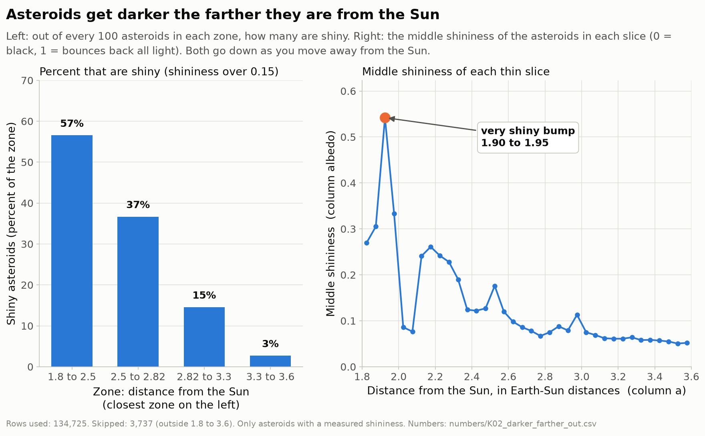

**How to read the chart**
- **Left chart, across the bottom:** four zones of distance from the Sun. The closest zone is on the left.
- **Left chart, up the side:** out of every hundred asteroids in that zone, how many are shiny.
- **Right chart:** each dot is one slice of distance. It shows the middle shininess of the asteroids in that slice. Across the bottom is the distance from the Sun again.
- **Look for:** the bars getting shorter from left to right, and the very shiny bump near 1.90 on the right chart.

**In short**
Picture a class photo where the front rows wear white shirts and the back rows wear black ones. Near the Sun, most rocks are light-coloured stone. Far away, most are as dark as charcoal.

**Our data shows:** the share of shiny asteroids drops from 57% to 37% to 15% to 3%. There is a very shiny bump at 1.90 to 1.95.
**Scientists say (not from our data):** near the Sun, most asteroids are stony. Farther out, most are made of dark rock full of carbon, as dark as charcoal. The shiny bump is a family of rocks called the Hungarias.

**Careful:** only 9% of asteroids have a measured shininess, and they are mostly big ones. Small asteroids might not follow the same pattern.

Note: the guide said the bump's middle shininess is 0.57; our data gives 0.54 (1.90 to 1.95, 266 asteroids).

**Chart:** `charts/K02_darker_farther_out.png` (the detailed version: `charts/A10_albedo_by_distance.png`)

**Animation:** `animations/F02_darker_farther_out.html` (open it in a web browser and press ▶ Play. It is also on the Findings page of the app.)

**Word box**
- Earth-Sun distance (AU): our space ruler for the Solar System: the distance from the Sun to Earth, about 150 million km. Scientists write it as AU. A car driving at 100 km an hour, day and night, would need about 171 years to cover it.
- asteroid: a rocky lump, much smaller than a planet, that travels around the Sun.
- percent (%): out of every hundred. Half is the same as fifty percent.
- shininess (albedo): how much sunlight a surface bounces back, from zero (pitch black) to one (all of it). Coal is close to zero; fresh snow is close to one. Scientists call it albedo.
- zone: a range of distances that we compare with the other ranges.
- Hungaria family: a group of very shiny asteroids at the inner edge of the asteroid belt.
- carbon: the stuff that coal, charcoal and pencil lead are made of.

---

### 3. Big asteroids almost never spin faster than once every 2.2 hours

**The question:** How fast can an asteroid spin before it falls apart?

**The data we used**
- File: `jpl_small_bodies_asteroids_comets.csv` (see "Meet the data" for part A)
- Rows: Asteroids with a measured spin time and a size: 34,592 rows. For 14,662 of them the size is a guess, worked out from the brightness number.
- Exact rule, for checking: `kind in [an, au] and rot_per is not blank and (diameter or H is not blank)`
- Columns:

| Column | What it tells us | Unit | Example value (Ceres) |
|---|---|---|---|
| `rot_per` | spin time: how long one full spin takes | hours | 9.07 |
| `diameter` | width, where someone measured it | km | 939.4 |
| `H` | brightness number: smaller = bigger. Used to guess the width when nobody measured it | a number | 3.34 |

**The math**
1. The speed limit: one spin every 2.2 hours. That's 132 minutes.
2. Big asteroids (wider than 300 m): 33,616. Only 1,236 of them spin faster than the limit. 1,236 ÷ 33,616 = 3.7%. So about 96% obey the limit.
3. Small asteroids (narrower than 150 m): 655. Of these, 524 spin faster than the limit: 80%.
4. The record holder, 2020 HS7, spins once every 0.000832 hours. 0.000832 × 3,600 = 3.0 seconds for one whole spin!

**The simple relationship**
`big rock → loose rubble held by weak gravity → can't spin faster than once every 2.2 hours`

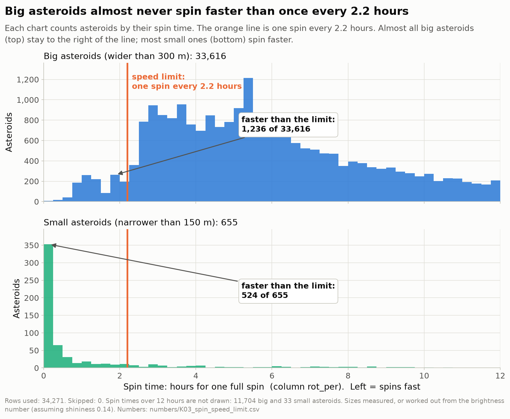

**How to read the chart**
- **Top chart:** big asteroids (wider than 300 m). **Bottom chart:** small asteroids (narrower than 150 m).
- **Across the bottom:** spin time in hours (column `rot_per`). Left = fast spinners.
- **Up the side:** how many asteroids have that spin time.
- **The orange line:** the speed limit, one spin every 2.2 hours.
- **Look for:** in the top chart, the bars jump up just right of the line, with only a few to its left. In the bottom chart, most small rocks are to its left.

**In short**
Swing a bucket of sand around very fast, and the sand flies out. Big asteroids are piles of loose rubble, held together only by their own weak gravity. Spin one too fast and it would fly apart.

**Our data shows:** a sharp edge at 2.2 hours for big asteroids. Small asteroids break it all the time.
**Scientists say (not from our data):** big asteroids are "rubble piles". Small ones can be single solid rocks, which can spin much faster without breaking.

**Careful:** for 801 of the 1,236 big fast spinners, the width is only a guess from the brightness number. We assumed a shininess of 0.14, so some may really be small. Guess (not checked): some of the other 435 may have a wrongly measured spin time.

**Chart:** `charts/K03_spin_speed_limit.png` (the detailed version: `charts/A11_size_vs_spin.png`)

**Animation:** `animations/F03_spin_speed_limit.html` (open it in a web browser and press ▶ Play. It is also on the Findings page of the app.)

**Word box**
- asteroid: a rocky lump, much smaller than a planet, that travels around the Sun.
- percent (%): out of every hundred. Half is the same as fifty percent.
- gravity: the pull every object has on every other object. Bigger, heavier things pull harder.
- habitable zone: the "just right" distance from a star: not too hot and not too cold, so water could be liquid.
- brightness number (H): how bright an asteroid would look from a set distance. Smaller means brighter, and brighter means bigger. Scientists call it absolute magnitude.
- shininess (albedo): how much sunlight a surface bounces back, from zero (pitch black) to one (all of it). Coal is close to zero; fresh snow is close to one. Scientists call it albedo.
- spin time: how long one full turn takes (column `rot_per`), like Earth's day.
- rubble pile: a loose heap of rocks held together only by gravity.

---

### 4. In 2025, three times as many objects were seen for the first time as in a normal recent year

**The question:** Do we find more space rocks every year? Did anything special happen in 2025?

**The data we used**
- File: `jpl_small_bodies_asteroids_comets.csv` (see "Meet the data" for part A)
- Rows: Every object in the file, sorted by the year of its first sighting. From 1980 to 2026: 1,556,667 rows.
- Exact rule, for checking: `year = the part of first_obs before the first dash, and 1980 <= year <= 2026`
- Columns:

| Column | What it tells us | Unit | Example value (Ceres) |
|---|---|---|---|
| `first_obs` | first sighting: the earliest sighting used to work out the path | a date | 1995-01-05 |
| `neo` | near-Earth flag: `Y` (yes) if its path comes near Earth's path | `Y` or `N` | `N` |
| `H` | brightness number, used to guess how wide new near-Earth rocks are | a number | 3.34 |

**The math**
1. From 2018 to 2024, between 15,495 and 22,716 objects were seen for the first time each year. The average was 19,089.
2. In 2025: 56,928. 56,928 ÷ 19,089 = 3.0, so three times a normal recent year.
3. July 2025 alone had 25,523: that's 45% of the whole year.
4. New near-Earth rocks: 62 in 1995, but between 2,781 and 3,157 a year since 2022.
5. They got smaller, too. The middle width of new near-Earth rocks was about 609 m in 1995, and about 29 m in 2026.

**The simple relationship**
`better telescopes → more rocks found each year, and smaller ones`

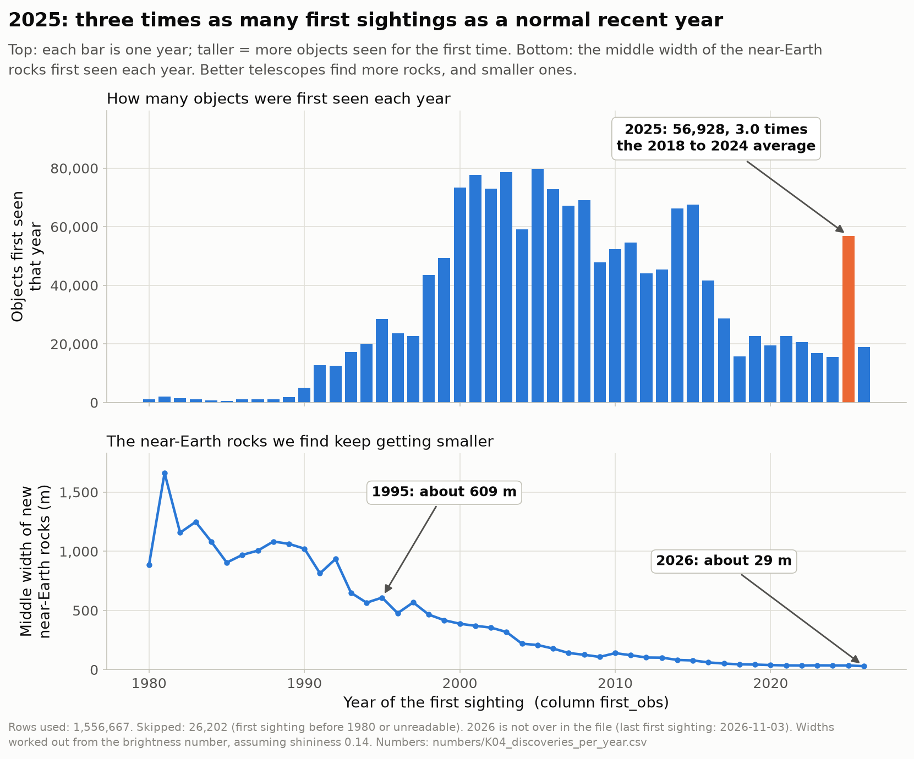

**How to read the chart**
- **Top chart, across the bottom:** the year of the first sighting (column `first_obs`). **Up the side:** how many objects were seen for the first time that year.
- **The orange bar:** 2025. It is about three times as tall as the bars from 2018 to 2024.
- **Bottom chart:** each dot is the middle width (in metres) of the near-Earth rocks first seen that year.
- **Look for:** the jump in 2025 on top, and the line sliding down on the bottom: we now find much smaller rocks.

**In short**
It's like getting new glasses: suddenly you can read the tiny print. A big new telescope started work in 2025 and spotted rocks nobody could see before.

**Our data shows:** a big jump in 2025, with 45% of it in July alone. It was the most first sightings in one year since 2015.
**Scientists say (not from our data):** the Vera C. Rubin Observatory in Chile ran its first test sweeps of the sky in the summer of 2025. It found more than 11,000 new asteroids in about six weeks.

**Careful:** `first_obs` is not always the day a rock was discovered: old photos are sometimes matched to a rock years later. Ceres was found in 1801, but its first sighting in the file is 1995-01-05. The busiest year in the file is 2005, with 79,735.

**Chart:** `charts/K04_discoveries_per_year.png` (the detailed version: `charts/A12_first_obs_per_year.png`, `charts/A13_nea_size_per_year.png`)

**Animation:** `animations/F04_discoveries_per_year.html` (open it in a web browser and press ▶ Play. It is also on the Findings page of the app.)

**Word box**
- asteroid: a rocky lump, much smaller than a planet, that travels around the Sun.
- average: add all the values up, then divide by how many there are.
- percent (%): out of every hundred. Half is the same as fifty percent.
- brightness number (H): how bright an asteroid would look from a set distance. Smaller means brighter, and brighter means bigger. Scientists call it absolute magnitude.
- near-Earth: an asteroid or comet whose path around the Sun comes close to Earth's path.
- first sighting: the earliest photo of an object that was used to work out its path (column `first_obs`).
- Vera C. Rubin Observatory: a new, very big telescope in Chile that photographs the whole southern sky every few nights.

---

### 5. Past Neptune, icy objects crowd into the spot where Neptune's rhythm keeps them safe

**The question:** Far beyond Neptune, are the icy objects spread out evenly?

**The data we used**
- File: `jpl_small_bodies_asteroids_comets.csv` (see "Meet the data" for part A)
- Rows: Asteroids on closed loops between 30 and 60 Earth-Sun distances from the Sun: 6,947 rows.
- Exact rule, for checking: `kind in [an, au] and e < 1 and 30 < a < 60`
- Columns:

| Column | What it tells us | Unit | Example value (Pluto) |
|---|---|---|---|
| `a` | distance from the Sun | Earth-Sun distances | 39.59 |
| `per_y` | year length: how long one trip around the Sun takes | years | 249 |

**The math**
1. In the narrow band from 39.2 to 39.7: 586 objects.
2. In the same-size boxes on each side: 170 and 157. The band has about 3.6 times more.
3. Objects in the band take about 248 years to go around the Sun. Neptune takes 164.8 years. 248 ÷ 164.8 = 1.50. So while they go around twice, Neptune goes around three times.
4. The main crowd, from 42 to 48, has 3,777. Beyond 48: only 1,118.

**The simple relationship**
`two of their trips = three of Neptune's → never close to Neptune → safe spot → crowd`

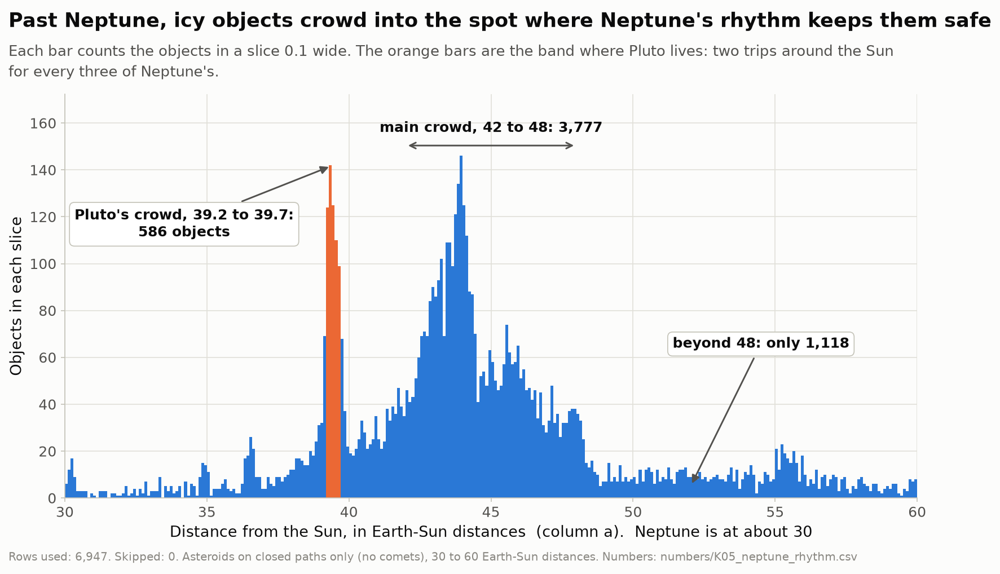

**How to read the chart**
- **Across the bottom:** distance from the Sun, in Earth-Sun distances (column `a`). Neptune is at about 30, on the far left.
- **Up the side:** how many objects are in each slice.
- **Each bar:** one slice of distance. The orange bars are the band from 39.2 to 39.7, where Pluto lives.
- **Look for:** the tall orange spike, the wide main crowd to its right, and almost nothing past 48.

**In short**
Two runners on a track are timed so the slow one is always on the far side when the fast one comes round. They never bump into each other. Neptune is the fast runner, and these icy objects are the slow ones.

**Our data shows:** a crowd at 39.2 to 39.7, a bigger crowd from 42 to 48, and a big drop after 48.
**Scientists say (not from our data):** objects with Pluto's rhythm (two trips for every three of Neptune's) are called Plutinos, which means "little Plutos". Neptune's timing keeps them safe.

**Careful:** comets are left out. With them, and counting from 39.2 itself, the band holds 601.

**Chart:** `charts/K05_neptune_rhythm.png` (the detailed version: `charts/A06_a_histogram_30-60AU.png`)

**Animation:** `animations/F05_neptune_rhythm.html` (open it in a web browser and press ▶ Play. It is also on the Findings page of the app.)

**Word box**
- Earth-Sun distance (AU): our space ruler for the Solar System: the distance from the Sun to Earth, about 150 million km. Scientists write it as AU. A car driving at 100 km an hour, day and night, would need about 171 years to cover it.
- comet: an icy lump that travels around the Sun. Near the Sun it heats up and grows a glowing tail.
- Neptune-size: about as big as Neptune, which is 3.9 times as wide as Earth.
- far side: the half of the Moon that always faces away from Earth. People only saw it when spacecraft flew around the Moon.
- Kuiper belt: a ring of icy objects beyond Neptune. Pluto lives there.
- Plutino: "little Pluto": an object with Pluto's rhythm, two trips around the Sun for every three of Neptune's.
- rhythm: a pattern that repeats in time, like the beat in a song.

---

### 6. Jupiter has two swarms of asteroids, and the one in front is bigger

**The question:** Do any asteroids share Jupiter's path around the Sun?

**The data we used**
- File: `jpl_small_bodies_asteroids_comets.csv` (see "Meet the data" for part A)
- Rows: Jupiter's Trojan asteroids only: 16,445 rows.
- Exact rule, for checking: `class == "TJN"`
- Columns:

| Column | What it tells us | Unit | Example value (Achilles) |
|---|---|---|---|
| `class` | neighbourhood: `TJN` = shares Jupiter's path | a code | `TJN` |
| `om` | angle: which way the path is turned | degrees | 316.53 |
| `w` | angle: where the closest point to the Sun is on the path | degrees | 134.31 |
| `ma` | angle: how far the rock has moved along its path since its closest point | degrees | 93.31 |

**The math**
1. Add the three angles to find where each rock is around the Sun. If the total is more than 360, take away 360 (one full turn).
2. Achilles: 316.53 + 134.31 + 93.31 = 544.15. Take away 360: 184.15 degrees.
3. Counting the rocks in slices of 5 degrees shows two clumps, 120 degrees apart.
4. Jupiter sits halfway between them. In front of Jupiter: 10,494. Behind it: 5,951. 10,494 ÷ 5,951 = 1.76.

**The simple relationship**
`balance points 60 degrees ahead of and behind Jupiter → two swarms → the front one is bigger`

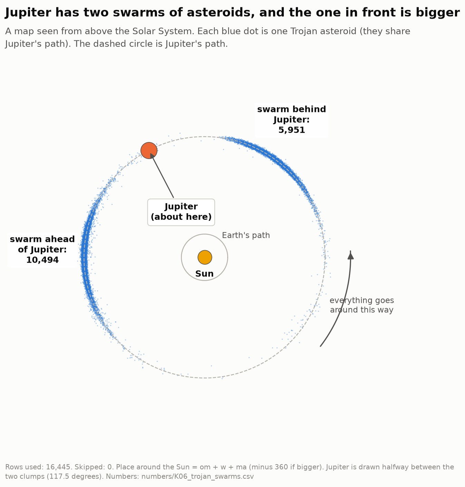

**How to read the chart**
- **This chart is a map, seen from above the Solar System.** The Sun is in the middle. The small circle is Earth's path; the dashed circle is Jupiter's path.
- **Each blue dot:** one Trojan asteroid, placed where it is around the Sun.
- **The orange dot:** about where Jupiter is. Everything goes around the Sun the way the arrow points.
- **Look for:** two clouds of dots, one ahead of Jupiter and one behind it. The one ahead has more dots.

**In short**
Imagine two groups of joggers running laps with one big runner. One group stays just ahead of the big runner, and one stays just behind. Nobody ever catches up. The group in front is bigger.

**Our data shows:** two swarms, and the one in front is 1.76 times as big as the one behind.
**Scientists say (not from our data):** Trojans gather around two balance points, 60 degrees ahead of and behind Jupiter. There, the pulls of the Sun and Jupiter work together. Scientists still argue about why the front swarm is bigger.

**Careful:** which swarm is "in front" comes from the picture: Jupiter must sit halfway between the two clumps, about 117.5 degrees here.

Note: the guide estimated Jupiter at about 112 degrees; our halfway point is 117.5 degrees.

**Chart:** `charts/K06_trojan_swarms.png` (the detailed version: `charts/A14_trojan_longitude.png`)

**Animation:** `animations/F06_trojan_swarms.html` (open it in a web browser and press ▶ Play. It is also on the Findings page of the app.)

**Word box**
- asteroid: a rocky lump, much smaller than a planet, that travels around the Sun.
- degree: a small slice of a circle. A full turn is 360 degrees.
- longitude: how far east or west a place is, in degrees.
- Trojan asteroid: a rock that shares Jupiter's path, ahead of it or behind it.
- balance point: a spot where a small object can ride along with a planet without being pulled away. Scientists call it a Lagrange point.
- swarm: a big crowd of things moving together, like bees.

---

### 7. "Potentially hazardous" is a rule, not a warning

**The question:** When an asteroid is called "potentially hazardous", does that mean it's coming for us?

**The data we used**
- File: `jpl_small_bodies_asteroids_comets.csv` (see "Meet the data" for part A)
- Rows: Asteroids whose hazard flag is filled in: 1,520,750 rows.
- Exact rule, for checking: `kind in [an, au] and pha is not blank`
- Columns:

| Column | What it tells us | Unit | Example value (2024 YR4) |
|---|---|---|---|
| `pha` | hazard flag: `Y` (yes) = called "potentially hazardous" | `Y` or `N` | `N` |
| `moid` | the closest its path ever gets to Earth's path | Earth-Sun distances | 0.0027 |
| `H` | brightness number: smaller = bigger | a number | 23.9 |
| `q` | closest point to the Sun | Earth-Sun distances | 0.85 |

**The math**
1. NASA's rule has two parts. One: the paths come within 0.05 Earth-Sun distances. Two: the brightness number is 22 or less.
2. 0.05 Earth-Sun distances is 7.5 million km, or about 19.5 Moon distances. A brightness number of 22 means about 141 m wide.
3. Flagged `Y`: 2,550. Of those, 2,517 pass both parts of the rule. That's 98.7%.
4. 2024 YR4 has a brightness number of 23.9: only about 58 m wide. Too small, so its flag is `N`, even though in early 2025 it had about a 3% chance of hitting Earth.

**The simple relationship**
`paths come close + rock is big enough → "potentially hazardous" flag`

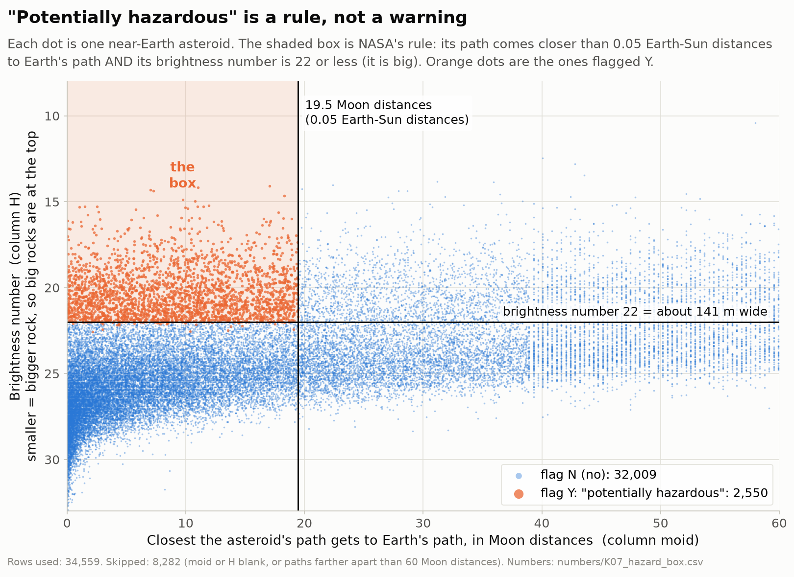

**How to read the chart**
- **Across the bottom:** the closest the asteroid's path gets to Earth's path, in Moon distances (column `moid`).
- **Up the side:** the brightness number (column `H`). Smaller numbers are higher up, so the big rocks are at the top.
- **Each dot:** one near-Earth asteroid. Orange = flag `Y`; blue = flag `N`.
- **The shaded box:** the rule: paths closer than 19.5 Moon distances, and wider than about 141 m.
- **Look for:** the orange dots fill the box, and almost all blue dots stay outside it.

**In short**
It's like the height line at a theme-park ride: if you're tall enough, you can ride. The label just means a rock passed two measuring lines. It does not mean the rock is coming.

**Our data shows:** 2,517 of the 2,550 `Y` flags follow the rule exactly. The other 33 have brightness numbers from 22.01 to 22.57, just past the line. Only 17 `N` asteroids sit inside the box. The near-Earth flag is a rule too: closest point to the Sun less than 1.3 Earth-Sun distances. That is true for 42,827 of the 42,841 asteroids flagged near-Earth.
**Scientists say (not from our data):** NASA defines "potentially hazardous" with exactly these two lines. It is a watch list, not a forecast.

**Careful:** a computer model that "predicts" the hazard flag from `moid` and `H` only learns the rule again. It learns nothing about danger.

**Chart:** `charts/K07_hazard_box.png` (the detailed version: `charts/BF07_hazard_box.png`)

**Animation:** `animations/F07_hazard_box.html` (open it in a web browser and press ▶ Play. It is also on the Findings page of the app.)

**Word box**
- Earth-Sun distance (AU): our space ruler for the Solar System: the distance from the Sun to Earth, about 150 million km. Scientists write it as AU. A car driving at 100 km an hour, day and night, would need about 171 years to cover it.
- asteroid: a rocky lump, much smaller than a planet, that travels around the Sun.
- percent (%): out of every hundred. Half is the same as fifty percent.
- brightness number (H): how bright an asteroid would look from a set distance. Smaller means brighter, and brighter means bigger. Scientists call it absolute magnitude.
- near-Earth: an asteroid or comet whose path around the Sun comes close to Earth's path.
- moid: the smallest gap between an asteroid's path and Earth's path. It is about the paths, not about where the rock is today. The letters stand for "minimum orbit intersection distance".
- Moon distance: the distance from Earth to the Moon, 384,400 km. A car driving at 100 km an hour, day and night, would need about 160 days to cover it.
- potentially hazardous: could possibly be dangerous one day, so it is worth watching.

---

## Part B: Close approaches

### Meet the data: the close-approach file

**What is this file?** A list of every time a near-Earth asteroid or comet flew past Earth, or will fly past, from 1900 to 2199. NASA's Jet Propulsion Laboratory (JPL) works the passes out from the paths of the rocks in part A.

**What is one row?** One row is one pass: one object flying past Earth one time. A rock that passes many times has many rows.

**How big is it?** 120,071 rows and 14 columns. The passes come from 28,430 different objects, so each one passes about 4.2 times. Over the 300 years in the file, that's about 400 passes a year.

**What is this data trying to tell us?** How close do space rocks come to Earth, how fast are they going, and when? The file also hides a trap: it can only list passes by rocks we have already found.

**The columns we use**

| Column (name in the file) | Nickname we use | What it tells us | How it's measured | Example (Apophis in 2029) |
|---|---|---|---|---|
| `des` | name tag | the object's short name or number. It matches the `pdes` column of the asteroid file | a code | `99942` |
| `fullname` | full name | the object's whole name | words | 99942 Apophis (2004 MN4) |
| `cd` | pass time | the date and time of the closest moment, in world time | year-month-day hour:minute | `2029-Apr-13 21:46` |
| `dist` | how close | the distance from the centre of Earth at the closest moment | Earth-Sun distances (we turn them into Moon distances or km) | 0.000254 |
| `v_rel` | speed | how fast it moves compared with Earth | km every second | 7.42 |
| `h` | brightness number | the same idea as `H` in part A: a bigger number means a smaller rock | a number | 19.09 |

**Let's read one row together (Apophis in 2029)**
- `fullname` is 99942 Apophis (2004 MN4): Apophis, the famous asteroid from part A. `des` is `99942`, its number.
- `cd` is `2029-Apr-13 21:46`: the moment Apophis will be closest to Earth, in world time.
- `dist` is 0.000254. Times 149.6 million km, that's 38,011 km from Earth's centre, or about 0.10 of a Moon distance.
- Take away Earth's radius (6,371 km): Apophis will pass 31,640 km above the ground. That's lower than the TV satellites that circle Earth 35,786 km up!
- `v_rel` is 7.42: it moves 7.42 km every second. That's 26,721 km an hour.
- `h` is 19.09. Apophis has 18 rows in this file, because it passes us many times between 1900 and 2199.

**Watch out for:** `dist` is measured from Earth's centre, not from the ground. Every pass in the file is closer than 0.1 Earth-Sun distances (39 Moon distances, about 15 million km): farther passes are not listed. Passes in the future are predictions. Passes from before a rock was found were worked out backwards. The brightness number `h` is blank in 114 rows.

**Word box**
- Earth-Sun distance (AU): our space ruler for the Solar System: the distance from the Sun to Earth, about 150 million km. Scientists write it as AU. A car driving at 100 km an hour, day and night, would need about 171 years to cover it.
- asteroid: a rocky lump, much smaller than a planet, that travels around the Sun.
- comet: an icy lump that travels around the Sun. Near the Sun it heats up and grows a glowing tail.
- world time (UTC): one clock that scientists everywhere share, so readings from different countries line up. Every time in these files is in world time.
- brightness number (H): how bright an asteroid would look from a set distance. Smaller means brighter, and brighter means bigger. Scientists call it absolute magnitude.
- near-Earth: an asteroid or comet whose path around the Sun comes close to Earth's path.
- Moon distance: the distance from Earth to the Moon, 384,400 km. A car driving at 100 km an hour, day and night, would need about 160 days to cover it.
- km every second: how many kilometres something travels in one second. Multiply by 3,600 to get kilometres in an hour.
- pass: one time an object flies by Earth.
- prediction: a careful guess about the future, worked out with math.
- radius: the distance from the centre of a ball to its outside: half of its width.

---

### 8. Close passes bunch up around today, because that's when we find the rocks

**The question:** Do more space rocks fly past Earth now than in the past, or than in the future?

**The data we used**
- File: `extras_close_approaches_1900-2200.csv` (see "Meet the data" for part B)
- Rows: Every pass in the file (all closer than 39 Moon distances): 120,071 passes by 28,430 different objects.
- Exact rule, for checking: `all rows`
- Columns:

| Column | What it tells us | Unit | Example value (2025 UC11) |
|---|---|---|---|
| `cd` | pass time: date and time of the closest moment (world time) | a date | `2025-Oct-30 12:11` |
| `dist` | how close: distance from Earth's centre | Earth-Sun distances | 0.000044 |

**The math**
1. We count the passes in each decade. From the 1900s to 1990s, there were about 3,323 per decade.
2. The 2010s: 12,237. The 2020s: 18,757. The 2030s: only 3,805. 18,757 ÷ 3,805 = 4.9.
3. Passes closer than the Moon: 189 in 2025 and 135 in 2026, but 0 in 2027 and 3 in 2028.
4. The closest pass of 2025 was 2025 UC11: 0.000044 × 149.6 million km = 6,599 km from Earth's centre. Take away Earth's radius (6,371 km): only 228 km above the ground, lower than the space station (400 km)!

**The simple relationship**
`we find most small rocks only while they pass → past and future passes look empty`

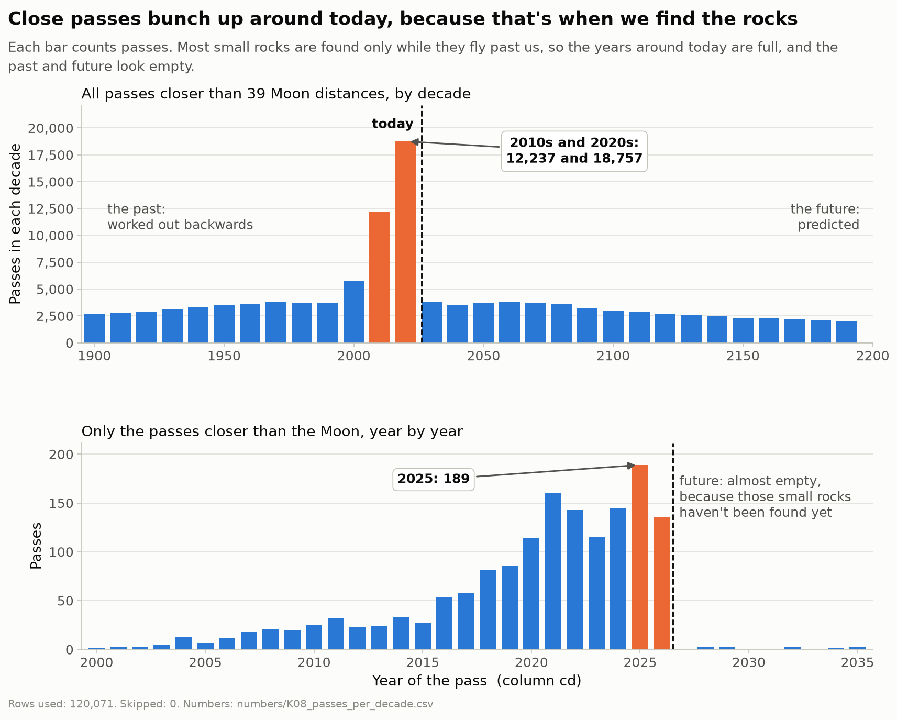

**How to read the chart**
- **Top chart, across the bottom:** time in years, one bar for each decade. The past is on the left; the future is on the right. **Up the side:** how many passes happened (or will happen) in that decade.
- **The dashed line:** today. The orange bars are the 2010s and 2020s.
- **Bottom chart:** only the passes closer than the Moon, year by year. The orange bars are 2025 and 2026.
- **Look for:** the tall bars right before the dashed line, and how empty it gets right after it.

**In short**
Imagine counting cars on a dark road with a flashlight. You only see the cars in your beam. Tomorrow's cars are out there too; you just can't see them yet.

**Our data shows:** passes bunch up in the 2010s and 2020s, and passes closer than the Moon almost disappear after 2026.
**Scientists say (not from our data):** most small asteroids are found during the very pass that brings them close. Rocks that haven't been found yet can't be in the file, so the future looks quiet.

**Careful:** passes from before a rock was found were worked out backwards with math, not seen. Future passes are predictions.

**Chart:** `charts/K08_passes_per_decade.png` (the detailed version: `charts/BF08_passes_per_decade.png`)

**Animation:** `animations/F08_passes_per_decade.html` (open it in a web browser and press ▶ Play. It is also on the Findings page of the app.)

**Word box**
- Earth-Sun distance (AU): our space ruler for the Solar System: the distance from the Sun to Earth, about 150 million km. Scientists write it as AU. A car driving at 100 km an hour, day and night, would need about 171 years to cover it.
- asteroid: a rocky lump, much smaller than a planet, that travels around the Sun.
- world time (UTC): one clock that scientists everywhere share, so readings from different countries line up. Every time in these files is in world time.
- decade: ten years in a row.
- Moon distance: the distance from Earth to the Moon, 384,400 km. A car driving at 100 km an hour, day and night, would need about 160 days to cover it.
- space station: the International Space Station, where astronauts live as it circles Earth.

---

### 9. July is quiet, for the telescopes

**The question:** Do space rocks fly past Earth more in some months than in others?

**The data we used**
- File: `extras_close_approaches_1900-2200.csv` (see "Meet the data" for part B)
- Rows: Passes from 2005 to 2025: 30,810 passes. The small rocks among them (brightness number over 25): 18,547.
- Exact rule, for checking: `2005 <= year of cd <= 2025; small rocks: h > 25`
- Columns:

| Column | What it tells us | Unit | Example value (2005 AU3) |
|---|---|---|---|
| `cd` | pass time: we use its month | a date | `2005-Jan-03 05:24` |
| `h` | brightness number: bigger = smaller rock | a number | 26.10 |

**The math**
1. We count the passes in each month, adding up all the years from 2005 to 2025.
2. Small rocks (brightness number over 25, so about 36 m wide or less): 691 passes in July, but 2,555 in October.
3. 2,555 ÷ 691 = 3.7: October has 3.7 times as many.
4. All passes together: 1,519 in July, 3,866 in October.

**The simple relationship**
`short, stormy summer nights at northern telescopes → fewer small rocks spotted in July`

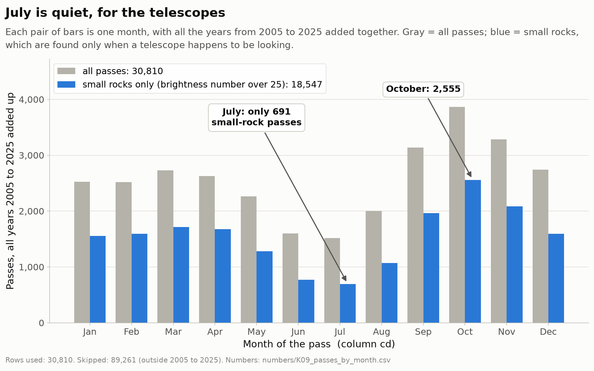

**How to read the chart**
- **Across the bottom:** the twelve months of the year.
- **Up the side:** how many passes happened in that month, with all the years from 2005 to 2025 added up.
- **Gray bars:** all passes. **Blue bars:** only the small rocks.
- **Look for:** the blue bars dipping lowest in July and highest in October.

**In short**
Imagine birdwatching only at night from your backyard. In summer the nights are short and often stormy, so you spot fewer birds. The birds didn't leave; you just looked less.

**Our data shows:** July is the quietest month for small rocks, and October is the busiest.
**Scientists say (not from our data):** a likely reason, which we did not test: most search telescopes are in the north, in places like Arizona and Hawaii. There, summer nights are short, summer storms close the domes, and the bright Milky Way fills the sky.

**Careful:** this shows when we look, not when the rocks come.

Note: the guide said a brightness number over 25 means under about 30 m; with a shininess of 0.14 we get about 36 m.

**Chart:** `charts/K09_passes_by_month.png` (the detailed version: `charts/BF09_passes_by_month.png`)

**Animation:** `animations/F09_passes_by_month.html` (open it in a web browser and press ▶ Play. It is also on the Findings page of the app.)

**Word box**
- brightness number (H): how bright an asteroid would look from a set distance. Smaller means brighter, and brighter means bigger. Scientists call it absolute magnitude.
- shininess (albedo): how much sunlight a surface bounces back, from zero (pitch black) to one (all of it). Coal is close to zero; fresh snow is close to one. Scientists call it albedo.
- Milky Way: our home galaxy. From Earth it looks like a cloudy band of light across the night sky.
- dome: the round roof over a big telescope. It opens at night and closes when it rains.

---

## Part C: Fireballs

### Meet the data: the fireball file

**What is this file?** A list of fireballs: space rocks that blew up high in our air. Government sensors on satellites, built to watch for big flashes, spotted them. NASA keeps the list.

**What is one row?** One row is one fireball.

**How big is it?** 1,074 rows and 9 columns, from 1988-04-15 to 2026-10-04. That's about 38 years, or about 28 fireballs a year.

**What is this data trying to tell us?** Where and when do space rocks blow up in our sky, and how much energy do they let out?

**The columns we use**

| Column (name in the file) | Nickname we use | What it tells us | How it's measured | Example (the Chelyabinsk fireball) |
|---|---|---|---|---|
| `date` | when | the date and time of the fireball, in world time | year-month-day hour:minute:second | `2013-02-15 03:20:26` |
| `energy` | light energy | how much light it gave off, counted in units of ten billion joules | a number | 37,500 |
| `impact-e` | total energy | all the energy it let out. One kiloton is the energy of 1,000 tonnes of TNT | kilotons | 441 |
| `lat, lat-dir` | north or south | how far from the equator, and which way: `N` = north, `S` = south | degrees, then a letter | 54.8, `N` |
| `lon, lon-dir` | east or west | how far east or west, and which way: `E` = east, `W` = west | degrees, then a letter | 61.1, `E` |
| `alt` | height | how high up it was when it shone brightest | km above the ground | 23.3 |
| `vel` | speed | how fast it was going | km every second | 18.6 |

**Let's read one row together (the Chelyabinsk fireball)**
- This is the biggest fireball in the file. It blew up over the city of Chelyabinsk, in Russia.
- `date` is `2013-02-15 03:20:26`, in world time.
- `impact-e` is 441 kilotons: the same energy as 441,000 tonnes of TNT going off at once.
- `lat` is 54.8 and `lat-dir` is `N`: 54.8 degrees north. `lon` is 61.1 and `lon-dir` is `E`: 61.1 degrees east.
- `alt` is 23.3: it blew up 23.3 km above the ground, about 2.1 times as high as a passenger plane flies (11 km).
- `vel` is 18.6: 18.6 km every second. That's 66,960 km an hour!

**Watch out for:** A blank cell means the sensors didn't report it: 186 fireballs have no place, 472 have no height, and 711 have no speed. Each place is split into two columns, a number and a direction letter. To put fireballs on a map, we turn south and west into negative numbers. Most fireballs are small: the middle one is only 0.20 kilotons.

**Word box**
- world time (UTC): one clock that scientists everywhere share, so readings from different countries line up. Every time in these files is in world time.
- kiloton: the energy of 1,000 tonnes of TNT explosive going off at once.
- degree: a small slice of a circle. A full turn is 360 degrees.
- equator: the imaginary line around the middle of a planet or moon, halfway between the north and south poles.
- km every second: how many kilometres something travels in one second. Multiply by 3,600 to get kilometres in an hour.
- fireball: a very bright shooting star: a space rock that burns and explodes high in the air.
- TNT: a strong explosive. Scientists use it as a ruler for the size of explosions.
- joule: the scientists' unit for energy.
- sensor: a machine that notices things, like a flash of light.
- satellite: a machine that circles Earth in space.

---

### 10. Fireballs happen everywhere, and one was far bigger than all the others

**The question:** Do fireballs like some places on Earth better than others? How big do they get?

**The data we used**
- File: `extras_fireballs.csv` (see "Meet the data" for part C)
- Rows: Fireballs with a known place: 888 of the 1,074.
- Exact rule, for checking: `lat and lon are not blank`
- Columns:

| Column | What it tells us | Unit | Example value (Chelyabinsk) |
|---|---|---|---|
| `lat, lat-dir` | north or south of the equator | degrees, `N` or `S` | 54.8, `N` |
| `lon, lon-dir` | east or west | degrees, `E` or `W` | 61.1, `E` |
| `impact-e` | total energy | kilotons | 441 |

**The math**
1. We turn south and west into negative numbers, so every place becomes one pair of numbers on a map.
2. If fireballs fell at random, each band of the globe would get its fair share of the area. From the equator to 30 degrees north is 25.0% of Earth's surface, so we expect 222 of the 888. We see 227.
3. Over the ocean: 647 of 888, which is 73%. The ocean covers about 71% of Earth.
4. The biggest: 441 kilotons on 2013-02-15. The next biggest: 49 kilotons on 2018-12-18. 441 ÷ 49 = 9.

**The simple relationship**
`random hits → each part of the globe gets its fair share of the area`

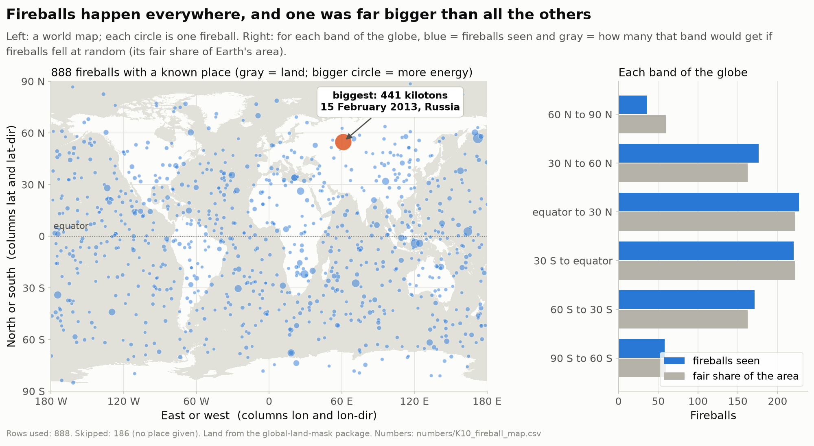

**How to read the chart**
- **Left, the map:** across the bottom is east or west; up the side is north or south. Gray is land, white is ocean.
- **Each blue circle:** one fireball. A bigger circle means more energy. The orange circle is the biggest one.
- **Right, the bars:** each pair is one band of the globe. Blue = fireballs seen. Gray = the band's fair share if fireballs fell at random.
- **Look for:** circles spread all over the map, and each blue bar close to its gray bar.

**In short**
Throw a handful of rice at a spinning beach ball. The grains land everywhere, with more on the wide middle of the ball, because there's more room there. Space rocks do the same to Earth.

**Our data shows:** every band gets about its fair share of the area, and the biggest fireball was 9 times the next biggest.
**Scientists say (not from our data):** the biggest is the Chelyabinsk fireball over Russia. Its energy was about 29 times that of the Hiroshima bomb (15 kilotons).

**Careful:** 186 fireballs have no place, so they are not on the map. Early years have fewer fireballs with a known place.

Note: the guide said 243 were over land; our land map gives 241.

**Chart:** `charts/K10_fireball_map.png` (the detailed version: `charts/BF10_fireball_map.png`)

**Animation:** `animations/F10_fireball_map.html` (open it in a web browser and press ▶ Play. It is also on the Findings page of the app.)

**Word box**
- percent (%): out of every hundred. Half is the same as fifty percent.
- kiloton: the energy of 1,000 tonnes of TNT explosive going off at once.
- degree: a small slice of a circle. A full turn is 360 degrees.
- equator: the imaginary line around the middle of a planet or moon, halfway between the north and south poles.
- fireball: a very bright shooting star: a space rock that burns and explodes high in the air.
- fair share: what each part would get if things were shared out evenly by size.
- Hiroshima bomb: the atomic bomb dropped on the city of Hiroshima, Japan, near the end of World War Two.

---

### 11. Fewer fireballs at dawn

**The question:** Do fireballs happen at every time of day equally?

**The data we used**
- File: `extras_fireballs.csv` (see "Meet the data" for part C)
- Rows: Fireballs with a known place: 888.
- Exact rule, for checking: `lat and lon are not blank; Sun time = world-time hour + longitude ÷ 15, wrapped around to stay within one day`
- Columns:

| Column | What it tells us | Unit | Example value (Chelyabinsk) |
|---|---|---|---|
| `date` | when, in world time | a date and time | `2013-02-15 03:20:26` |
| `lon, lon-dir` | east or west (east counts as plus, west as minus) | degrees | 61.1 |

**The math**
1. The file uses world time. To get the time where the fireball happened, we use the Sun: every 15 degrees east is one hour later.
2. Chelyabinsk: world time 3.33 hours + 61.1 ÷ 15 = 3.33 + 4.07 = 7.4. That's about 07:24 in the morning.
3. We count the fireballs in 2-hour slots. Fewest: 4 to 6 am (49). Most: the slot before midnight (111). An even spread would be 74 per slot.
4. Months are flat: every month has between 81 and 99 fireballs.

**The simple relationship**
`slow rocks catch up with Earth from behind → they hit the evening side → fewer fireballs at dawn`

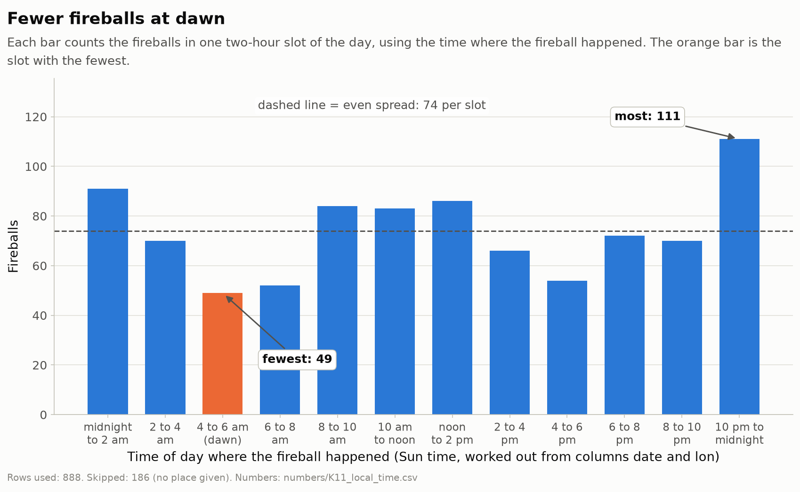

**How to read the chart**
- **Across the bottom:** the time of day where the fireball happened, in 2-hour slots. Midnight is at both ends.
- **Up the side:** how many fireballs happened in that slot.
- **The dashed line:** an even spread, 74 in every slot. **The orange bar:** the slot with the fewest.
- **Look for:** the dip around dawn and the tallest bar just before midnight.

**In short**
Ride your bike slowly, and faster bikes going the same way bump into your back. Many space rocks travel around the Sun the same way Earth does, but a bit faster. They catch Earth from behind, on the side where it's evening.

**Our data shows:** dawn has the fewest fireballs in both halves of the data. Before 2010: 20 at dawn against 50 late in the evening. Since then: 29 against 61.
**Scientists say (not from our data):** meteorites have long been found to fall more often in the afternoon and evening than in the morning. Slow rocks on paths like Earth's catch up from behind.

**Careful:** the sensors might not watch every hour equally. We did not test that.

**Chart:** `charts/K11_local_time.png` (the detailed version: `charts/BF11_local_time.png`)

**Animation:** `animations/F11_fewer_at_dawn.html` (open it in a web browser and press ▶ Play. It is also on the Findings page of the app.)

**Word box**
- world time (UTC): one clock that scientists everywhere share, so readings from different countries line up. Every time in these files is in world time.
- degree: a small slice of a circle. A full turn is 360 degrees.
- longitude: how far east or west a place is, in degrees.
- fireball: a very bright shooting star: a space rock that burns and explodes high in the air.
- Sun time: the time of day set by the Sun: noon is when the Sun is highest. It changes as you go east or west.
- dawn: early morning, when the Sun comes up.
- meteorite: a space rock that reaches the ground.

---

## Part D: Space weather

### Meet the data: the space weather file

**What is this file?** Readings of the solar wind and of Earth's storm meter, taken every 5 minutes from 2010-01-01 00:00 to 2026-10-18 23:55. NASA's OMNI service puts them together from spacecraft that sit between the Sun and Earth, and from magnetic sensors on the ground.

**What is one row?** One row is one 5-minute reading: what the solar wind and Earth's magnetic field were doing in those 5 minutes.

**How big is it?** 1,766,880 rows and 14 columns. That's 288 readings every day and about 105,120 a year, for about 17 years.

**What is this data trying to tell us?** Space has weather too! The Sun blows a wind at Earth all the time. Sometimes it sends a gust or a giant cloud, and Earth's magnetic field shakes: that is a magnetic storm, and it can make northern lights. The file shows when storms happen, how strong they are, and what the wind was doing just before.

**The columns we use**

| Column (name in the file) | Nickname we use | What it tells us | How it's measured | Example (a calm reading) |
|---|---|---|---|---|
| `datetime_utc` | time | when the 5-minute reading starts, in world time | year-month-day hour:minute | `2019-06-01 00:00` |
| `sym_h_nT` | storm meter | how hard a storm is shaking Earth's magnetic field. Near zero = calm. -50 or lower = a storm; -100 = a strong storm; -250 = an extreme one | nanotesla | -8 |
| `speed_km_s` | wind speed | how fast the solar wind is blowing | km every second | 371 |
| `density_cm3` | how crowded | how many tiny bits of wind are packed into one cubic centimetre (a cube one centimetre on each side, smaller than a sugar cube) | bits per cubic centimetre | 2.7 |
| `pressure_nPa` | push | how hard the wind pushes on Earth's magnetic bubble | nanopascals | 0.75 |
| `bz_gsm_nT` | Bz (north or south) | which way the magnetic field inside the wind points: plus = north, minus = south. South is the way that lets storm energy in | nanotesla | -0.3 |

**Let's read one row together (a calm reading)**
- `datetime_utc` is `2019-06-01 00:00`, in world time, during a calm year.
- `sym_h_nT` is -8: close to zero, so there's no storm. The middle reading of the whole file is -8.
- `speed_km_s` is 371: the wind blew 371 km every second. That's 1,335,600 km an hour! At its middle speed, the wind takes about 4.3 days to travel from the Sun to Earth.
- `density_cm3` is 2.7: about 2.7 tiny bits in each cubic centimetre. Space is very empty: the air around you is packed far, far tighter.
- `pressure_nPa` is 0.75: a very gentle push.
- `bz_gsm_nT` is -0.3: almost zero, so the door for storm energy is nearly shut.
- Compare the strongest storm in the file: at `2024-05-11 02:15` the storm meter read -497.

**Watch out for:** A blank cell means no measurement in those minutes: 4.4% of the Bz readings and 8.7% of the speed readings are blank. The storm meter stops on 2026-09-30, even though the wind readings go on. Even on calm days the storm meter sits a little below zero. The other 8 columns (like temperature and aurora meters) are not used here.

**Word box**
- percent (%): out of every hundred. Half is the same as fifty percent.
- world time (UTC): one clock that scientists everywhere share, so readings from different countries line up. Every time in these files is in world time.
- magnetic field: the invisible push and pull around a magnet. Earth and the Sun both have one.
- solar wind: a wind of tiny bits of electrically charged gas that blows out from the Sun all the time.
- northern lights (aurora): glowing curtains of green and red light in the night sky, made when a solar storm hits Earth's magnetic field.
- density: how crowded something is: how many tiny bits are packed into one space.
- pressure: how hard something pushes on whatever is in its way.
- km every second: how many kilometres something travels in one second. Multiply by 3,600 to get kilometres in an hour.
- storm meter: a number that shows how hard a solar storm is shaking Earth's magnetic field. Near zero is calm; the more negative, the bigger the storm. Scientists call it SYM-H.
- Bz: the north-south direction of the magnetic field carried by the solar wind. When it points south (a minus number), it links up with Earth's field and lets storm energy in, like opening a door.
- nanotesla: a very tiny unit for how strong a magnetic field is.
- nanopascal: a very tiny unit for how hard something pushes.
- magnetic bubble: the space around Earth that Earth's magnetic field controls. It shields us from most of the solar wind. Scientists call it the magnetosphere.
- giant star: a big, bright star near the end of its life.
- spacecraft: a machine that travels or works in space.
- magnetic storm: a storm in Earth's magnetic field, set off by the Sun. Scientists call it a geomagnetic storm.
- sugar cube: a small cube of sugar; a cubic centimetre is a bit smaller than one.

---

### 12. Storms rise and fall with the Sun's 11-year cycle

**The question:** Does the Sun make the same number of storms every year?

**The data we used**
- File: `nasa_omni_solar_wind_storms_5min_2010-2026.csv` (see "Meet the data" for part D)
- Rows: The readings grouped into world-time days. For each day we keep its lowest storm-meter reading: 6,117 days.
- Exact rule, for checking: `sym_h_nT is not blank; one row per day = that day's lowest sym_h_nT`
- Columns:

| Column | What it tells us | Unit | Example value (2024-05-11) |
|---|---|---|---|
| `sym_h_nT` | storm meter: we keep each day's lowest reading | nanotesla | -497 |
| `speed_km_s` | wind speed: we average it for each day and each year | km every second | 782 |

**The math**
1. A storm day is a day when the storm meter reached -50 or lower. A strong-storm day reached -100 or lower.
2. Storm days: 11 in 2019 and only 9 in 2020, the fewest. Then 66 in 2024 and 97 in 2025, the most.
3. Strong-storm days were highest in 2024: 21 of them.
4. The wind was fastest on average in 2025 (490 km every second) and slowest in 2020 (378).

**The simple relationship**
`busy Sun → more storms; it rises and falls about every 11 years`

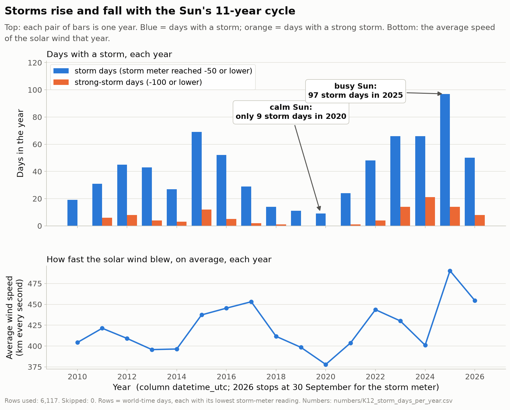

**How to read the chart**
- **Top chart, across the bottom:** the years. **Up the side:** how many days that year had a storm.
- **Blue bars:** storm days. **Orange bars:** strong-storm days.
- **Bottom chart:** the average speed of the solar wind each year.
- **Look for:** the short bars in 2019 and 2020, and the tall ones in 2024 and 2025.

**In short**
The Sun has moods that last for years, like very slow seasons. 2019 to 2020 was its calm winter. 2024 to 2025 was its stormy summer.

**Our data shows:** few storm days in 2019 and 2020, and many in 2024 and 2025.
**Scientists say (not from our data):** the Sun's activity goes up and down about every 11 years (the sunspot cycle). This cycle turned out stronger than many forecasts.

**Careful:** the storm meter stops on 2026-09-30, so 2026 is not a full year.

**Chart:** `charts/K12_storm_days_per_year.png` (the detailed version: `charts/BF12_storm_days_per_year.png`)

**Animation:** `animations/F12_storm_cycle.html` (open it in a web browser and press ▶ Play. It is also on the Findings page of the app.)

**Word box**
- average: add all the values up, then divide by how many there are.
- solar wind: a wind of tiny bits of electrically charged gas that blows out from the Sun all the time.
- km every second: how many kilometres something travels in one second. Multiply by 3,600 to get kilometres in an hour.
- storm meter: a number that shows how hard a solar storm is shaking Earth's magnetic field. Near zero is calm; the more negative, the bigger the storm. Scientists call it SYM-H.
- nanotesla: a very tiny unit for how strong a magnetic field is.
- cycle: something that repeats over and over, like the seasons.
- sunspot: a dark, cooler patch on the Sun. More sunspots mean a busier, stormier Sun.
- forecast: a prediction, like a weather forecast.

---

### 13. What the solar wind does in the hours before a big storm

**The question:** Does the solar wind change before a big storm, like a warning sign?

**The data we used**
- File: `nasa_omni_solar_wind_storms_5min_2010-2026.csv` (see "Meet the data" for part D)
- Rows: Storms: runs of readings at -50 or lower, joined together when they are less than 12 hours apart. That makes 442 storms, and 71 of them are strong (-100 or lower).
- Exact rule, for checking: `storm = sym_h_nT <= -50, runs joined if less than 12 hours apart; strong = lowest <= -100`
- Columns:

| Column | What it tells us | Unit | Example value (the middle strong storm, 24 hours before its lowest point) |
|---|---|---|---|
| `density_cm3` | how crowded the wind is | bits per cubic centimetre | 6.8 |
| `pressure_nPa` | how hard the wind pushes | nanopascals | 2.1 |
| `bz_gsm_nT` | Bz: plus = north, minus = south | nanotesla | 0.5 |
| `sym_h_nT` | storm meter | nanotesla | -8 |

**The math**
1. We line up the 71 strong storms so that their lowest points match. Then, every 5 minutes, we take the middle value of all of them.
2. Crowding: 5.1 bits per cubic centimetre two days before, but 10.0 at 20 hours before. Twice as crowded!
3. Push: 1.6 two days before, 5.2 at 8 hours before. 5.2 ÷ 1.6 = 3.2 times harder.
4. Bz turns south: -7.1 at 6 hours before, and -11.2 at 2 hours before.
5. Storm by storm, the lowest point comes about 10.8 hours (the middle value) after Bz first reaches -10.

**The simple relationship**
`crowded, pushy wind + Bz turns south → a storm a few hours later`

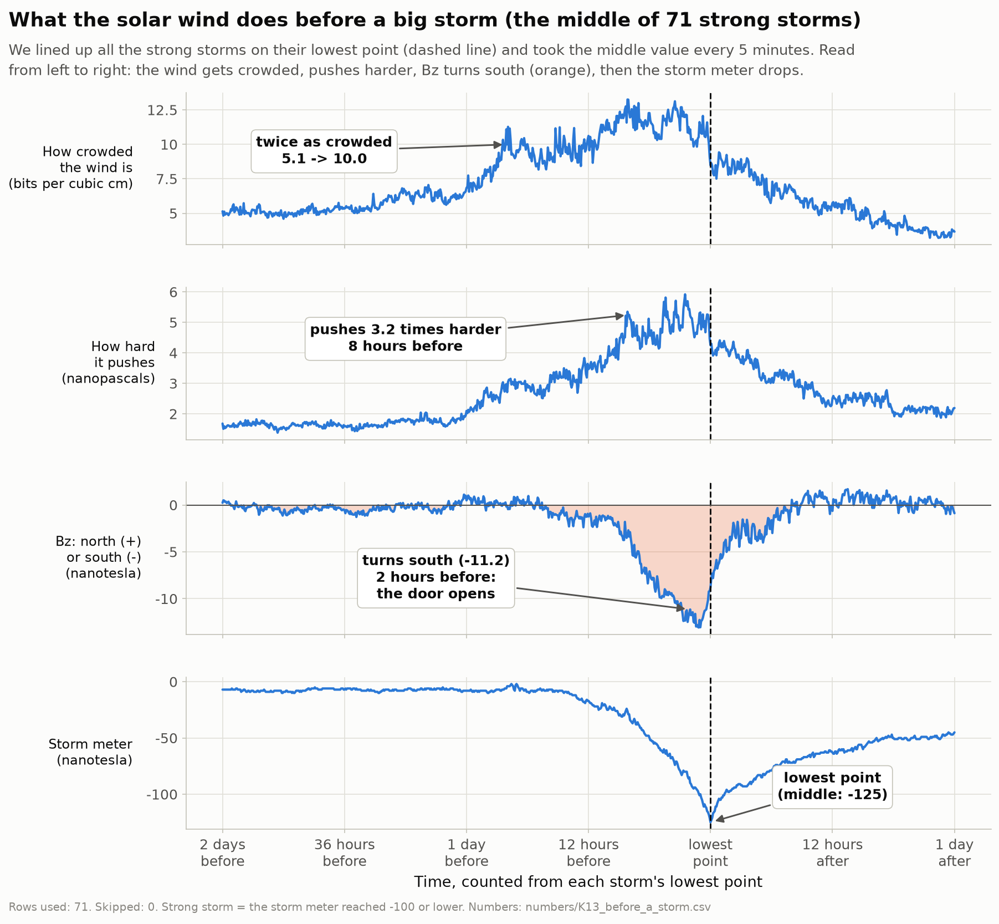

**How to read the chart**
- **Across the bottom:** time, counted from each storm's lowest point (the dashed line). Left = before, right = after.
- **Four charts, top to bottom:** how crowded the wind is, how hard it pushes, Bz (north or south), and the storm meter. Each has its own numbers up the side.
- **The orange area:** the hours when Bz points south, so the door is open.
- **Look for:** the top two lines climbing first, then the orange area, then the storm meter diving down.

**In short**
Think of a traffic jam before a crash. First the cars bunch up. Then they push harder. Then the road tilts the wrong way, and the crash happens.

**Our data shows:** crowding and pushing rise first, then Bz turns south, and then the storm meter drops.
**Scientists say (not from our data):** when Bz points south, the Sun's magnetic field links up with Earth's and lets energy in, like opening a door.

**Careful:** the readings are already moved to the time the wind reaches Earth, so these hours are not real warning time.

**Chart:** `charts/K13_before_a_storm.png` (the detailed version: `charts/BF13_before_a_storm.png`)

**Animation:** `animations/F13_before_a_storm.html` (open it in a web browser and press ▶ Play. It is also on the Findings page of the app.)

**Word box**
- middle value (median): line all the values up from smallest to biggest and pick the one in the middle. Scientists call it the median. One giant value can't pull it up the way it pulls up an average.
- magnetic field: the invisible push and pull around a magnet. Earth and the Sun both have one.
- solar wind: a wind of tiny bits of electrically charged gas that blows out from the Sun all the time.
- density: how crowded something is: how many tiny bits are packed into one space.
- pressure: how hard something pushes on whatever is in its way.
- storm meter: a number that shows how hard a solar storm is shaking Earth's magnetic field. Near zero is calm; the more negative, the bigger the storm. Scientists call it SYM-H.
- Bz: the north-south direction of the magnetic field carried by the solar wind. When it points south (a minus number), it links up with Earth's field and lets storm energy in, like opening a door.
- nanotesla: a very tiny unit for how strong a magnetic field is.
- nanopascal: a very tiny unit for how hard something pushes.
- lined up: moved in time so that every storm's lowest point sits at the same spot on the chart.

---

### 14. The Sun repeats itself every 27 days

**The question:** Does the solar wind follow a pattern?

**The data we used**
- File: `nasa_omni_solar_wind_storms_5min_2010-2026.csv` (see "Meet the data" for part D)
- Rows: The average wind speed of each day: 6,115 days.
- Exact rule, for checking: `speed_km_s is not blank, averaged over each world-time day`
- Columns:

| Column | What it tells us | Unit | Example value (2010-04-11) |
|---|---|---|---|
| `speed_km_s` | wind speed, averaged over the day | km every second | 403 |

**The math**
1. An example: on 2010-04-11 the wind blew 403 km every second. 27 days later, on 2010-05-08, it blew 469.
2. We compare the whole list of daily speeds with the same list shifted by some days. Then we give it a match score: one = a perfect match, zero = no match.
3. Shifted by 27 days: 0.46 for all the years, and 0.60 for the quiet years 2016 to 2018.
4. Shifted by 13 days: only 0.08. By 20 days: 0.04. Almost no match at all.

**The simple relationship**
`the Sun turns about once every 27 days → the same fast wind comes back`

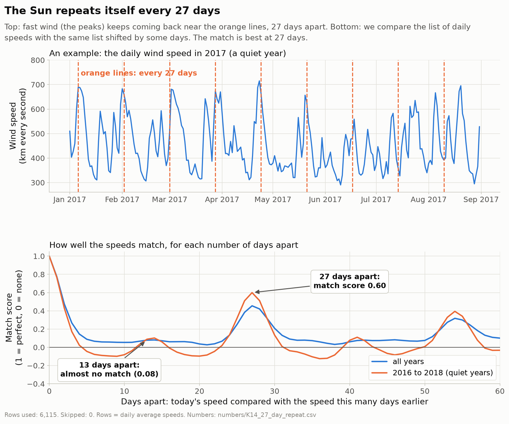

**How to read the chart**
- **Top chart:** the daily wind speed through part of 2017. Across the bottom is the date; up the side is the speed.
- **Orange dashed lines:** 27 days apart. The peaks of fast wind keep coming back near them.
- **Bottom chart:** the match score (up the side) for each number of days apart (across the bottom), up to 60. Blue = all years; orange = the quiet years.
- **Look for:** the big bump at 27 days.

**In short**
Think of a lighthouse: its beam sweeps past you once every turn. The Sun has "holes" that blow fast wind, and the same hole faces Earth again every 27 days.

**Our data shows:** between 20 and 35 days apart, the best match is at exactly 27 days.
**Scientists say (not from our data):** seen from Earth, the Sun turns once about every 27 days. Holes in the Sun's outer layer, called coronal holes, send out fast wind on each turn.

**Careful:** busy years blur the pattern; quiet years show it best.

**Chart:** `charts/K14_27_day_repeat.png` (the detailed version: `charts/BF14_27_day_repeat.png`)

**Animation:** `animations/F14_repeats_27_days.html` (open it in a web browser and press ▶ Play. It is also on the Findings page of the app.)

**Word box**
- average: add all the values up, then divide by how many there are.
- solar wind: a wind of tiny bits of electrically charged gas that blows out from the Sun all the time.
- match score (correlation): a number that says how well two lists of numbers go up and down together. One means a perfect match; zero means no match at all.
- km every second: how many kilometres something travels in one second. Multiply by 3,600 to get kilometres in an hour.
- coronal hole: a darker, cooler patch in the Sun's outer layer, where fast wind escapes.
- shifted: slid along, so each day lines up with a later day.

---

### 15. Storms like the months around the equinoxes

**The question:** Do magnetic storms happen more in some months than in others?

**The data we used**
- File: `nasa_omni_solar_wind_storms_5min_2010-2026.csv` (see "Meet the data" for part D)
- Rows: Every reading that has a storm-meter value: 1,761,696.
- Exact rule, for checking: `sym_h_nT is not blank`
- Columns:

| Column | What it tells us | Unit | Example value (a calm reading) |
|---|---|---|---|
| `datetime_utc` | time: we use its month | a date and time | `2019-06-01 00:00` |
| `sym_h_nT` | storm meter: stormy = -50 or lower | nanotesla | -8 |

**The math**
1. For each month, we find the percent of readings that are stormy (-50 or lower).
2. Highest: March 4.5% and April 4.2%. High again in September 3.7% and October 4.0%.
3. Lowest: December 1.5% and July 2.0%. 4.5% ÷ 1.5% = 3.0.
4. Strong storms: 10 in March, 9 in October and 9 in November, but only 2 in July and 2 in December.

**The simple relationship**
`near the equinoxes → Earth's magnetic field lines up best with the Sun's → more storms`

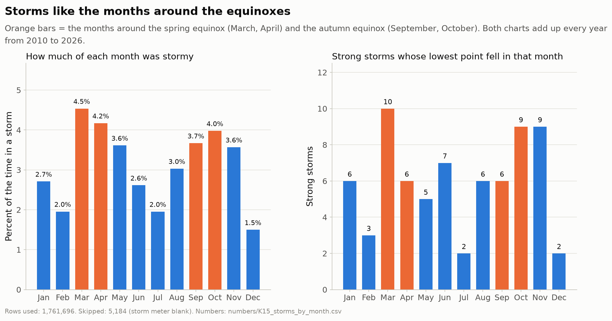

**How to read the chart**
- **Both charts, across the bottom:** the twelve months.
- **Left, up the side:** the percent of time that month was stormy. **Right, up the side:** how many strong storms had their lowest point in that month.
- **Orange bars:** the months around the equinoxes (March, April, September, October).
- **Look for:** two humps (spring and autumn) and two dips (summer and winter).

**In short**
A key only opens a lock when you hold it at the right angle. Around late March and late September, Earth is tilted at just the right angle for the Sun's magnetic key.

**Our data shows:** two peaks (spring and autumn) and two dips (summer and winter).
**Scientists say (not from our data):** this pattern has a name: the Russell-McPherron effect, after the two scientists who explained it.

**Careful:** a few huge storms can tip a month, so we added all the years together.

Note: the guide said 3.7-3.8% for September and October; our data gives 3.7% and 4.0%.

**Chart:** `charts/K15_storms_by_month.png` (the detailed version: `charts/BF15_storms_by_month.png`)

**Animation:** `animations/F15_storms_by_month.html` (open it in a web browser and press ▶ Play. It is also on the Findings page of the app.)

**Word box**
- percent (%): out of every hundred. Half is the same as fifty percent.
- magnetic field: the invisible push and pull around a magnet. Earth and the Sun both have one.
- storm meter: a number that shows how hard a solar storm is shaking Earth's magnetic field. Near zero is calm; the more negative, the bigger the storm. Scientists call it SYM-H.
- nanotesla: a very tiny unit for how strong a magnetic field is.
- equinox: one of the two days each year, in late March and late September, when day and night are about the same length everywhere on Earth.

---

### 16. The May 2024 superstorm, hour by hour

**The question:** What happened, step by step, during the biggest storm in the file?

**The data we used**
- File: `nasa_omni_solar_wind_storms_5min_2010-2026.csv` (see "Meet the data" for part D)
- Rows: The readings from 10 May 2024 12:00 to 12 May 2024 12:00, world time: 577 readings.
- Exact rule, for checking: `2024-05-10 12:00 <= datetime_utc <= 2024-05-12 12:00`
- Columns:

| Column | What it tells us | Unit | Example value (right after the cloud hit) |
|---|---|---|---|
| `speed_km_s` | wind speed | km every second | 608 |
| `density_cm3` | how crowded the wind is | bits per cubic centimetre | 35.1 |
| `bz_gsm_nT` | Bz: minus = south | nanotesla | -16 |
| `sym_h_nT` | storm meter | nanotesla | +79 |

**The math**
1. At 17:05 world time (13:05 in Toronto), a giant cloud from the Sun hit. The wind speed jumped from 447 to 608 km every second in one 5-minute step.
2. The wind got 2.4 times as crowded (14.9 → 35.1). The storm meter first jumped UP to +79, because the cloud squeezed Earth's magnetic bubble.
3. Then Bz turned south: -16 at 17:30, and -31 at 18:00.
4. The lowest point: -497 at 11 May 02:15 world time, which was 10 May 22:15 in Toronto. That's 9.2 hours after the cloud hit.

**The simple relationship**
`cloud hits → magnetic bubble squeezed → Bz turns south → huge storm`

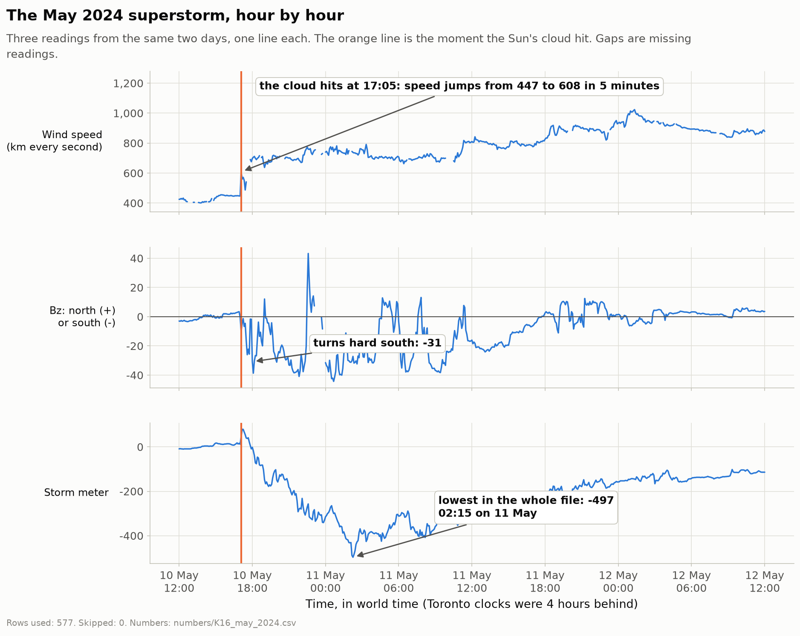

**How to read the chart**
- **Across the bottom:** time, in world time, over two days.
- **Three charts:** wind speed (top), Bz (middle) and the storm meter (bottom).
- **The orange line:** the moment the cloud hit.
- **Look for:** the jump in speed at the orange line, Bz plunging below zero, and the storm meter falling to its lowest point hours later.

**In short**
Think of a big wave hitting a sandcastle. First the splash pushes it (the storm meter goes up). Then the water pulls everything down (the storm meter dives).

**Our data shows:** the lowest storm-meter reading in the whole file, -497. The October 2024 storm reached -343, on 10 Oct 21:45 Toronto time.
**Scientists say (not from our data):** this was the Gannon superstorm. It painted northern lights across Ontario and much of the world.

**Careful:** 1% of the Bz readings in these two days are blank; they show as gaps in the line.

Note: the guide said the cloud hit at about 17:10 with the speed jumping to 572; our readings show the jump at 17:05 to 608, then 572 at 17:15.

**Chart:** `charts/K16_may_2024.png` (the detailed version: `charts/BF16_may_2024.png`)

**Animation:** `animations/F16_may_2024_superstorm.html` (open it in a web browser and press ▶ Play. It is also on the Findings page of the app.)

**Word box**
- percent (%): out of every hundred. Half is the same as fifty percent.
- world time (UTC): one clock that scientists everywhere share, so readings from different countries line up. Every time in these files is in world time.
- magnetic field: the invisible push and pull around a magnet. Earth and the Sun both have one.
- northern lights (aurora): glowing curtains of green and red light in the night sky, made when a solar storm hits Earth's magnetic field.
- density: how crowded something is: how many tiny bits are packed into one space.
- km every second: how many kilometres something travels in one second. Multiply by 3,600 to get kilometres in an hour.
- storm meter: a number that shows how hard a solar storm is shaking Earth's magnetic field. Near zero is calm; the more negative, the bigger the storm. Scientists call it SYM-H.
- Bz: the north-south direction of the magnetic field carried by the solar wind. When it points south (a minus number), it links up with Earth's field and lets storm energy in, like opening a door.
- nanotesla: a very tiny unit for how strong a magnetic field is.
- magnetic bubble: the space around Earth that Earth's magnetic field controls. It shields us from most of the solar wind. Scientists call it the magnetosphere.
- Toronto time: the clock time in Toronto, Ontario. It is 5 hours behind world time in winter and 4 hours behind in summer.
- giant star: a big, bright star near the end of its life.
- superstorm: an extremely strong magnetic storm, the kind that happens only every few decades.

---

### 17. Big storms that happened during an Ontario night

**The question:** How often could people in Ontario have seen northern lights from a strong storm?

**The data we used**
- File: `nasa_omni_solar_wind_storms_5min_2010-2026.csv` (see "Meet the data" for part D)
- Rows: Storm-meter readings up to 2026-09-30, changed to Toronto time, dark hours only: 6,117 nights.
- Exact rule, for checking: `Toronto time from 21:00 to 04:00 (the hours after midnight count for the night before)`
- Columns:

| Column | What it tells us | Unit | Example value (January 2026) |
|---|---|---|---|
| `datetime_utc` | time, which we change to Toronto time | a date and time | 20 Jan 11:50 |
| `sym_h_nT` | storm meter | nanotesla | -251 |

**The math**
1. Toronto clocks are 5 hours behind world time in winter and 4 hours behind in summer.
2. For each night, from 21:00 to 04:00, we keep the lowest storm-meter reading.
3. Nights at -100 or lower: 58. There were 9 each in 2023, 2024 and 2025, but 0 in 2019, 2020 and 2022.
4. In January 2026 the storm meter hit -251, but at 6:50 am in Toronto, when the dark hours were over. The nights around it reached -132 (before) and -167 (after).

**The simple relationship**
`strong storm + dark sky in Toronto → a chance of northern lights`

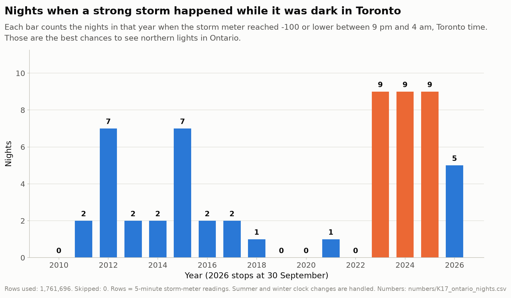

**How to read the chart**
- **Across the bottom:** the years.
- **Up the side:** how many nights that year had a strong storm while it was dark in Toronto.
- **Orange bars:** the years with the most.
- **Look for:** the empty years around 2019 to 2022, and the busy years 2023 to 2025.

**In short**
It's like a shooting star: the show has to happen while it's dark where you are. Part of it is luck.

**Our data shows:** 58 good nights since 2010.
**Scientists say (not from our data):** the storm meter is only a rough guide: clouds, moonlight and city lights matter too.

**Careful:** the storm meter stops on 2026-09-30, so 2026 is not complete.

Note: the guide said the dark-hours value was -167; our data gives -132 the night before and -167 the night after.

**Chart:** `charts/K17_ontario_nights.png` (the detailed version: `charts/BF17_ontario_nights.png`)

**Animation:** `animations/F17_ontario_nights.html` (open it in a web browser and press ▶ Play. It is also on the Findings page of the app.)

**Word box**
- world time (UTC): one clock that scientists everywhere share, so readings from different countries line up. Every time in these files is in world time.
- northern lights (aurora): glowing curtains of green and red light in the night sky, made when a solar storm hits Earth's magnetic field.
- storm meter: a number that shows how hard a solar storm is shaking Earth's magnetic field. Near zero is calm; the more negative, the bigger the storm. Scientists call it SYM-H.
- nanotesla: a very tiny unit for how strong a magnetic field is.
- Toronto time: the clock time in Toronto, Ontario. It is 5 hours behind world time in winter and 4 hours behind in summer.
- dark hours: here, 21:00 to 04:00 Toronto time, when the sky is dark enough to see northern lights.

---

## Part E: Stars

### Meet the data: the star file (Gaia)

**What is this file?** The European Space Agency's Gaia spacecraft measured the position, distance, brightness, colour and movement of stars all over the sky. This file keeps only the stars within about 502 light-years of the Sun (154 parsecs).

**What is one row?** One row is one star.

**How big is it?** 1,165,165 rows and 21 columns. Counting one star every second, day and night, would take about 13.5 days. Only 3,567 of them are bright enough to see with your eyes on a dark night.

**What is this data trying to tell us?** What kinds of stars live near the Sun? How hot and how bright are they? How fast do they move? Which ones travel together in families?

**The columns we use**

| Column (name in the file) | Nickname we use | What it tells us | How it's measured | Example (Proxima Centauri) |
|---|---|---|---|---|
| `source_id` | star ID | Gaia's ID number for the star | a long number | 5853498713190525696 |
| `ra, dec` | sky position | where the star is on the sky, like longitude and latitude on a map of the sky | degrees | 217.39, -62.68 |
| `l, b` | Milky Way position | the same position, measured from the middle of the Milky Way: `l` goes around the sky, `b` is above or below the Milky Way's flat disc | degrees | 313.9, -1.9 |
| `distance_pc` | distance | how far away the star is, worked out from its tiny yearly wobble (the `parallax` column) | parsecs (one parsec = 3.26 light-years) | 1.30 |
| `pmra, pmdec` | sideways drift | how fast the star slides across the sky each year, east-west and north-south | thousandths of an arcsecond per year | -3,782, 769 |
| `radial_velocity` | toward-or-away speed | how fast it moves straight toward us (minus) or away from us (plus) | km every second | -21.9 |
| `phot_g_mean_mag` | brightness as we see it | how bright the star looks from Earth. Like the asteroid brightness number: smaller = brighter | a number | 8.98 |
| `bp_rp` | colour number | the star's colour: small = blue and hot, big = red and cool | a number | 3.80 |
| `abs_g_mag` | true brightness | how bright the star would look if every star were the same distance away. Smaller = brighter | a number | 13.41 |
| `ruwe` | wobble score | how well Gaia's measurement fits one simple star. Over 1.4 = suspicious (maybe a hidden partner star, or a bad measurement) | a number | 0.97 |

**Let's read one row together (Proxima Centauri)**
- This is Proxima Centauri, the closest star to the Sun. Its `source_id` is `5853498713190525696`.
- `distance_pc` is 1.30 parsecs. Times 3.26, that's 4.24 light-years: its light takes 4.24 years to reach us!
- `ra` is 217.39 and `dec` is -62.68: far down in the southern sky, so it never rises over Ontario.
- `phot_g_mean_mag` is 8.98. Eyes can only see stars down to about 6, so even the closest star is too faint to see without a telescope.
- `bp_rp` is 3.80: very red and cool. `abs_g_mag` is 13.41: a very dim star. It is a red dwarf.
- `pmra` is -3,782 and `pmdec` is 769: together, it slides 3.86 arcseconds across the sky each year. That's fast for a star.
- `radial_velocity` is -21.9: the minus sign means it is coming toward us. `ruwe` is 0.97, under 1.4, so the measurement looks fine.

**Watch out for:** Blank cells are common: only 40% of the stars have a toward-or-away speed, and 4% have no colour. This file has no quality filter: 22% of the stars have a wobble score over 1.4. The very brightest stars, like Sirius, are too bright for Gaia, so they're missing.

**Word box**
- asteroid: a rocky lump, much smaller than a planet, that travels around the Sun.
- percent (%): out of every hundred. Half is the same as fifty percent.
- light-year: how far light travels in one year. Light is the fastest thing there is.
- parsec: another unit for star distances: one parsec is 3.26 light-years.
- degree: a small slice of a circle. A full turn is 360 degrees.
- latitude: how far north or south a place is, in degrees. The equator is zero.
- longitude: how far east or west a place is, in degrees.
- brightness number (H): how bright an asteroid would look from a set distance. Smaller means brighter, and brighter means bigger. Scientists call it absolute magnitude.
- km every second: how many kilometres something travels in one second. Multiply by 3,600 to get kilometres in an hour.
- colour number: a star's colour (column `bp_rp`): a small number means blue and hot; a big number means red and cool.
- true brightness: how bright a star would look if all stars were the same distance away (column `abs_g_mag`). Smaller means brighter.
- wobble score: how well Gaia's measurement fits one simple star (column `ruwe`). Over 1.4 means the measurement is suspicious.
- arcsecond: a tiny angle: about the width of a coin seen from 4 km away. There are 3,600 arcseconds in one degree.
- Milky Way: our home galaxy. From Earth it looks like a cloudy band of light across the night sky.
- Gaia: a European space telescope that measures the positions and movements of stars very precisely.
- parallax: the tiny shift in a star's position as Earth goes around the Sun. Hold up a finger and close one eye, then the other: the finger jumps. Closer stars jump more, so the jump tells us the distance.
- red dwarf: a small, cool, dim, red star. The most common kind of star.

---

### 18. A star's colour and true brightness sort it into a family

**The question:** If we put every star on one chart, by colour and true brightness, do they spread out evenly?

**The data we used**
- File: `gaia_dr3_stars_within_500_light_years.csv` (see "Meet the data" for part E)
- Rows: Stars with a colour and a true brightness: 1,114,566 of the 1,165,165.
- Exact rule, for checking: `bp_rp and abs_g_mag are not blank`
- Columns:

| Column | What it tells us | Unit | Example value (Proxima Centauri) |
|---|---|---|---|
| `bp_rp` | colour number: small = blue and hot, big = red and cool | a number | 3.80 |
| `abs_g_mag` | true brightness: smaller = brighter | a number | 13.41 |
| `ruwe` | wobble score: over 1.4 = suspicious | a number | 0.97 |

**The math**
1. We put colour across the bottom and true brightness up the side. Then we count the stars in each little square.
2. White-dwarf test: true brightness more than 10 + 2.6 × colour, and colour under 1.7. That finds 84,595 stars (55,995 with a good wobble score).
3. Giant test: true brightness under 3.5 and colour over 0.9: 5,058 stars.
4. All the rest make the main band: 1,024,913 stars. The Sun would sit at colour 0.82, true brightness 4.67.

**The simple relationship**
`colour + true brightness → star family`

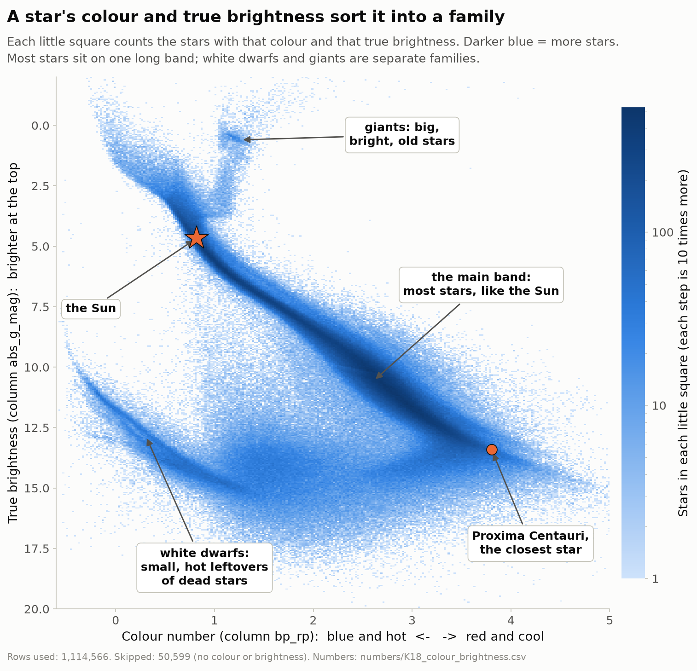

**How to read the chart**
- **Across the bottom:** the colour number. Left = blue and hot; right = red and cool.
- **Up the side:** true brightness. Brighter stars are at the top.
- **Colours:** each little square is coloured by how many stars are in it: darker blue = more. Each step on the colour key is 10 times more.
- **Look for:** the long main band with the Sun on it, the white-dwarf band below it, and the giants at the top.

**In short**
Sort all the people in your town by height and weight. Most fall along one line. A few are giants. And some are tiny but very heavy, like the white dwarfs.

**Our data shows:** a main band, a white-dwarf band below it, and a small group of giants above.
**Scientists say (not from our data):** this chart is called the Hertzsprung-Russell diagram, after two astronomers. White dwarfs are the cooling cores of dead stars.

**Careful:** dots scattered between the bands are often bad measurements (wobble score over 1.4).

**Chart:** `charts/K18_colour_brightness.png` (the detailed version: `charts/BF18_colour_brightness.png`)

**Animation:** `animations/F18_colour_brightness.html` (open it in a web browser and press ▶ Play. It is also on the Findings page of the app.)

**Word box**
- light-year: how far light travels in one year. Light is the fastest thing there is.
- colour number: a star's colour (column `bp_rp`): a small number means blue and hot; a big number means red and cool.
- true brightness: how bright a star would look if all stars were the same distance away (column `abs_g_mag`). Smaller means brighter.
- wobble score: how well Gaia's measurement fits one simple star (column `ruwe`). Over 1.4 means the measurement is suspicious.
- white dwarf: the small, hot leftover core of a dead star, about as big as Earth.
- giant star: a big, bright star near the end of its life.
- main band: the long band on the colour-brightness chart where most stars, like the Sun, spend most of their lives. Scientists call it the main sequence.

---

### 19. Three out of four nearby stars are red dwarfs

**The question:** What kind of star is the most common near the Sun?

**The data we used**
- File: `gaia_dr3_stars_within_500_light_years.csv` (see "Meet the data" for part E)
- Rows: Main-band stars (the white dwarfs and giants from finding 18 are taken out): 1,024,913.
- Exact rule, for checking: `has a colour, and is not white dwarf-like and not giant-like`
- Columns:

| Column | What it tells us | Unit | Example value (Proxima Centauri) |
|---|---|---|---|
| `bp_rp` | colour number, used to sort the stars into types | a number | 3.80 |

**The math**
1. We cut the colour number at 0, 0.33, 0.75, 0.98 and 1.80. That makes six types, from blue-white to red.
2. The reddest type (M, the red dwarfs): 792,571. 792,571 ÷ 1,024,913 = 77.3%.
3. The others: orange (K) 14.1%, yellow like the Sun (G) 5.1%, yellow-white (F) 3.1%, white (A) 0.31%, blue-white (O and B) 0.07%.
4. Out of 100 stars, that's about 78 red dwarfs and only 5 like the Sun.

**The simple relationship**
`small, cool, red stars → the most common, but too dim to see`

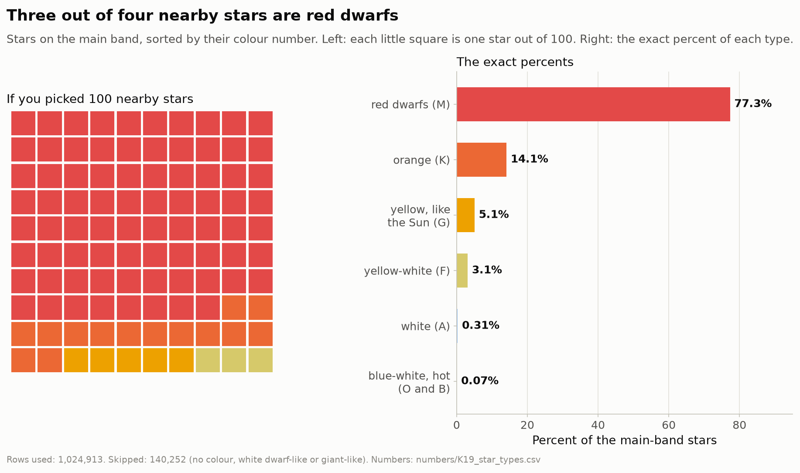

**How to read the chart**
- **Left:** 100 little squares, one for each star if you picked 100 at random. The colour shows the star's type.
- **Right:** the exact percent for each type. A longer bar means a bigger percent.
- **Look for:** how much of the square is red, and how tiny the white and blue-white bars are: less than one star in 100.

**In short**
In a noisy crowd you only hear the few loud people. Most stars are quiet red dwarfs that you can't see without a telescope.

**Our data shows:** 77.3% red dwarfs, but only 5.1% Sun-like stars.
**Scientists say (not from our data):** no red dwarf is bright enough to see with your eyes, so the night sky looks nothing like this list.

**Careful:** the types come from colour only. Guess (not checked): Gaia misses the dimmest far-away red dwarfs, so the real share may be even higher.

**Chart:** `charts/K19_star_types.png` (the detailed version: `charts/BF19_colour_classes.png`)

**Animation:** `animations/F19_star_types.html` (open it in a web browser and press ▶ Play. It is also on the Findings page of the app.)

**Word box**
- percent (%): out of every hundred. Half is the same as fifty percent.
- light-year: how far light travels in one year. Light is the fastest thing there is.
- colour number: a star's colour (column `bp_rp`): a small number means blue and hot; a big number means red and cool.
- white dwarf: the small, hot leftover core of a dead star, about as big as Earth.
- giant star: a big, bright star near the end of its life.

---

### 20. Eight times too many "nearby" stars toward the middle of the Milky Way

**The question:** Are the nearby stars spread evenly around the sky?

**The data we used**
- File: `gaia_dr3_stars_within_500_light_years.csv` (see "Meet the data" for part E)
- Rows: All the stars, counted inside two circles on the sky, each reaching 5 degrees from its centre.
- Exact rule, for checking: `angle from the middle of the Milky Way < 5, against angle from the opposite direction < 5`
- Columns:

| Column | What it tells us | Unit | Example value (Proxima Centauri) |
|---|---|---|---|
| `l, b` | position measured from the middle of the Milky Way | degrees | 313.9, -1.9 |
| `ruwe` | wobble score | a number | 0.97 |
| `bp_rp` | colour number (blank = no colour measured) | a number | 3.80 |

**The math**
1. Toward the middle of the Milky Way: 15,901 stars. In the opposite direction: 2,041. 15,901 ÷ 2,041 = 7.8.
2. Wobble score: the middle value is 1.63 toward the middle, against 1.06 for all stars. Badly measured (over 1.4): 66% against 22%.
3. No colour: 33% against 4%.
4. A check: the Large Magellanic Cloud, a small galaxy next to ours, gives 1,881 against 1,894 in a mirror patch. No extra stars there.

**The simple relationship**
`very crowded, far-away stars → wrong distance → they look nearby`

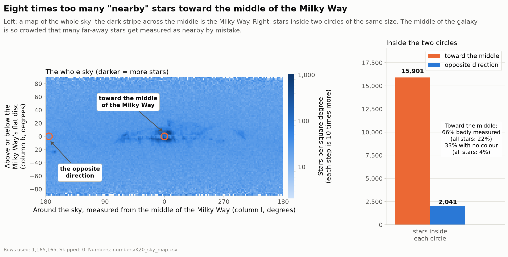

**How to read the chart**
- **Left, across the bottom:** around the sky, measured from the middle of the Milky Way. **Up the side:** above or below the Milky Way's flat disc.
- **Colours:** darker blue = more stars on that part of the sky. Each step on the colour key is 10 times more.
- **Orange circles:** the two circles we compare. **Right:** the stars inside each circle.
- **Look for:** the dark knot in the middle of the map, and the orange bar about eight times taller than the blue one.

**In short**
In a packed concert crowd, it's hard to judge how far away people are, so some faraway people seem close.

**Our data shows:** about 7.8 times too many "nearby" stars toward the middle, and most of them are badly measured.
**Scientists say (not from our data):** the galaxy's crowded middle confuses Gaia's distance measurements: stars that are really far away get counted as nearby.

**Careful:** this file has no quality filter, so always check the wobble score.

Note: the guide said 15,895 against 2,040 (wobble score 1.65, 34% with no colour) and 1,594 against 1,587; our circles give 15,901 against 2,041 (1.63, 33%) and 1,881 against 1,894.

**Chart:** `charts/K20_sky_map.png` (the detailed version: `charts/BF20_sky_map.png`)

**Animation:** `animations/F20_sky_map.html` (open it in a web browser and press ▶ Play. It is also on the Findings page of the app.)

**Word box**
- middle value (median): line all the values up from smallest to biggest and pick the one in the middle. Scientists call it the median. One giant value can't pull it up the way it pulls up an average.
- percent (%): out of every hundred. Half is the same as fifty percent.
- light-year: how far light travels in one year. Light is the fastest thing there is.
- degree: a small slice of a circle. A full turn is 360 degrees.
- colour number: a star's colour (column `bp_rp`): a small number means blue and hot; a big number means red and cool.
- wobble score: how well Gaia's measurement fits one simple star (column `ruwe`). Over 1.4 means the measurement is suspicious.
- Milky Way: our home galaxy. From Earth it looks like a cloudy band of light across the night sky.
- galaxy: a giant family of stars held together by gravity. Ours is the Milky Way.
- Large Magellanic Cloud: a small galaxy that circles our Milky Way. You can see it from the southern half of Earth.

---

### 21. Stars that were born together still travel together

**The question:** Can a computer find star families using only where stars are and how they move?

**The data we used**
- File: `gaia_dr3_stars_within_500_light_years.csv` (see "Meet the data" for part E)
- Rows: Well-measured stars brighter than 18 (brightness as we see it) that have a measured drift: 700,570.
- Exact rule, for checking: `ruwe < 1.4 and phot_g_mean_mag < 18 and pmra, pmdec are not blank`
- Columns:

| Column | What it tells us | Unit | Example value (the biggest group, middle values) |
|---|---|---|---|
| `ra, dec` | sky position | degrees | 56.6, 24.1 |
| `distance_pc` | distance | parsecs | 136 |
| `pmra, pmdec` | sideways drift | thousandths of an arcsecond per year | 19.9, -45.5 |

**The math**
1. For each star we make five numbers. Three say where it is in space, in parsecs. Two say how fast it drifts sideways, in km every second (drift × distance × 4.74 ÷ 1,000).
2. We multiply the speeds by 4, so moving together counts as much as sitting together.
3. The computer (a method called DBSCAN) calls stars a group when 12 or more of them are within 3 steps of each other.
4. Result: 24 groups. The biggest has 768 stars, about 136 parsecs (442 light-years) away. The next two have 176 and 171.

**The simple relationship**
`born together → same place + same motion → one group`

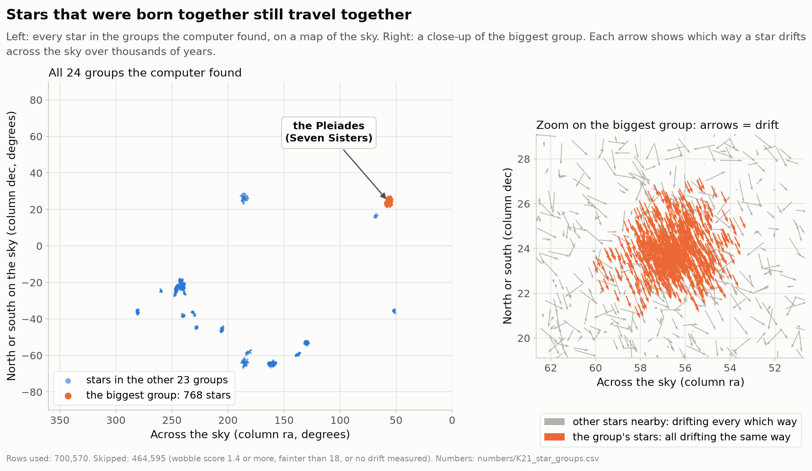

**How to read the chart**
- **Left:** a map of the sky. Across the bottom is `ra`; up the side is `dec`. Each dot is a star in a group; orange = the biggest group.
- **Right:** a close-up of the biggest group. Each arrow shows which way a star drifts across the sky.
- **Orange arrows:** the group's stars. **Gray arrows:** other stars in the same patch of sky (long arrows are cut short).
- **Look for:** the orange arrows all pointing the same way, while the gray ones point every which way.

**In short**
It's like spotting a school class on a trip to a busy museum: the students stay close together and walk the same way.

**Our data shows:** 24 groups. The biggest sits at the same place in the sky as the Pleiades.
**Scientists say (not from our data):** the biggest group is the Pleiades, also called the Seven Sisters (`ra` 56.75, `dec` 24.12). Its stars were born from the same cloud of gas.

**Careful:** the computer's settings (3 steps, 12 stars) change how many groups it finds.

**Chart:** `charts/K21_star_groups.png` (the detailed version: `charts/BF21_star_groups.png`)

**Animation:** `animations/F21_star_groups.html` (open it in a web browser and press ▶ Play. It is also on the Findings page of the app.)

**Word box**
- middle value (median): line all the values up from smallest to biggest and pick the one in the middle. Scientists call it the median. One giant value can't pull it up the way it pulls up an average.
- light-year: how far light travels in one year. Light is the fastest thing there is.
- parsec: another unit for star distances: one parsec is 3.26 light-years.
- degree: a small slice of a circle. A full turn is 360 degrees.
- km every second: how many kilometres something travels in one second. Multiply by 3,600 to get kilometres in an hour.
- wobble score: how well Gaia's measurement fits one simple star (column `ruwe`). Over 1.4 means the measurement is suspicious.
- arcsecond: a tiny angle: about the width of a coin seen from 4 km away. There are 3,600 arcseconds in one degree.
- DBSCAN: a computer method that finds crowded spots: points with many close neighbours become a group.
- Pleiades: a famous little cluster of stars in the winter sky, also called the Seven Sisters.

---

### 22. Some stars are really fast, and some speeds can't be right

**The question:** How fast do stars move, and can we trust every speed in the file?

**The data we used**
- File: `gaia_dr3_stars_within_500_light_years.csv` (see "Meet the data" for part E)
- Rows: All stars for the sideways drift. For the speed toward or away from us, only the stars where it was measured: 460,304.
- Exact rule, for checking: `radial_velocity is not blank`
- Columns:

| Column | What it tells us | Unit | Example value (Groombridge 1830) |
|---|---|---|---|
| `pmra, pmdec` | sideways drift | thousandths of an arcsecond per year | 4,003, -5,818 |
| `distance_pc` | distance | parsecs | 9.17 |
| `radial_velocity` | speed toward (minus) or away (plus) | km every second | -98.1 |

**The math**
1. The fastest sideways drift: 10.4 arcseconds a year, at 1.83 parsecs. Its position matches Barnard's Star.
2. Sideways speed = 4.74 × drift × distance. Groombridge 1830: 4.74 × 7.06 × 9.17 = 307 km every second.
3. Faster than 200 km every second sideways: 2,278 stars.
4. Faster than 300 toward or away: 201. They look fainter (middle brightness number 14.7, against 13.4 for all). The wildest: -865 km every second, at 131 parsecs. That's faster than a star needs to escape our galaxy (about 550).

**The simple relationship**
`faint star + extreme speed → probably a measuring mistake`

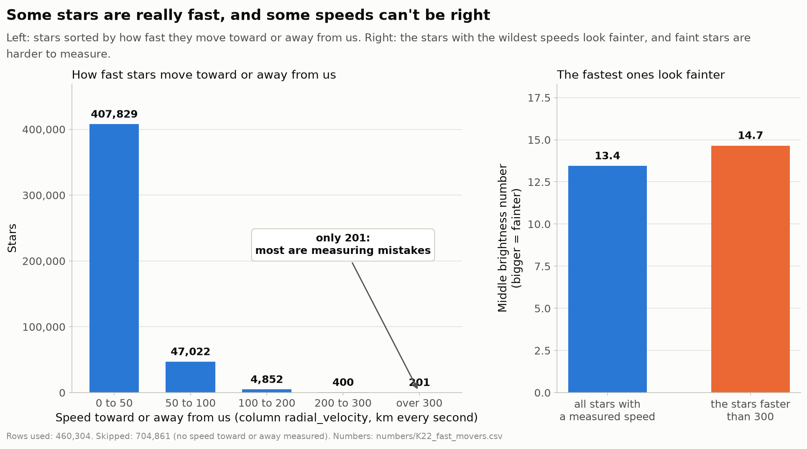

**How to read the chart**
- **Left, across the bottom:** speed toward or away from us, in groups (km every second). **Up the side:** how many stars.
- **The orange bar:** the 201 stars faster than 300.
- **Right:** the middle brightness number as we see it (bigger = fainter), for all stars and for the fastest ones.
- **Look for:** almost all stars in the slow groups, and the fastest ones looking fainter.

**In short**
If a speed camera says a bicycle went as fast as a race car, you check the camera first.

**Our data shows:** a few truly fast stars, and 201 speeds that look suspicious.
**Scientists say (not from our data):** Barnard's Star, Groombridge 1830 and Kapteyn's Star are old stars from the galaxy's halo, just passing through our neighbourhood. Kapteyn's Star moves away from us at 245 km every second.

**Careful:** a speed this big is possible but rare; for a faint star, a measuring mistake is more likely.

Note: the guide said 2,280 stars beat 200 km every second sideways; our data gives 2,278.

**Chart:** `charts/K22_fast_movers.png` (the detailed version: `charts/BF22_radial_velocity.png`)

**Animation:** `animations/F22_fast_movers.html` (open it in a web browser and press ▶ Play. It is also on the Findings page of the app.)

**Word box**
- light-year: how far light travels in one year. Light is the fastest thing there is.
- parsec: another unit for star distances: one parsec is 3.26 light-years.
- brightness number (H): how bright an asteroid would look from a set distance. Smaller means brighter, and brighter means bigger. Scientists call it absolute magnitude.
- km every second: how many kilometres something travels in one second. Multiply by 3,600 to get kilometres in an hour.
- arcsecond: a tiny angle: about the width of a coin seen from 4 km away. There are 3,600 arcseconds in one degree.
- galaxy: a giant family of stars held together by gravity. Ours is the Milky Way.
- halo: the thin cloud of old stars around our galaxy's flat disc.
- escape: to move so fast that gravity can't pull you back.

---

## Part F: Planets around other stars

### Meet the data: the planet file

**What is this file?** NASA's Exoplanet Archive: the official list of confirmed planets that go around other stars. Planets outside our Solar System are called exoplanets.

**What is one row?** One row is one planet.

**How big is it?** 6,451 rows and 25 columns. The planets go around 4,847 different stars, and 1,069 of those stars have more than one planet. The first one in the list was found in 1992; the newest in 2026.

**What is this data trying to tell us?** What kinds of planets are out there? How big are they, how close to their star, how were they found, and could any of them be a bit like Earth?

**The columns we use**

| Column (name in the file) | Nickname we use | What it tells us | How it's measured | Example (Proxima Cen b) |
|---|---|---|---|---|
| `pl_name, hostname` | planet name, star name | the planet's name and its star's name. The planet is the star's name plus a small letter | words | Proxima Cen b, Proxima Cen |
| `disc_year` | year found | the year the planet was announced | a year | 2016 |
| `discoverymethod` | how it was found | `Transit` = it passed in front of its star and made it a tiny bit dimmer; `Radial Velocity` = its pull made the star wobble toward and away from us | words | Radial Velocity |
| `disc_facility` | who found it | the telescope or team that found it | words | European Southern Observatory |
| `pl_orbper` | year length | how many Earth days one trip around its star takes | days | 11.18 |
| `pl_rade` | size | how wide the planet is, compared with Earth | Earths (one = as wide as Earth) | 1.02 |
| `pl_bmasse` | mass | how heavy the planet is, compared with Earth | Earths (one = as heavy as Earth) | 1.05 |
| `pl_insol` | starlight | how much starlight the planet gets, compared with Earth | Earths (one = the same as Earth) | 0.64 |
| `st_met` | metal score | how much metal the star has: zero = like the Sun, plus = more, minus = less | a number | blank |
| `sy_dist` | distance | how far the planet's star is from us | parsecs (one parsec = 3.26 light-years) | 1.30 |
| `gaia_source_id` | Gaia ID | the star's ID in the Gaia star file of part E, so the two files can be joined | a long number, kept as text | 5853498713190525696 |

**Let's read one row together (Proxima Cen b)**
- Proxima Cen b goes around Proxima Cen (Proxima Centauri), the closest star to the Sun.
- `disc_year` is 2016 and `discoverymethod` is Radial Velocity: astronomers saw the star wobble. `disc_facility` is the European Southern Observatory.
- `pl_orbper` is 11.18: one year there lasts only 11.18 days, so it has about 33 birthdays in one of our years!
- `pl_rade` is 1.02 and `pl_bmasse` is 1.05: about the size and weight of Earth.
- `pl_insol` is 0.64: it gets a bit less starlight than Earth does.
- `st_met` is blank: nobody has measured the star's metal score yet.
- `sy_dist` is 1.30 parsecs, about 4.2 light-years. Its `gaia_source_id` is `5853498713190525696`, the same ID Proxima Centauri has in the Gaia file of part E.

**Watch out for:** A blank cell means nobody has measured it yet: 50 planets have no size, 596 no starlight value, and 699 no metal score. Planets found by radial velocity (19% of the list) never crossed their star. So their size is worked out from their mass: it's a careful guess. Most planets (74%) were found by transit. `gaia_source_id` must be read as text: long ID numbers get rounded if a computer treats them as decimals.

**Word box**
- percent (%): out of every hundred. Half is the same as fifty percent.
- light-year: how far light travels in one year. Light is the fastest thing there is.
- parsec: another unit for star distances: one parsec is 3.26 light-years.
- transit: when a planet passes in front of its star and makes the star a tiny bit dimmer, like a moth flying past a lamp.
- radial velocity: a way to find planets: the planet's pull makes its star wobble toward and away from us, and telescopes can measure that wobble.
- Earths (planet size): planet sizes are measured against Earth: two means twice as wide as Earth.
- metal score: how much metal a star has (column `st_met`). To astronomers, "metal" means any element heavier than helium, like iron or oxygen.
- exoplanet: a planet that goes around a star other than our Sun.
- confirmed: checked carefully, so scientists are sure the planet is really there.
- mass: how much stuff something is made of. On Earth, more mass means heavier.

---

### 23. Planet discoveries arrive in batches

**The question:** Do astronomers find about the same number of planets every year?

**The data we used**
- File: `nasa_exoplanet_archive_confirmed_planets.csv` (see "Meet the data" for part F)
- Rows: All the confirmed planets: 6,451. Of these, 4,785 were found by transit.
- Exact rule, for checking: `all rows`
- Columns:

| Column | What it tells us | Unit | Example value (Proxima Cen b) |
|---|---|---|---|
| `disc_year` | year the planet was announced | a year | 2016 |
| `discoverymethod` | how it was found | words | Radial Velocity |
| `disc_facility` | who found it | words | European Southern Observatory |

**The math**
1. We count the planets in each year, split by how they were found.
2. Found by transit: 79 in 2013, then 810 in 2014, 99 in 2015, and 1,432 in 2016.
3. The Kepler telescope alone: 784 in 2014 and 1,276 in 2016.
4. The busiest year is 2016, with 1,504 planets. All of 2025 had 246; 2026 so far has 361.

**The simple relationship**
`a team checks many planets, then announces them all at once → one very tall bar`

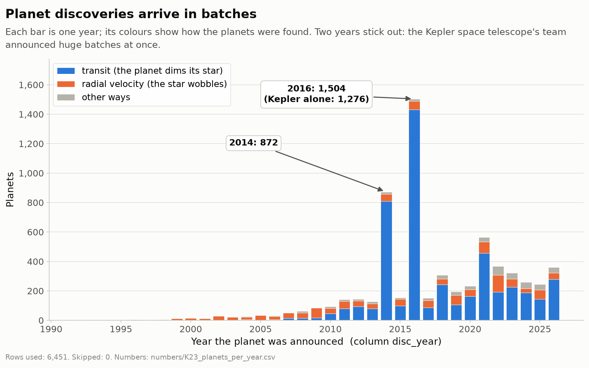

**How to read the chart**
- **Across the bottom:** the year the planet was announced.
- **Up the side:** how many planets were announced that year.
- **Colours:** blue = found by transit, orange = found by radial velocity, gray = other ways.
- **Look for:** the two very tall, mostly blue bars in 2014 and 2016.

**In short**
A teacher marks everyone's tests over many weeks, then hands them all back on the same day. That one day looks huge, even though the work was spread out.

**Our data shows:** two very tall years, 2014 and 2016, mostly planets found by transit.
**Scientists say (not from our data):** the Kepler team confirmed big batches of planets at once in 2014 and 2016.

**Careful:** the year is when a planet was announced, not when its star was first watched.

**Chart:** `charts/K23_planets_per_year.png` (the detailed version: `charts/BF23_planets_per_year.png`)

**Animation:** `animations/F23_planets_per_year.html` (open it in a web browser and press ▶ Play. It is also on the Findings page of the app.)

**Word box**
- transit: when a planet passes in front of its star and makes the star a tiny bit dimmer, like a moth flying past a lamp.
- radial velocity: a way to find planets: the planet's pull makes its star wobble toward and away from us, and telescopes can measure that wobble.
- Kepler: a NASA space telescope that stared at one patch of sky and found thousands of planets by transit.
- batch: a big group of things that arrive at the same time.

---

### 24. Hot Jupiters are common in the list, but hot Neptunes are rare

**The question:** Can a planet of any size live very close to its star?

**The data we used**
- File: `nasa_exoplanet_archive_confirmed_planets.csv` (see "Meet the data" for part F)
- Rows: Planets with a year length and a size: 6,050.
- Exact rule, for checking: `pl_orbper and pl_rade are not blank`
- Columns:

| Column | What it tells us | Unit | Example value (HD 209458 b) |
|---|---|---|---|
| `pl_orbper` | year length | days | 3.52 |
| `pl_rade` | size | Earths | 15.6 |
| `discoverymethod` | how it was found | words | Transit |

**The math**
1. Neptune-size means more than 2.5 and up to 6 Earths wide.
2. Neptune-size planets with a year shorter than 3 days: 70. With a year of 3 to 10 days: 449. 449 ÷ 70 = 6.4.
3. Jupiter-size planets (over 8 Earths) with a year shorter than 10 days: 764.
4. A strange flat line: 509 planets found by radial velocity have sizes from 12 to 13.5 Earths. Their sizes were worked out from their mass.

**The simple relationship**
`very close to the star + middle size → rare`

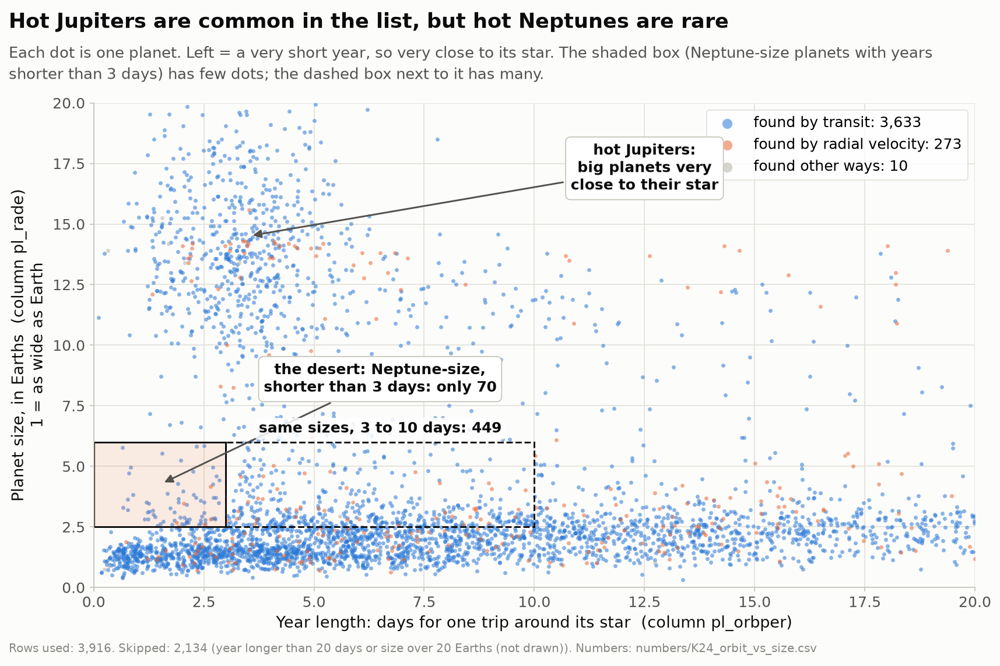

**How to read the chart**
- **Across the bottom:** year length in days. Left = a very short year, so very close to the star.
- **Up the side:** planet size, in Earths.
- **Each dot:** one planet. Blue = found by transit, orange = found by radial velocity.
- **The shaded box:** Neptune-size planets with years shorter than 3 days. **The dashed box:** the same sizes with years of 3 to 10 days.
- **Look for:** few dots in the shaded box, many in the dashed box, and a big cloud of hot Jupiters at the top left.

**In short**
Put snowballs near a campfire: the medium ones melt away, but big blocks of ice last much longer.

**Our data shows:** Neptune-size planets almost disappear on the shortest years; Jupiter-size planets don't.
**Scientists say (not from our data):** this is called the hot Neptune desert: strong starlight may strip away a middle-size planet's gas. Hot Jupiters are the easiest planets to find, so there are extra of them in the list.

**Careful:** the chart only shows planets with years up to 20 days and sizes up to 20 Earths, so it zooms in on the planets closest to their stars.

**Chart:** `charts/K24_orbit_vs_size.png` (the detailed version: `charts/BF24_orbit_vs_size.png`)

**Animation:** `animations/F24_orbit_vs_size.html` (open it in a web browser and press ▶ Play. It is also on the Findings page of the app.)

**Word box**
- transit: when a planet passes in front of its star and makes the star a tiny bit dimmer, like a moth flying past a lamp.
- radial velocity: a way to find planets: the planet's pull makes its star wobble toward and away from us, and telescopes can measure that wobble.
- Earths (planet size): planet sizes are measured against Earth: two means twice as wide as Earth.
- Neptune-size: about as big as Neptune, which is 3.9 times as wide as Earth.
- hot Jupiter: a giant planet like Jupiter that goes around its star very closely, so it is very hot.
- desert: here, an empty part of the chart where few planets are found.

---

### 25. A gap between rocky planets and gassy planets

**The question:** Are planets of every size equally common, or are some sizes missing?

**The data we used**
- File: `nasa_exoplanet_archive_confirmed_planets.csv` (see "Meet the data" for part F)
- Rows: Planets with a year shorter than 100 days and a size from 0.5 to 6 Earths: 3,982.
- Exact rule, for checking: `pl_orbper < 100 and 0.5 <= pl_rade <= 6`
- Columns:

| Column | What it tells us | Unit | Example value (Proxima Cen b) |
|---|---|---|---|
| `pl_rade` | size | Earths | 1.02 |
| `pl_orbper` | year length | days | 11.18 |

**The math**
1. We cut the sizes into 30 slices. Each slice is a little wider than the one before it, so small planets get a fair look.
2. Hump of smaller planets: 1.47 to 1.59 Earths, 233 planets.
3. The dip: 1.73 to 1.88 Earths, only 199.
4. Hump of bigger planets: 2.22 to 2.41 Earths, 347 planets.

**The simple relationship**
`small planets lose their gas → rocky; bigger ones keep it → gassy; few stay in between`

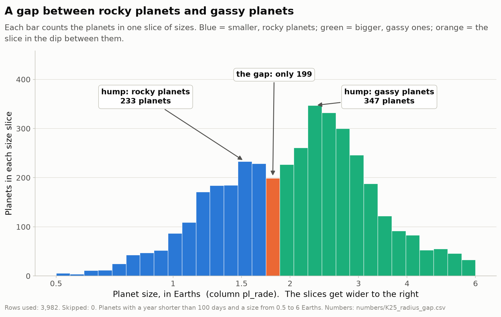

**How to read the chart**
- **Across the bottom:** planet size, in Earths. The slices get wider to the right.
- **Up the side:** how many planets are in each size slice.
- **Colours:** blue = smaller (rocky) planets, green = bigger (gassy) ones, orange = the slice in the dip.
- **Look for:** two humps with a small dip between them.

**In short**
People on a slide end up either at the bottom or still sitting at the top. Hardly anyone stays stuck halfway down.

**Our data shows:** two humps with a shallow dip between them.
**Scientists say (not from our data):** this is called the radius valley. Planets smaller than the gap are bare rock; bigger ones have thick layers of gas.

**Careful:** many sizes are worked out from mass, which blurs the dip.

**Chart:** `charts/K25_radius_gap.png` (the detailed version: `charts/BF25_radius_valley.png`)

**Animation:** `animations/F25_radius_gap.html` (open it in a web browser and press ▶ Play. It is also on the Findings page of the app.)

**Word box**
- Earths (planet size): planet sizes are measured against Earth: two means twice as wide as Earth.
- radius valley: the dip in planet sizes between rocky planets and gassy planets.

---

### 26. Planet hunters mostly look at Sun-like stars

**The question:** Do planets turn up around every kind of star?

**The data we used**
- File: `nasa_exoplanet_archive_confirmed_planets.csv` (see "Meet the data" for part F)
- Rows: Planets whose star is also in the Gaia star file, matched by ID: 2,045 planets around 1,424 stars.
- Exact rule, for checking: `gaia_source_id (read as text) == source_id in the Gaia file (read as text)`
- Columns:

| Column | What it tells us | Unit | Example value (Proxima Cen b) |
|---|---|---|---|
| `gaia_source_id` | the star's Gaia ID (planet file) | text | 5853498713190525696 |
| `source_id` | the star's Gaia ID (star file of part E) | text | 5853498713190525696 |
| `bp_rp` | colour number (star file), used to sort stars into types | a number | 3.80 |

**The math**
1. Matching the IDs as text: 2,045 planets.
2. If the IDs are turned into decimal numbers first, 57% of them change, and only 789 still match.
3. Stars with planets: yellow like the Sun (G) 28%, orange (K) 33%, red dwarfs (M) 27%.
4. All nearby stars: G 6%, K 17%, M 71%.

**The simple relationship**
`planet searches aim at Sun-like stars → planets are found there`

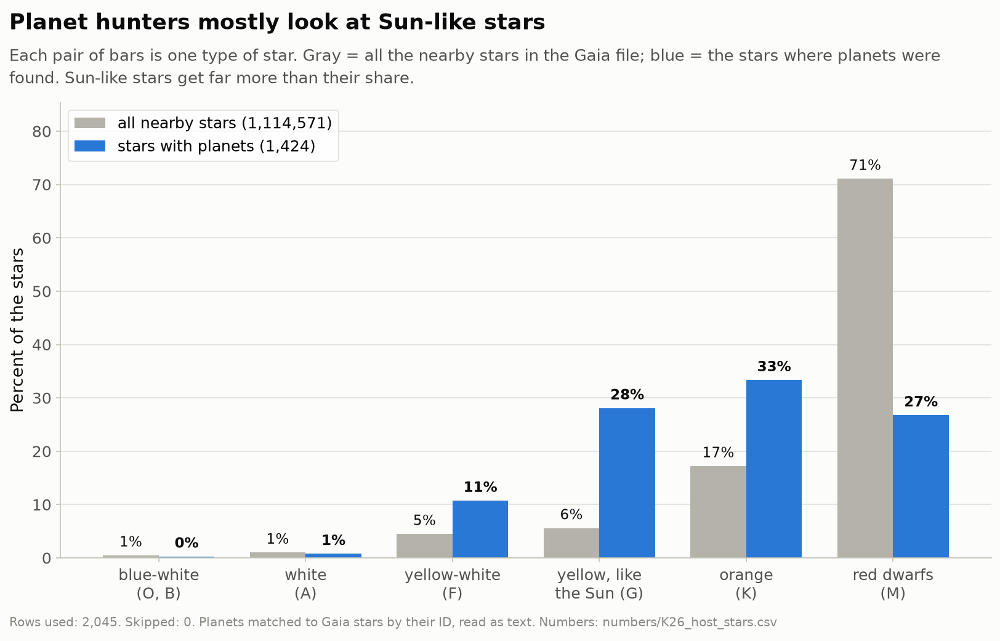

**How to read the chart**
- **Across the bottom:** six types of stars, from blue-white to red.
- **Up the side:** the percent of stars of that type.
- **Gray bars:** all nearby stars. **Blue bars:** stars where planets were found.
- **Look for:** the blue bars taller than the gray ones for Sun-like stars, and much shorter for red dwarfs.

**In short**
If you only look for your lost keys under the streetlight, every key you find will be under the streetlight.

**Our data shows:** red dwarfs are 71% of the stars but only 27% of the stars with planets.
**Scientists say (not from our data):** planet searches often pick bright, Sun-like stars on purpose.

**Careful:** a computer model that learns "which stars have planets" also learns where people looked.

Note: the guide said decimals change 73% of the IDs, leaving 555; our test gives 57% and 789 (it depends on how the IDs are turned into numbers).

**Chart:** `charts/K26_host_stars.png` (the detailed version: `charts/BF26_host_classes.png`)

**Animation:** `animations/F26_host_stars.html` (open it in a web browser and press ▶ Play. It is also on the Findings page of the app.)

**Word box**
- percent (%): out of every hundred. Half is the same as fifty percent.
- colour number: a star's colour (column `bp_rp`): a small number means blue and hot; a big number means red and cool.
- join: matching the rows of two files by a value they share, like an ID number.
- decimal number: a number a computer stores with limited precision, so very long IDs can get rounded.

---

### 27. Stars with more metal have more giant planets

**The question:** Does the star's metal have anything to do with the planets it makes?

**The data we used**
- File: `nasa_exoplanet_archive_confirmed_planets.csv` (see "Meet the data" for part F)
- Rows: Planets whose star has a metal score from just above -1.0 up to 0.6: 5,747.
- Exact rule, for checking: `-1.0 < st_met <= 0.6`
- Columns:

| Column | What it tells us | Unit | Example value (the most metal-rich group) |
|---|---|---|---|
| `st_met` | metal score of the star: zero = like the Sun | a number | 0.2 to 0.6 |
| `pl_bmasse` | planet mass, in Earths | Earths | over 95 = a giant |
| `pl_rade` | planet size, in Earths | Earths | over 6 = a giant |

**The math**
1. A giant planet is heavier than 95 Earths or wider than 6 Earths.
2. Least metal (-1.0 to -0.2): 196 giants out of 689 planets = 28%.
3. The middle groups: 23% and 32%.
4. Most metal (0.2 to 0.6): 510 giants out of 842 = 61%.

**The simple relationship**
`more metal in the star → more giant planets`

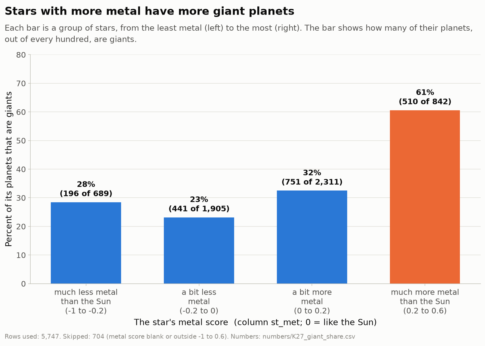

**How to read the chart**
- **Across the bottom:** four groups of stars, from the least metal (left) to the most (right).
- **Up the side:** out of every hundred planets of those stars, how many are giants.
- **The orange bar:** the most metal-rich stars.
- **Look for:** the orange bar, about twice as tall as the others.

**In short**
More Lego in the box means you can build bigger towers. Stars born with more heavy stuff had more planet-building material.

**Our data shows:** the giant share jumps to 61% for the most metal-rich stars.
**Scientists say (not from our data):** this link between metal-rich stars and giant planets is well known.

**Careful:** 699 planets have no metal score for their star, so they are left out.

Note: the guide said 33% for the third group; ours is 32% (32.5% before rounding).

**Chart:** `charts/K27_giant_share.png` (the detailed version: `charts/BF27_giant_share.png`)

**Animation:** `animations/F27_giant_share.html` (open it in a web browser and press ▶ Play. It is also on the Findings page of the app.)

**Word box**
- percent (%): out of every hundred. Half is the same as fifty percent.
- giant star: a big, bright star near the end of its life.
- Earths (planet size): planet sizes are measured against Earth: two means twice as wide as Earth.
- metal score: how much metal a star has (column `st_met`). To astronomers, "metal" means any element heavier than helium, like iron or oxygen.
- giant planet: a very big planet, like Jupiter or Saturn, made mostly of gas.

---

### 28. Earth-size planets in the "just right" zone

**The question:** Are there planets like Earth: about Earth's size and getting about Earth's starlight?

**The data we used**
- File: `nasa_exoplanet_archive_confirmed_planets.csv` (see "Meet the data" for part F)
- Rows: Earth-size planets that get Earth-like starlight: 43.
- Exact rule, for checking: `pl_rade <= 1.8 and 0.25 <= pl_insol <= 1.5`
- Columns:

| Column | What it tells us | Unit | Example value (Proxima Cen b) |
|---|---|---|---|
| `pl_rade` | size, in Earths | Earths | 1.02 |
| `pl_insol` | starlight, compared with Earth (Earth = 1) | Earths | 0.64 |
| `sy_dist` | distance | parsecs | 1.30 |

**The math**
1. Up to 1.8 Earths wide, and getting 0.25 to 1.5 times Earth's starlight: 43 planets.
2. The nearest: Proxima Cen b, at 1.30 parsecs × 3.26 = 4.2 light-years.
3. Travelling at the speed of the Voyager 1 spacecraft (17 km every second), the trip would take about 75,000 years.

**The simple relationship**
`Earth-size + Earth-like warmth → maybe "just right" for liquid water`

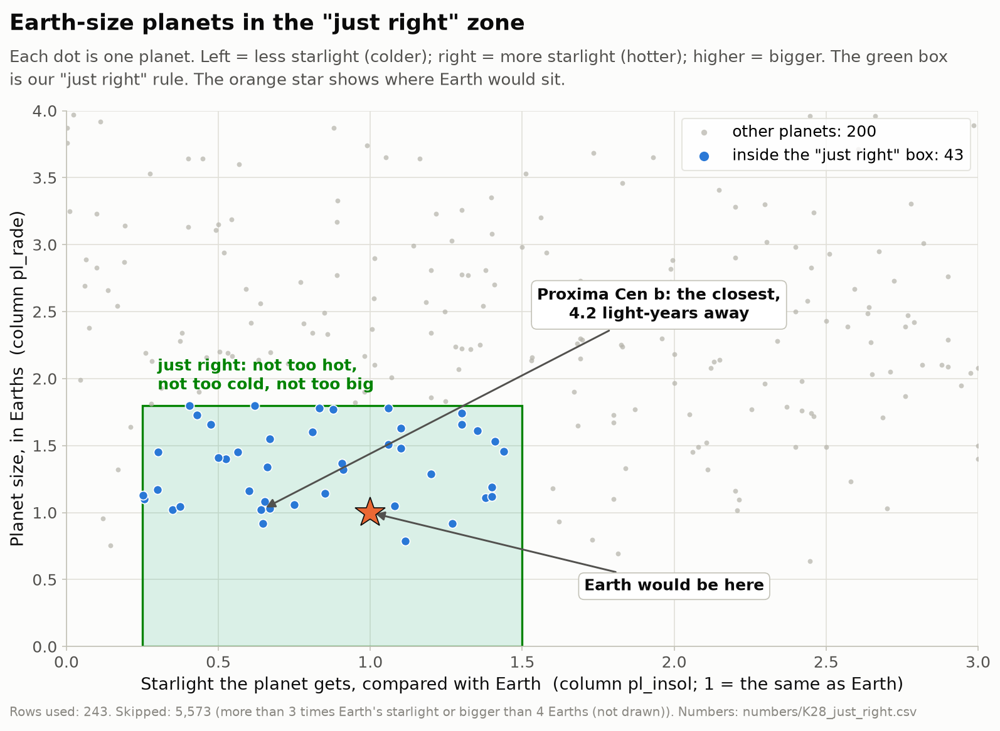

**How to read the chart**
- **Across the bottom:** how much starlight the planet gets. One = the same as Earth; left = colder, right = hotter.
- **Up the side:** planet size, in Earths.
- **The green box:** our "just right" rule. **Blue dots:** the 43 planets inside it. **The orange star:** where Earth would sit.
- **Look for:** the blue dots crowded around Earth's star, and the closest one, Proxima Cen b.

**In short**
Like Goldilocks' porridge: not too hot, not too cold, just right.

**Our data shows:** 43 planets, and 17 of them are within 10 parsecs of us.
**Scientists say (not from our data):** "just right" (the habitable zone) means water could be liquid there. It does not mean anything lives there.

**Careful:** 18 of the 43 were found by radial velocity, so their sizes are guesses worked out from their mass.

**Chart:** `charts/K28_just_right.png` (the detailed version: `charts/BF28_just_right.png`)

**Animation:** `animations/F28_just_right.html` (open it in a web browser and press ▶ Play. It is also on the Findings page of the app.)

**Word box**
- light-year: how far light travels in one year. Light is the fastest thing there is.
- parsec: another unit for star distances: one parsec is 3.26 light-years.
- habitable zone: the "just right" distance from a star: not too hot and not too cold, so water could be liquid.
- km every second: how many kilometres something travels in one second. Multiply by 3,600 to get kilometres in an hour.
- radial velocity: a way to find planets: the planet's pull makes its star wobble toward and away from us, and telescopes can measure that wobble.
- Earths (planet size): planet sizes are measured against Earth: two means twice as wide as Earth.
- Voyager 1: a NASA spacecraft that is now the farthest human-made object from Earth.

---

## Part G: Moon craters

### Meet the data: the Moon crater file

**What is this file?** A list of every crater on the Moon that is at least 1 km wide. The scientist Stuart Robbins mapped them, using pictures from NASA's Lunar Reconnaissance Orbiter, a spacecraft that circles the Moon.

**What is one row?** One row is one crater.

**How big is it?** 1,296,796 rows and 10 columns. Counting one crater every second, day and night, would take about 15.0 days. Visiting one crater a day would take about 3,550 years!

**What is this data trying to tell us?** Where have space rocks hit the Moon? How big are the holes, what shape are they, and what do they tell us about the Moon's past?

**The columns we use**

| Column (name in the file) | Nickname we use | What it tells us | How it's measured | Example (Copernicus crater) |
|---|---|---|---|---|
| `crater_id` | crater ID | the crater's ID code in the list | a code | `04-1-000623` |
| `lat` | north or south | how far north (plus) or south (minus) of the Moon's equator the crater's centre is | degrees | 9.62 |
| `lon_east` | east | how far east the centre is, going all the way round the Moon, from zero to 360 | degrees | 339.93 |
| `diameter_km` | width | how wide the crater is (the width of the circle that fits it best) | km | 93.0 |
| `ellipse_major_km` | longest width | the crater's longest width, if it is not a perfect circle | km | 94.0 |
| `ellipse_minor_km` | shortest width | the crater's shortest width | km | 91.9 |
| `ellipse_angle_deg` | direction | which way the long side points, from zero to 180 | degrees | 27.7 |
| `rim_arc_fraction` | rim left | how much of the crater's rim can still be seen: one = all of it; low = old and worn away | a number from zero to one | 0.98 |

**Let's read one row together (Copernicus crater)**
- This is Copernicus, a big young crater on the side of the Moon that faces Earth. You can see it with a small telescope. Its `crater_id` is `04-1-000623`.
- `lat` is 9.62: a little north of the Moon's equator.
- `lon_east` is 339.93. For a map we take away 360 from anything over 180: 339.93 becomes -20.07, so it is a bit west of the middle of the near side.
- `diameter_km` is 93.0: wider than many cities.
- `ellipse_major_km` is 94.0 and `ellipse_minor_km` is 91.9. 94.0 ÷ 91.9 = 1.02, so it is almost a perfect circle.
- `rim_arc_fraction` is 0.98: almost the whole rim can still be seen, because Copernicus is young.

**Watch out for:** `lon_east` goes all the way round, from zero to 360. To draw a map, we change it to go from minus 180 (west) to plus 180 (east). Craters narrower than 1 km are not in the list. The README says 3 craters appear twice under different IDs. Only 152 cells in the whole file are blank.

**Word box**
- crater: a bowl-shaped hole made when a space rock smashes into the ground.
- degree: a small slice of a circle. A full turn is 360 degrees.
- equator: the imaginary line around the middle of a planet or moon, halfway between the north and south poles.
- near side: the half of the Moon that always faces Earth. The Moon turns so that we always see the same side.
- Lunar Reconnaissance Orbiter: a NASA spacecraft that circles the Moon and photographs its whole surface.
- rim: the raised edge around a crater.

---

### 29. The craters draw the Moon's dark "seas"

**The question:** Are the craters spread evenly over the whole Moon?

**The data we used**
- File: `moon_craters_robbins_lro_1.3M.csv` (see "Meet the data" for part G)
- Rows: Craters 5 km and wider: 83,061.
- Exact rule, for checking: `diameter_km >= 5`
- Columns:

| Column | What it tells us | Unit | Example value (one crater) |
|---|---|---|---|
| `lat` | north or south | degrees | -22.2 |
| `lon_east` | east, all the way round from 0 to 360 | degrees | 300.0 |
| `diameter_km` | width | km | 2.72 |

**The math**
1. We change `lon_east` to go from minus 180 to 180: take away 360 from anything over 180 (300.0 becomes -60.0).
2. The near side is everything within 90 degrees of zero (it faces Earth). The rest is the far side.
3. Craters 5 km and wider: 55,586 on the far side, 27,475 on the near side. 55,586 ÷ 27,475 = 2.0.
4. Craters 1 km and wider: 736,618 against 560,178. Craters 20 km and wider: 4,161 against 2,812.

**The simple relationship**
`lava floods → old craters buried → fewer craters on the dark "seas"`

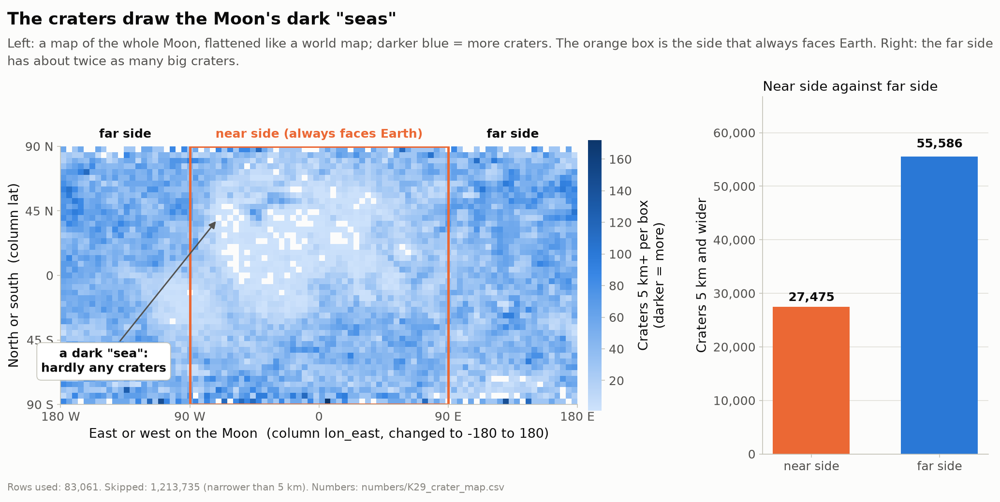

**How to read the chart**
- **Left, the map:** the whole Moon flattened like a world map. Across the bottom is east or west; up the side is north or south.
- **Colours:** each little box is coloured by how many craters 5 km and wider it has, made fair for the box's size. Darker blue = more craters.
- **The orange box:** the near side, which always faces Earth. **Right:** the craters on each side.
- **Look for:** the pale patches inside the orange box (the dark "seas"), and the far-side bar about twice as tall.

**In short**
Imagine a dented car that got a thick coat of paint on one side: the dents on that side got filled in. On the Moon, lava was the paint.

**Our data shows:** the far side has 2.0 times as many big craters, and the near side has big pale patches with few craters.
**Scientists say (not from our data):** the dark "seas" (maria) are younger lava floods that buried older craters. They are the dark patches you can see on the Moon with your own eyes.

**Careful:** the pattern is clearest for craters 5 km and wider; tiny craters can form on top of the seas later.

**Chart:** `charts/K29_crater_map.png` (the detailed version: `charts/BF29_crater_map.png`)

**Animation:** `animations/F29_crater_map.html` (open it in a web browser and press ▶ Play. It is also on the Findings page of the app.)

**Word box**
- crater: a bowl-shaped hole made when a space rock smashes into the ground.
- degree: a small slice of a circle. A full turn is 360 degrees.
- near side: the half of the Moon that always faces Earth. The Moon turns so that we always see the same side.
- far side: the half of the Moon that always faces away from Earth. People only saw it when spacecraft flew around the Moon.
- dark "seas": the Moon's dark, smooth patches. They are not water: they are old lava that flooded low ground. Scientists call them maria.
- lava: melted rock that comes up from inside a planet or moon and then cools into hard rock.

---

### 30. Ten times wider, about 50 to 100 times rarer

**The question:** Are big craters as common as small ones?

**The data we used**
- File: `moon_craters_robbins_lro_1.3M.csv` (see "Meet the data" for part G)
- Rows: All the craters (each one 1 km or wider): 1,296,796.
- Exact rule, for checking: `all rows`
- Columns:

| Column | What it tells us | Unit | Example value (the biggest) |
|---|---|---|---|
| `diameter_km` | width | km | 2,492 |

**The math**
1. At least 1 km wide: 1,296,796. At least 10 km: 24,412. At least 100 km: 314. At least 1,000 km: only 3.
2. 1,296,796 ÷ 24,412 = 53.
3. 24,412 ÷ 314 = 78.
4. 314 ÷ 3 = 105.

**The simple relationship**
`10 times wider → about 53 to 105 times rarer`

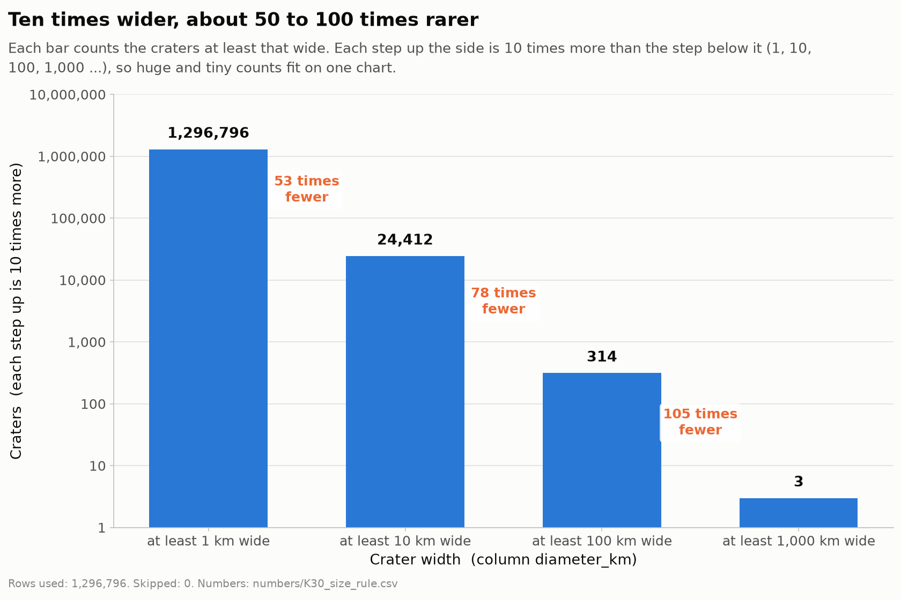

**How to read the chart**
- **Across the bottom:** four groups: craters at least 1, 10, 100 and 1,000 km wide.
- **Up the side:** how many craters are in each group. Each step up the side is 10 times the step below it, so the huge count and the tiny count fit on one chart.
- **Orange labels:** how many times fewer each group has than the one before.
- **Look for:** the steady staircase going down.

**In short**
Think of rain: lots of tiny drops, fewer big drops, and once in a while a giant hailstone.

**Our data shows:** a steady rule. The middle crater is only 1.6 km wide; the biggest is 2,492 km wide, about 72% of the Moon's whole width.
**Scientists say (not from our data):** this kind of steady rule is called a power law: small space rocks are far more common than big ones.

**Careful:** below about 2 km, craters get worn away or missed, so the count of tiny craters is too low.

**Chart:** `charts/K30_size_rule.png` (the detailed version: `charts/BF30_size_rule.png`)

**Animation:** `animations/F30_size_rule.html` (open it in a web browser and press ▶ Play. It is also on the Findings page of the app.)

**Word box**
- percent (%): out of every hundred. Half is the same as fifty percent.
- crater: a bowl-shaped hole made when a space rock smashes into the ground.
- giant star: a big, bright star near the end of its life.
- power law: a rule where each step up in size makes things rarer by about the same number of times.

---

### 31. Most craters are nearly round, and the stretched ones lean one way

**The question:** Are craters always round?

**The data we used**
- File: `moon_craters_robbins_lro_1.3M.csv` (see "Meet the data" for part G)
- Rows: Stretched craters: longest width more than 1.5 times the shortest, and at least 3 km wide: 4,853.
- Exact rule, for checking: `ellipse_major_km / ellipse_minor_km > 1.5 and diameter_km >= 3`
- Columns:

| Column | What it tells us | Unit | Example value (a stretched crater) |
|---|---|---|---|
| `ellipse_major_km` | longest width | km | 1.75 |
| `ellipse_minor_km` | shortest width | km | 1.17 |
| `ellipse_angle_deg` | which way the long side points | degrees | 91.5 |

**The math**
1. Stretch = longest width ÷ shortest width. Our example: 1.75 ÷ 1.17 = 1.50.
2. The middle stretch of all craters is 1.12: only 12% longer than wide.
3. Stretched more than 1.5: 2.1% of craters. More than 2: only 0.22%.
4. Of the stretched ones, 1,935 point between 60 and 105 degrees. That's 40%, but an even spread would give 25%. Only 456 point between 0 and 30.

**The simple relationship**
`rock hits at a shallow angle → stretched crater; stretched craters lean one way`

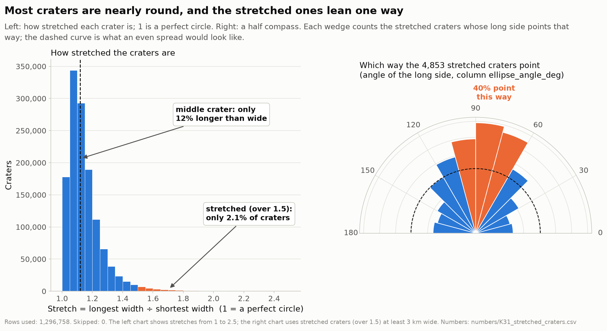

**How to read the chart**
- **Left, across the bottom:** the stretch. One = a perfect circle. **Up the side:** how many craters.
- **Orange bars (left):** the stretched craters, over 1.5. **Dashed line:** the middle crater.
- **Right, a half compass:** each wedge counts the stretched craters whose long side points that way. Longer wedge = more craters. The dashed curve is an even spread.
- **Look for:** the tall pile near one on the left, and the orange wedges (between 60 and 105 degrees) sticking out on the right.

**In short**
Drop a ball of clay straight down and you get a round dent. Throw it at a low angle and you get a long dent.

**Our data shows:** most craters are nearly round; the stretched ones lean toward 60 to 105 degrees.
**Scientists say (not from our data):** rocks that hit at a very shallow angle, and chains of rocks thrown out by a bigger impact, make stretched craters. Guess (not checked): part of the lean may come from how the ovals were fitted to the pictures.

**Careful:** the direction is the file's angle, from zero to 180 degrees. We did not check which compass direction zero means.

**Chart:** `charts/K31_stretched_craters.png` (the detailed version: `charts/BF31_stretched_angles.png`)

**Animation:** `animations/F31_stretched_craters.html` (open it in a web browser and press ▶ Play. It is also on the Findings page of the app.)

**Word box**
- percent (%): out of every hundred. Half is the same as fifty percent.
- crater: a bowl-shaped hole made when a space rock smashes into the ground.
- degree: a small slice of a circle. A full turn is 360 degrees.
- oval: a stretched circle, like an egg seen from the side. Scientists call it an ellipse.
- stretch (of a crater): how long a crater is compared with how wide: longest width ÷ shortest width. One is a perfect circle.

---

### 32. More craters per square kilometre toward the poles

**The question:** Are there more craters near the Moon's poles or near its equator?

**The data we used**
- File: `moon_craters_robbins_lro_1.3M.csv` (see "Meet the data" for part G)
- Rows: All the craters, sorted into bands 10 degrees tall from the south pole to the north pole: 1,296,796.
- Exact rule, for checking: `band = floor(lat / 10)`
- Columns:

| Column | What it tells us | Unit | Example value (the north pole band) |
|---|---|---|---|
| `lat` | north (plus) or south (minus) | degrees | 80 to 90 |

**The math**
1. Bands of the same height are not the same size: near a pole, the band is a tiny cap. So we divide each band's count by its area.
2. The band from 80 to 90 degrees north has an area of 0.015, against 0.174 for 0 to 10 degrees north. It is 11.4 times smaller.
3. Counts: 24,381 against 89,510. Per area, the north pole band has 3.0 times as many craters as the equator; the south pole band 1.8 times.
4. Beyond 80 degrees: 24,381 craters in the north, 14,406 in the south.

**The simple relationship**
`near the poles → low sun → long shadows → small craters easier to spot`

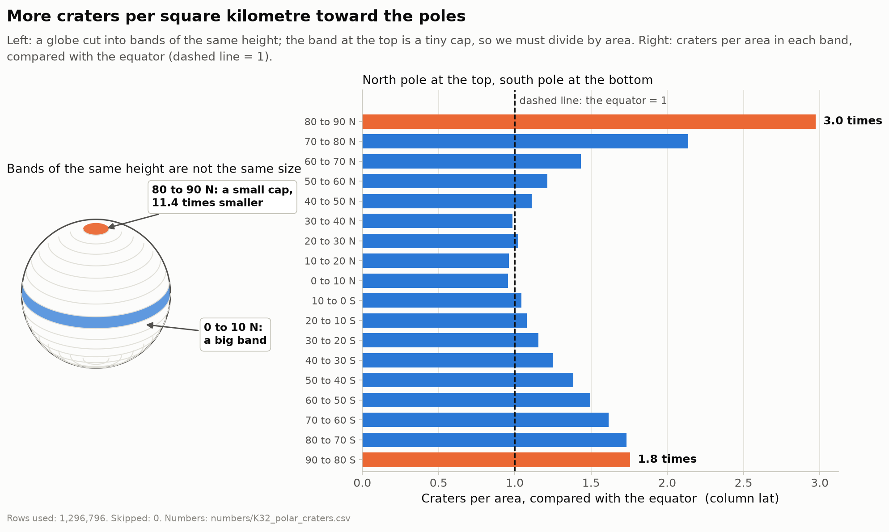

**How to read the chart**
- **Left:** a globe cut into bands of the same height. The blue band near the equator is big; the orange cap at the top is tiny.
- **Right, up the side:** the bands, with the north pole at the top and the south pole at the bottom.
- **Across the bottom:** craters per area, compared with the equator. The dashed line is the equator's value, one.
- **Look for:** the bars getting longer toward both poles, and the orange polar bars sticking out the most.

**In short**
Look at footprints in snow at sunset: the low sunlight makes long shadows, so every little dent shows up.

**Our data shows:** more craters per area toward both poles, and more in the north than in the south.
**Scientists say (not from our data):** part of this may come from the mapping: long shadows near the poles make small craters easier to see. The biggest crater within 1.5 degrees of the south pole is 38 km wide; Shackleton crater (21 km here) sits right at the south pole.

**Careful:** always divide by area when you compare bands of a globe.

**Chart:** `charts/K32_polar_craters.png` (the detailed version: `charts/BF32_polar_bands.png`)

**Animation:** `animations/F32_polar_craters.html` (open it in a web browser and press ▶ Play. It is also on the Findings page of the app.)

**Word box**
- crater: a bowl-shaped hole made when a space rock smashes into the ground.
- degree: a small slice of a circle. A full turn is 360 degrees.
- equator: the imaginary line around the middle of a planet or moon, halfway between the north and south poles.
- pole: the very top (north) or very bottom (south) point of a planet or moon.
- per square kilometre: for each square of ground one kilometre long and one kilometre wide.
- area: how much surface something covers.

---

## Master word list (A to Z)

- **arcsecond**: a tiny angle: about the width of a coin seen from 4 km away. There are 3,600 arcseconds in one degree.
- **area**: how much surface something covers.
- **asteroid**: a rocky lump, much smaller than a planet, that travels around the Sun.
- **asteroid belt**: the ring of rocks between Mars and Jupiter.
- **average**: add all the values up, then divide by how many there are.
- **balance point**: a spot where a small object can ride along with a planet without being pulled away. Scientists call it a Lagrange point.
- **batch**: a big group of things that arrive at the same time.
- **brightness number (H)**: how bright an asteroid would look from a set distance. Smaller means brighter, and brighter means bigger. Scientists call it absolute magnitude.
- **Bz**: the north-south direction of the magnetic field carried by the solar wind. When it points south (a minus number), it links up with Earth's field and lets storm energy in, like opening a door.
- **carbon**: the stuff that coal, charcoal and pencil lead are made of.
- **closed loop**: a path that goes round and round the Sun. An open path swings past the Sun once and never comes back.
- **code**: a few letters that stand for something longer, like `MBA` for main belt asteroid.
- **colour number**: a star's colour (column `bp_rp`): a small number means blue and hot; a big number means red and cool.
- **column**: one list going down a table. Each column holds one kind of fact, like the width.
- **comet**: an icy lump that travels around the Sun. Near the Sun it heats up and grows a glowing tail.
- **confirmed**: checked carefully, so scientists are sure the planet is really there.
- **coronal hole**: a darker, cooler patch in the Sun's outer layer, where fast wind escapes.
- **crater**: a bowl-shaped hole made when a space rock smashes into the ground.
- **cycle**: something that repeats over and over, like the seasons.
- **dark "seas"**: the Moon's dark, smooth patches. They are not water: they are old lava that flooded low ground. Scientists call them maria.
- **dark hours**: here, 21:00 to 04:00 Toronto time, when the sky is dark enough to see northern lights.
- **dawn**: early morning, when the Sun comes up.
- **DBSCAN**: a computer method that finds crowded spots: points with many close neighbours become a group.
- **decade**: ten years in a row.
- **decimal number**: a number a computer stores with limited precision, so very long IDs can get rounded.
- **degree**: a small slice of a circle. A full turn is 360 degrees.
- **density**: how crowded something is: how many tiny bits are packed into one space.
- **desert**: here, an empty part of the chart where few planets are found.
- **dome**: the round roof over a big telescope. It opens at night and closes when it rains.
- **Earth-Sun distance (AU)**: our space ruler for the Solar System: the distance from the Sun to Earth, about 150 million km. Scientists write it as AU. A car driving at 100 km an hour, day and night, would need about 171 years to cover it.
- **Earths (planet size)**: planet sizes are measured against Earth: two means twice as wide as Earth.
- **equator**: the imaginary line around the middle of a planet or moon, halfway between the north and south poles.
- **equinox**: one of the two days each year, in late March and late September, when day and night are about the same length everywhere on Earth.
- **escape**: to move so fast that gravity can't pull you back.
- **exoplanet**: a planet that goes around a star other than our Sun.
- **fair share**: what each part would get if things were shared out evenly by size.
- **far side**: the half of the Moon that always faces away from Earth. People only saw it when spacecraft flew around the Moon.
- **fireball**: a very bright shooting star: a space rock that burns and explodes high in the air.
- **first sighting**: the earliest photo of an object that was used to work out its path (column `first_obs`).
- **forecast**: a prediction, like a weather forecast.
- **Gaia**: a European space telescope that measures the positions and movements of stars very precisely.
- **galaxy**: a giant family of stars held together by gravity. Ours is the Milky Way.
- **giant planet**: a very big planet, like Jupiter or Saturn, made mostly of gas.
- **giant star**: a big, bright star near the end of its life.
- **gravity**: the pull every object has on every other object. Bigger, heavier things pull harder.
- **habitable zone**: the "just right" distance from a star: not too hot and not too cold, so water could be liquid.
- **halo**: the thin cloud of old stars around our galaxy's flat disc.
- **Hiroshima bomb**: the atomic bomb dropped on the city of Hiroshima, Japan, near the end of World War Two.
- **hot Jupiter**: a giant planet like Jupiter that goes around its star very closely, so it is very hot.
- **Hungaria family**: a group of very shiny asteroids at the inner edge of the asteroid belt.
- **join**: matching the rows of two files by a value they share, like an ID number.
- **joule**: the scientists' unit for energy.
- **JPL**: NASA's Jet Propulsion Laboratory in California. It keeps track of asteroids and comets.
- **Kepler**: a NASA space telescope that stared at one patch of sky and found thousands of planets by transit.
- **kiloton**: the energy of 1,000 tonnes of TNT explosive going off at once.
- **Kirkwood gap**: an empty lane in the asteroid belt, cleared by Jupiter's pulls.
- **km every second**: how many kilometres something travels in one second. Multiply by 3,600 to get kilometres in an hour.
- **Kuiper belt**: a ring of icy objects beyond Neptune. Pluto lives there.
- **Large Magellanic Cloud**: a small galaxy that circles our Milky Way. You can see it from the southern half of Earth.
- **latitude**: how far north or south a place is, in degrees. The equator is zero.
- **lava**: melted rock that comes up from inside a planet or moon and then cools into hard rock.
- **light-year**: how far light travels in one year. Light is the fastest thing there is.
- **lined up**: moved in time so that every storm's lowest point sits at the same spot on the chart.
- **longitude**: how far east or west a place is, in degrees.
- **Lunar Reconnaissance Orbiter**: a NASA spacecraft that circles the Moon and photographs its whole surface.
- **magnetic bubble**: the space around Earth that Earth's magnetic field controls. It shields us from most of the solar wind. Scientists call it the magnetosphere.
- **magnetic field**: the invisible push and pull around a magnet. Earth and the Sun both have one.
- **magnetic storm**: a storm in Earth's magnetic field, set off by the Sun. Scientists call it a geomagnetic storm.
- **main band**: the long band on the colour-brightness chart where most stars, like the Sun, spend most of their lives. Scientists call it the main sequence.
- **mass**: how much stuff something is made of. On Earth, more mass means heavier.
- **match score (correlation)**: a number that says how well two lists of numbers go up and down together. One means a perfect match; zero means no match at all.
- **metal score**: how much metal a star has (column `st_met`). To astronomers, "metal" means any element heavier than helium, like iron or oxygen.
- **meteorite**: a space rock that reaches the ground.
- **middle value (median)**: line all the values up from smallest to biggest and pick the one in the middle. Scientists call it the median. One giant value can't pull it up the way it pulls up an average.
- **Milky Way**: our home galaxy. From Earth it looks like a cloudy band of light across the night sky.
- **moid**: the smallest gap between an asteroid's path and Earth's path. It is about the paths, not about where the rock is today. The letters stand for "minimum orbit intersection distance".
- **Moon distance**: the distance from Earth to the Moon, 384,400 km. A car driving at 100 km an hour, day and night, would need about 160 days to cover it.
- **nanopascal**: a very tiny unit for how hard something pushes.
- **nanotesla**: a very tiny unit for how strong a magnetic field is.
- **near side**: the half of the Moon that always faces Earth. The Moon turns so that we always see the same side.
- **near-Earth**: an asteroid or comet whose path around the Sun comes close to Earth's path.
- **Neptune-size**: about as big as Neptune, which is 3.9 times as wide as Earth.
- **northern lights (aurora)**: glowing curtains of green and red light in the night sky, made when a solar storm hits Earth's magnetic field.
- **oval**: a stretched circle, like an egg seen from the side. Scientists call it an ellipse.
- **parallax**: the tiny shift in a star's position as Earth goes around the Sun. Hold up a finger and close one eye, then the other: the finger jumps. Closer stars jump more, so the jump tells us the distance.
- **parsec**: another unit for star distances: one parsec is 3.26 light-years.
- **pass**: one time an object flies by Earth.
- **per square kilometre**: for each square of ground one kilometre long and one kilometre wide.
- **percent (%)**: out of every hundred. Half is the same as fifty percent.
- **Pleiades**: a famous little cluster of stars in the winter sky, also called the Seven Sisters.
- **Plutino**: "little Pluto": an object with Pluto's rhythm, two trips around the Sun for every three of Neptune's.
- **pole**: the very top (north) or very bottom (south) point of a planet or moon.
- **potentially hazardous**: could possibly be dangerous one day, so it is worth watching.
- **power law**: a rule where each step up in size makes things rarer by about the same number of times.
- **prediction**: a careful guess about the future, worked out with math.
- **pressure**: how hard something pushes on whatever is in its way.
- **radial velocity**: a way to find planets: the planet's pull makes its star wobble toward and away from us, and telescopes can measure that wobble.
- **radius**: the distance from the centre of a ball to its outside: half of its width.
- **radius valley**: the dip in planet sizes between rocky planets and gassy planets.
- **red dwarf**: a small, cool, dim, red star. The most common kind of star.
- **rhythm**: a pattern that repeats in time, like the beat in a song.
- **rim**: the raised edge around a crater.
- **row**: one line across a table. Here, one row is one asteroid or comet.
- **rubble pile**: a loose heap of rocks held together only by gravity.
- **satellite**: a machine that circles Earth in space.
- **sensor**: a machine that notices things, like a flash of light.
- **shifted**: slid along, so each day lines up with a later day.
- **shininess (albedo)**: how much sunlight a surface bounces back, from zero (pitch black) to one (all of it). Coal is close to zero; fresh snow is close to one. Scientists call it albedo.
- **solar wind**: a wind of tiny bits of electrically charged gas that blows out from the Sun all the time.
- **space station**: the International Space Station, where astronauts live as it circles Earth.
- **spacecraft**: a machine that travels or works in space.
- **spin time**: how long one full turn takes (column `rot_per`), like Earth's day.
- **storm meter**: a number that shows how hard a solar storm is shaking Earth's magnetic field. Near zero is calm; the more negative, the bigger the storm. Scientists call it SYM-H.
- **stretch (of a crater)**: how long a crater is compared with how wide: longest width ÷ shortest width. One is a perfect circle.
- **stretch number (e)**: how stretched a path around the Sun is. Zero is a perfect circle; close to one is a long, thin oval; one or more means the path is not a closed loop, so the object flies off and never comes back. Scientists call it eccentricity.
- **sugar cube**: a small cube of sugar; a cubic centimetre is a bit smaller than one.
- **Sun time**: the time of day set by the Sun: noon is when the Sun is highest. It changes as you go east or west.
- **sunspot**: a dark, cooler patch on the Sun. More sunspots mean a busier, stormier Sun.
- **superstorm**: an extremely strong magnetic storm, the kind that happens only every few decades.
- **swarm**: a big crowd of things moving together, like bees.
- **TNT**: a strong explosive. Scientists use it as a ruler for the size of explosions.
- **Toronto time**: the clock time in Toronto, Ontario. It is 5 hours behind world time in winter and 4 hours behind in summer.
- **transit**: when a planet passes in front of its star and makes the star a tiny bit dimmer, like a moth flying past a lamp.
- **Trojan asteroid**: a rock that shares Jupiter's path, ahead of it or behind it.
- **true brightness**: how bright a star would look if all stars were the same distance away (column `abs_g_mag`). Smaller means brighter.
- **Vera C. Rubin Observatory**: a new, very big telescope in Chile that photographs the whole southern sky every few nights.
- **Voyager 1**: a NASA spacecraft that is now the farthest human-made object from Earth.
- **white dwarf**: the small, hot leftover core of a dead star, about as big as Earth.
- **wobble score**: how well Gaia's measurement fits one simple star (column `ruwe`). Over 1.4 means the measurement is suspicious.
- **world time (UTC)**: one clock that scientists everywhere share, so readings from different countries line up. Every time in these files is in world time.
- **Y and N**: the file's short way of writing yes and no.
- **zone**: a range of distances that we compare with the other ranges.
