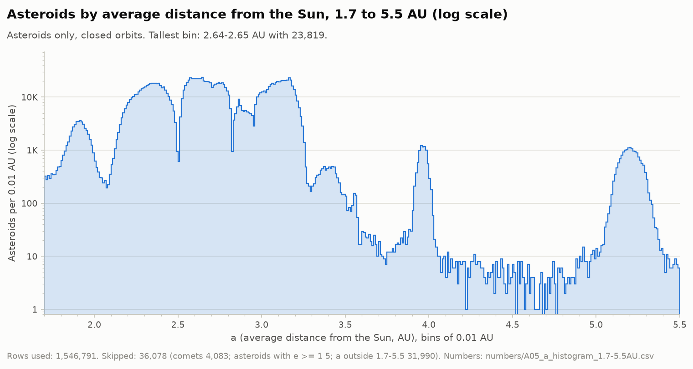
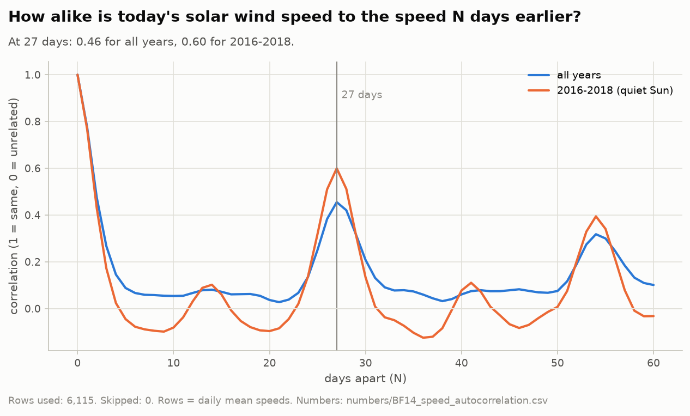
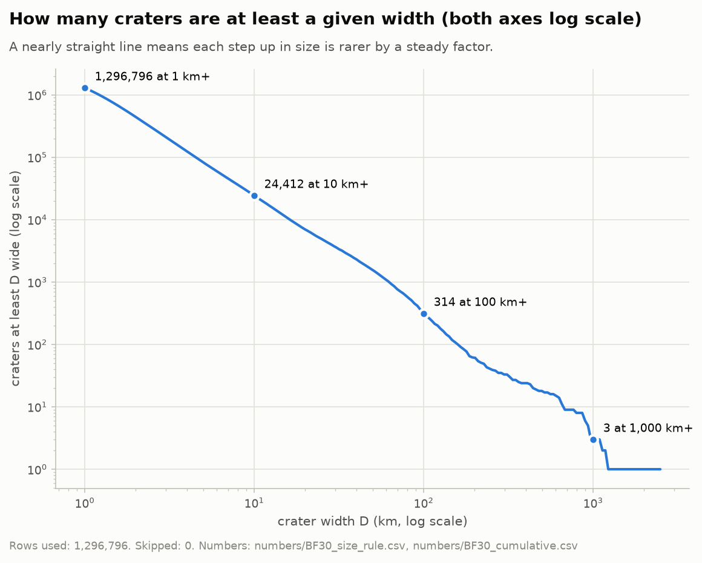

# NASA Beyond Earth

**Thirty-two small results from seven public NASA data sets**

Sheridan Datathon 2026, NASA track. Last revised November 2026.

```
Contents
   0  Abstract
   1  The data
   2  How a number gets from a CSV file to the screen
   3  The math explained in very simple English
   4  Results
   5  Forecasts
   6  Figures
   7  Running it
   8  Caveats
   9  Files
      References
```

## 0. Abstract

We looked at seven public data files from NASA and JPL: 1,582,869 asteroids and comets,
120,071 close passes by Earth, 1,074 fireballs,
1,766,880 five-minute readings of the solar wind and Earth's magnetic field
(2010-01-01 to 2026-10-18), 1,165,165 nearby stars from Gaia,
6,451 confirmed planets around other stars, and 1,296,796 craters on the Moon.
From these we pulled out 32 results. Most of them are old physics showing up in new numbers: Kepler's third law,
Jupiter's resonances, the 27-day turn of the Sun. Some are about the data itself: where it has holes, and why a count
can say more about who was looking, and when, than about what is out there.

Every number that comes from the data, in this note, in `FINDINGS.md` and in the app, is computed by a script and
stored in `numbers/`. None of them is typed by hand.

## 1. The data

| part | file | from | rows | columns | MB |
|---|---|---|---|---|---|
| A | `jpl_small_bodies_asteroids_comets.csv` | JPL Small-Body Database | 1,582,869 | 29 | 256.8 |
| B | `extras_close_approaches_1900-2200.csv` | JPL CNEOS close approaches | 120,071 | 14 | 19.8 |
| C | `extras_fireballs.csv` | JPL CNEOS fireballs | 1,074 | 9 | 0.1 |
| D | `nasa_omni_solar_wind_storms_5min_2010-2026.csv` | NASA OMNIWeb, 5-minute values | 1,766,880 | 14 | 138.7 |
| E | `gaia_dr3_stars_within_500_light_years.csv` | ESA Gaia DR3 | 1,165,165 | 21 | 314.4 |
| F | `nasa_exoplanet_archive_confirmed_planets.csv` | NASA Exoplanet Archive | 6,451 | 25 | 1.4 |
| G | `moon_craters_robbins_lro_1.3M.csv` | Robbins lunar crater database | 1,296,796 | 10 | 102.0 |

The CSV files add up to about 833 MB, so they are not in this repository (see section 6).

## 2. How a number gets from a CSV file to the screen

```
  NASA CSV files           notebooks/BF_*.py               numbers/*.csv
  (not in git)   ------->  one script per part    ------>  key, value, shown, unit, source
                                 |                               |
                                 v                               v
                            charts/*.png            make_findings.py    -->  FINDINGS.md
                                                    make_space_anims.py -->  animations/*.html
                                                    make_readme.py      -->  README.md
                                                    app.py (Streamlit) reads all of the above
```

A number exists once, as one row of a table in `numbers/`. For example, from `numbers/BF01_asteroid_belt_lanes.csv`:

```
key,value,shown,unit,source
gap_count,8659.0,"8,659",,our data
```

The text is written with placeholders such as `{gap_count}` and the scripts fill them in. After that,
`notebooks/check_findings_numbers.py` reads `FINDINGS.md` back and stops if it finds a number that is not in
`numbers/`. This README goes through the same check.

## 3. The math explained in very simple English

First, don't worry about all the equations. They are just tools scientists use to understand space.

This section explains how we used math to check what is happening with asteroids, planets, stars, the Sun and
craters. Each part is explained with simple examples, and its title says which findings use it.

### 3.1 Jupiter's gravity creates empty spaces between asteroids (findings 1 and 5)

**What is this about?**

Asteroids travel around the Sun, just like Earth does. But they don't all travel at the same speed. Some take a
short time to complete one trip around the Sun. Others take much longer.

There is a rule called Kepler's third law:

$$P^2 = a^3$$

You don't need to memorize it. It simply tells us:

* $P$ = how long an object takes to go around the Sun (in years).
* $a$ = how far the object is from the Sun (in AU).
* The farther away an object is, the longer its trip takes.

Now, what does Jupiter have to do with this? Imagine an asteroid going around the Sun. Every time Jupiter and that
asteroid meet at the same positions, Jupiter's gravity can pull on the asteroid. If this keeps happening again and
again, Jupiter can slowly push the asteroid away from that area.

Think of pushing a swing at the same time during every movement. The pushes can make the swing move more and more.

This creates empty spaces where fewer asteroids are found. Scientists call this an orbital resonance.

**What did we find?**

We used Jupiter's distance from the Sun (5.20 AU) to calculate where these empty
spaces should be. A 3:1 pattern means the asteroid goes around the Sun 3 times while Jupiter goes around once.

| Asteroid orbit pattern | Math prediction | Actual empty space |
|---|---|---|
| 3:1 | 2.50 AU | 2.50 AU |
| 5:2 | 2.83 AU | 2.82 AU |
| 7:3 | 2.96 AU | 2.95 AU |
| 2:1 | 3.28 AU | 3.29 AU |

AU means the average distance between Earth and the Sun. Look at the table. The predicted locations and the actual
empty spaces are almost the same.

**What about Neptune?**

Neptune is much farther away from the Sun than Jupiter. Some objects beyond Neptune move in a special pattern:

* Neptune completes 3 trips around the Sun.
* The other object completes 2 trips.

This repeating pattern helps protect those objects from getting too close to Neptune. The same math says it happens
at 39.4 AU from the Sun. We found 586 objects in this area, between
39.2 and 39.7 AU. There were about
3.6 times more objects there than in the nearby areas.

**The main idea:** Jupiter's gravity creates empty spaces between asteroids. Neptune's gravity also helps create
special areas where objects can stay safely.

### 3.2 Finding the size of asteroids using brightness (findings 2, 3 and 7)

**What is this about?**

Most asteroids are too far away for scientists to measure their actual size directly. But scientists can measure
how bright they look. This gives them a way to estimate their size.

Think about two rocks:

* A small, shiny rock can look bright.
* A large, dark rock can look equally bright.

So brightness alone cannot tell us the exact size. Scientists also need to guess how much sunlight the asteroid's
surface reflects. This is called albedo.

* High albedo = reflects lots of sunlight.
* Low albedo = reflects little sunlight.

They use this formula:

$$D = \frac{1329}{\sqrt{p_V}} \times 10^{-H/5}$$

You only need to understand these letters:

* $D$ = estimated asteroid diameter, in kilometres.
* $H$ = how bright the asteroid is. A bigger number means fainter.
* $p_V$ = how much sunlight the asteroid reflects.

**What did we find?**

We used an average reflectiveness of 0.14. For an asteroid with an $H$ value of
22, the estimated size is about 141 metres wide.

This is important because scientists use two rules to identify potentially hazardous asteroids:

1. The asteroid has an $H$ value of 22 or lower.
2. Its orbit comes within 0.05 AU of Earth's orbit.

MOID means Minimum Orbit Intersection Distance. In simple words, it tells us how close the asteroid's path can come
to Earth's path.

Out of 2,550 asteroids marked as potentially hazardous, 2,517 passed
both rules. That is 98.7%.

**The main idea:** Scientists can estimate how big an asteroid is by looking at its brightness and guessing how
reflective its surface is.

### 3.3 Why some asteroids cannot spin too fast (finding 3)

**What is this about?**

Imagine a pile of small rocks. There is no glue holding them together. Gravity is the only thing keeping them in one
pile. Now imagine spinning that pile faster and faster. At some point, the spinning becomes so fast that the rocks
start flying away.

This is similar to what can happen to asteroids. Scientists call this the spin barrier. For an asteroid made of
loose rock, there is a limit to how fast it can spin before it breaks apart. For a typical rocky asteroid, that limit
is around 2.2 hours for one full rotation (Pravec and Harris 2000). In other words, a loose
pile of rock spinning once every 2.2 hours is close to its breaking point.

**What did we find?**

We looked at 33,616 asteroids wider than 300 metres whose spin has been
measured. Only 1,236 of them spun faster than this limit. That is just
3.7%.

But many small asteroids spin much faster. Of the 655 small ones in our data (narrower than
150 metres), 524 spin faster than this limit. That is
80%.

Why? Because small asteroids can be solid rocks. They are not always just loose piles of stones. Solid rocks can
hold together better while spinning.

**The main idea:** Big asteroids are often loose piles of rocks, so they cannot spin too fast. Small asteroids can
sometimes be solid and spin much faster.

### 3.4 Why Jupiter has two groups of asteroids (finding 6)

**What is this about?**

Jupiter has two large groups of asteroids called Trojan asteroids. One group travels ahead of Jupiter. The other
group travels behind Jupiter. They stay in special positions because of the gravity of the Sun and Jupiter.

Imagine three people standing at the corners of an equilateral triangle:

* One person represents the Sun.
* One represents Jupiter.
* The third represents an asteroid group.

The two asteroid groups sit about 60 degrees ahead of and behind Jupiter. The angle
between the two groups is 120 degrees.

Scientists use something called mean longitude to calculate where an asteroid is along its orbit. The formula is:

$$L = \Omega + \omega + M$$

Don't worry about the three letters. They are simply three angles that help scientists calculate an asteroid's
position.

**What did we find?**

We found two large groups, with their middles 120 degrees apart:

* 10,494 asteroids ahead of Jupiter.
* 5,951 asteroids behind Jupiter.

**The main idea:** Jupiter has two large groups of asteroids. One group moves ahead of it, and the other follows
behind it.

### 3.5 How to fairly compare places on a round planet (findings 10 and 32)

**What is this about?**

Imagine throwing 1,000 balls randomly across the surface of Earth. You might expect some areas to get more balls
than others. But you cannot fairly compare two areas without looking at their sizes. For example:

* Area A is very large.
* Area B is very small.

Area A might have more balls simply because it has more space.

Scientists use math to calculate how much of Earth's surface belongs to each band of latitude. A latitude is a line
that tells us how far north or south a place is from the equator. The formula is:

$$f = \frac{\sin\varphi_2 - \sin\varphi_1}{2}$$

Here $\varphi_1$ and $\varphi_2$ are the latitudes of the two edges of the band. You don't need to understand the
sine function yet. The formula simply calculates how much of the sphere's surface belongs to a particular band.

**What did we find on Earth?**

The area between the equator and 30 degrees north covers
25.0% of Earth's surface. There were 888
fireballs with known locations. If fireballs landed randomly, we would expect about
222 to land in that area.

What actually happened? 227 fireballs were found there. That is very close to
the prediction.

**What about the Moon?**

We used the same idea to study craters on the Moon. We found:

* The area between the equator and 10 degrees north is 11.4
  times larger than the small area around the north pole (80 to
  90 degrees north).
* But the north polar area has 3.0 times as many craters per square kilometre.

This means the north polar area has more craters compared with its size.

**The main idea:** When comparing two areas, we must consider how big each area is. More objects do not always mean
a place is more crowded.

### 3.6 Calculating the local time of a fireball (finding 11)

**What is this about?**

Imagine a fireball falling in another country. The time in that country might be different from the time recorded
by a computer in the UK or Canada. Scientists often record events using UTC, a worldwide standard time. But they may
want to know the local time where the fireball happened.

Earth turns around once every 24 hours. It turns 360 degrees
during that time. So:

$$360 \div 24 = 15$$

Earth turns 15 degrees every hour. That means every
15 degrees of longitude changes the local time by about one hour. The formula is:

$$t_{\text{local}} = t_{\text{UTC}} + \frac{\lambda}{15}$$

Here:

* $t_{\text{local}}$ = local time.
* $t_{\text{UTC}}$ = worldwide standard time.
* $\lambda$ = longitude, which tells us the east-west position (east counts as plus, west as minus).

This local time goes by the Sun: noon is when the Sun is highest in the sky. The clocks in that country can be set
differently.

**Example from the data**

The Chelyabinsk fireball, the biggest in the file, happened on 2013-02-15 at:

* UTC time: 03:20.
* Longitude: 61.1 degrees east.

61.1 divided by 15 is about 4 hours
and 4 minutes. So:

03:20 + 04:04 = 07:24

The local time was 07:24 AM.

**The main idea:** Scientists can calculate the local time of an event using its longitude.

### 3.7 Solar storms and the 27-day repeating pattern (findings 12 to 17)

**What is this about?**

The Sun constantly sends out energy and tiny particles into space. This moving material is called the solar wind.
Sometimes the solar wind disturbs Earth's magnetic field. This can cause a solar or geomagnetic storm.

Scientists use something called SYM-H to measure how much Earth's magnetic field is disturbed. Think of it as a
storm meter. It is measured in nanotesla (nT), and we use these lines (Gonzalez et al. 1994):

* -50 nT or lower = storm.
* -100 nT or lower = strong storm.

The more negative the number becomes, the stronger the disturbance.

**What is the 27-day pattern?**

The Sun rotates. From Earth's point of view, the Sun takes about 27 days to complete
one rotation. Because of this, some areas of the Sun can send fast solar wind toward Earth again after about
27 days.

We wanted to see whether the solar wind speed repeats after 27 days. We used a math
method called correlation. Correlation simply checks whether two things move in a similar pattern. Imagine
listening to a song and hearing the same part again later. That is similar to what we are checking here.

The correlation result is:

* 1 = perfect match.
* 0 = no clear match.
* -1 = opposite pattern.

**What did we find?**

| Time difference | Correlation |
|---|---|
| 27 days | 0.46 |
| 13 days | 0.08 |

The 27-day result is much stronger. This means solar wind speed shows a repeating
pattern after about 27 days (Figure 2). The 13-day
result is very weak.

**What about March and September?**

We also found more storms around March and September. This is called the Russell-McPherron effect (Russell and
McPherron 1973). During these times, Earth's magnetic field and the Sun's magnetic field can line up in a way that
allows more solar energy to enter Earth's magnetic space. This can make storms more likely.

**The main idea:** The Sun rotates about every 27 days, and this can create
repeating patterns in solar wind and Earth's magnetic storms.

### 3.8 Understanding stars: brightness, speed and groups (findings 18 to 22)

**What is this about?**

Scientists use a space telescope called Gaia to study stars. Gaia collects information about:

* How bright a star looks.
* How far away it is.
* What colour it is.
* How it moves.

Let's understand these one by one.

**1. How bright is a star?**

A star can look bright because it is close to Earth. But that does not always mean it is naturally bright. Imagine
two light bulbs: one is close to you, and one is far away. The closer bulb might look brighter, even if both bulbs
produce the same amount of light.

Scientists calculate how bright a star would look if all stars were placed at the same standard distance. This is
called absolute magnitude. The formula is:

$$M_G = G + 5\log_{10}\varpi - 10$$

You don't need to understand every part. It uses the star's observed brightness ($G$) and its distance (through the
parallax $\varpi$, in milliarcseconds) to calculate its true brightness. Remember: a bigger magnitude number means a
fainter star.

**2. What is a white dwarf?**

A white dwarf is the small, extremely dense leftover core of a star that has reached the end of its normal life.
Scientists use the star's brightness and colour to identify possible white dwarfs. The rule we used is:

$$M_G \gt 10 + 2.6\,(BP-RP)$$

and the star's colour ($BP-RP$) must be below 1.7. The colour measurement helps
scientists separate white dwarfs from other types of stars.

**3. How fast is a star moving?**

Stars move through space. From Earth, we can see some stars slowly changing their positions in the sky. This
movement is called proper motion. Scientists combine how quickly the star appears to move across the sky with how
far away it is. They can then estimate its sideways speed. The formula is:

$$v_t = 4.74 \times \mu \times d$$

Where:

* $v_t$ = sideways speed, in km/s.
* $\mu$ = how quickly the star appears to move, in arcseconds per year.
* $d$ = distance from Earth, in parsecs.

**4. Finding groups of stars**

Imagine 100 people standing in a large park. Some people are standing close together. Others are standing far
away. A computer method called DBSCAN (Ester et al. 1996) finds groups of stars in a similar way. The computer looks
at where stars are and how fast they move. In our search, a group needs at least
12 stars close to each other according to the chosen measurements.

**What did we find?**

We found 24 star groups. The biggest group had:

* 768 stars.
* A distance of 136 parsecs from Earth.
* The name Pleiades.

A parsec is a unit used to measure very large distances in space. One parsec is about
3.26 light-years.

**The main idea:** Scientists can use brightness, colour, distance and movement to understand stars and discover
groups of stars.

### 3.9 Finding planets around other stars (findings 23 to 28)

**What is this about?**

Scientists want to find planets outside our solar system. These are called exoplanets. One way to find them is to
watch a star carefully.

Imagine a light bulb shining in a dark room. Now imagine a small ball passing in front of it. The light becomes
slightly weaker. The same thing happens when a planet passes in front of its star. Scientists call this a transit.

They measure how much the star's light becomes weaker. The formula is:

$$\frac{\Delta F}{F} = \left(\frac{R_p}{R_\star}\right)^2$$

In simple words: the bigger the planet is compared with its star ($R_p$ is the planet's radius and $R_\star$ the
star's), the more light it blocks.

For Earth passing in front of the Sun, the Sun's light would become weaker by only about
0.008%. That is a very tiny change! This is why bigger planets are usually easier to find
using this method.

**What is the habitable zone?**

Scientists also want to find planets that receive a suitable amount of heat and light from their stars. Imagine
standing outside:

* Too little sunlight might make a place extremely cold.
* Too much sunlight might make it extremely hot.
* A suitable amount could allow liquid water to exist.

The amount of light a planet receives depends on how bright its star is and how far away the planet is. The formula
is:

$$S = \frac{L}{a^2}$$

Here:

* $S$ = amount of light the planet receives compared with Earth.
* $L$ = brightness of the star compared with the Sun.
* $a$ = distance between the planet and its star, in AU.

For this work, a planet was called suitable when:

1. It received between 0.25 and 1.5 times Earth's
   sunlight.
2. Its size was less than 1.8 times Earth's size.

This is our definition of a potentially suitable planet. It does not mean life has been found there.

**What did we find?**

We found 43 planets that passed these rules. The closest was
Proxima Cen b, about 1.30 parsecs away.

**The main idea:** Scientists can find planets by watching stars become slightly darker. They can also estimate
whether a planet receives a suitable amount of sunlight.

### 3.10 Understanding the sizes of craters (finding 30)

**What is this about?**

The Moon has many craters. Some are small. Some are medium-sized. Some are extremely large. We wanted to understand
how often different crater sizes appear. The basic question was: are large craters as common as small craters?

The answer is no. Small craters are much more common.

We used this formula:

$$N(\geq D) \propto D^{-b}$$

Don't worry about the formula. It simply describes how the number of craters changes as crater size increases
($N(\geq D)$ is the number of craters at least $D$ wide). We calculated a number called $b$. The value of $b$ helps
describe how quickly large craters become less common.

**What did we find?**

| Crater size comparison | Result ($b$) |
|---|---|
| 1 km to 10 km | 1.73 |
| 10 km to 100 km | 1.89 |
| 100 km to 1,000 km | 2.02 |

All three numbers are close to 2.

What does that mean? Imagine we increase crater size by 10 times. The number of craters becomes
53 to 105 times smaller (Figure 3). For example, in our file:

* 1,296,796 craters are at least 1 km wide.
* 24,412 are at least 10 km wide.
* 314 are at least 100 km wide.
* Only 3 are at least 1,000 km wide.

**The main idea:** Small craters are very common. Craters that are 10 times bigger are roughly
50 to 100 times less common.

### Summary: what does all this math actually tell us?

Here is the whole thing in simple language:

| Section | What we learned |
|---|---|
| 3.1 Jupiter and Neptune | Gravity creates empty spaces and special safe areas for asteroids. |
| 3.2 Asteroid brightness | We can estimate an asteroid's size using its brightness. |
| 3.3 Asteroid spinning | Loose asteroids can break apart if they spin too fast. |
| 3.4 Jupiter's two groups | Jupiter has two large groups of Trojan asteroids. |
| 3.5 Earth's and Moon's surface | We must compare object counts fairly by considering area size. |
| 3.6 Local time | We can calculate when a fireball happened using its longitude. |
| 3.7 Solar storms | Solar wind can show a repeating 27-day pattern. |
| 3.8 Stars | We can calculate star brightness, speed and groups. |
| 3.9 Other planets | We can find planets by watching stars become slightly darker. |
| 3.10 Moon craters | Bigger craters are much less common than smaller ones. |

### One important thing to understand

You do not need to memorize all these formulas. The important thing is to understand why each formula is being
used. For example:

* Want to know where asteroids should be? Use orbital math.
* Want to estimate an asteroid's size? Use brightness.
* Want to know how fast an asteroid can spin? Use gravity and rotation.
* Want to find groups of stars? Use a computer clustering method.
* Want to find planets? Look for tiny changes in starlight.
* Want to compare craters? Compare their sizes and how often they appear.

The math is basically helping scientists turn space observations into numbers they can test and understand.

## 4. Results

One line each. The full text, with a chart and an animation for every result, is in `FINDINGS.md` and in the app.

**Part A: Asteroids and comets**

1. The asteroid belt has empty lanes. Empty lane 2.48 to 2.52: only 8,659 asteroids. Just inside it, 2.40 to 2.44: 54,292 (6.3 times as many).
2. Asteroids get darker the farther they are from the Sun. Out of every 100 asteroids in each zone, the shiny ones: 57%, then 37%, then 15%, then only 3%.
3. Big asteroids almost never spin faster than once every 2.2 hours. Big asteroids: only 1,236 of 33,616 spin faster than once every 2.2 hours (3.7%). Small asteroids: 524 of 655 do (80%).
4. In 2025, three times as many objects were seen for the first time as in a normal recent year. 2025: 56,928 objects seen for the first time, 3.0 times the 2018 to 2024 average of 19,089. July 2025 alone: 25,523 (45% of the year).
5. Past Neptune, icy objects crowd into the spot where Neptune's rhythm keeps them safe. Pluto's crowd, 39.2 to 39.7: 586 objects, about 3.6 times the same-size slices beside it.
6. Jupiter has two swarms of asteroids, and the one in front is bigger. Ahead of Jupiter: 10,494. Behind Jupiter: 5,951. 10,494 ÷ 5,951 = 1.76: the front swarm is bigger.
7. "Potentially hazardous" is a rule, not a warning. Flagged Y: 2,550. Inside the box: 2,517 (98.7%). Flagged N but inside the box: only 17.

**Part B: Close approaches**

8. Close passes bunch up around today, because that's when we find the rocks. 1900s to 1990s: about 3,323 passes per decade. 2010s: 12,237. 2020s: 18,757. 2030s: only 3,805.
9. July is quiet, for the telescopes. Small rocks: 691 passes in July, 2,555 in October. 2,555 ÷ 691 = 3.7: October has 3.7 times as many.

**Part C: Fireballs**

10. Fireballs happen everywhere, and one was far bigger than all the others. Over the ocean: 647 (73%); the ocean covers about 71% of Earth. Biggest: 441 kilotons; next biggest: 49 kilotons. 441 ÷ 49 = 9.
11. Fewer fireballs at dawn. Fewest: 4 to 6 am (dawn), 49 fireballs. Most: the two hours before midnight, 111.

**Part D: Space weather**

12. Storms rise and fall with the Sun's 11-year cycle. Storm days: 11 in 2019, 9 in 2020 then 66 in 2024, 97 in 2025. Wind: 378 km every second in 2020, 490 in 2025.
13. What the solar wind does in the hours before a big storm. Crowding: 5.1 two days before, 10.0 at 20 hours before. Push: 1.6, then 5.2 at 8 hours before (3.2 times as hard).
14. The Sun repeats itself every 27 days. Slid by 27 days: match 0.46 (all years), 0.60 in the quiet years 2016 to 2018. Slid by 13 days: 0.08; by 20 days: 0.04.
15. Storms like the months around the equinoxes. Most stormy: March 4.5%, April 4.2%; September 3.7%, October 4.0%. Least: December 1.5%, July 2.0%.
16. The May 2024 superstorm, hour by hour. 17:05 world time (13:05 in Toronto): a giant cloud from the Sun hits. Lowest: -497 at 11 May 02:15 (10 May 22:15 in Toronto).
17. Big storms that happened during an Ontario night. 58 nights with a strong storm (storm meter -100 or lower) between 21:00 and 04:00 Toronto time. 9 each in 2023, 2024 and 2025; 0 in 2019, 2020 and 2022.

**Part E: Stars**

18. A star's colour and true brightness sort it into a family. Main band: 1,024,913. White dwarfs: 84,595 (55,995 well measured). Giants: 5,058.
19. Three out of four nearby stars are red dwarfs. Out of 100 main-band stars near the Sun: about 78 red dwarfs, 14 orange stars, 5 like the Sun and 3 yellow-white stars.
20. Eight times too many "nearby" stars toward the middle of the Milky Way. Circles 5 degrees across, same size: toward the middle 15,901, opposite way 2,041. Badly measured: 66% toward the middle (all stars: 22%); no colour: 33%.
21. Stars that were born together still travel together. 24 groups found by the computer (DBSCAN) using where 700,570 stars are and how they drift. Biggest: 768 stars, about 136 parsecs (442 light-years) away: the Pleiades.
22. Some stars are really fast, and some speeds can't be right. Faster than 300 km every second toward or away: 201 stars. Sideways faster than 200: 2,278 stars.

**Part F: Planets around other stars**

23. Planet discoveries arrive in batches. By transit: 79 in 2013, 810 in 2014, 99 in 2015, 1,432 in 2016. Busiest: 2016, 1,504 planets.
24. Hot Jupiters are common in the list, but hot Neptunes are rare. Neptune-size planets (2.5 to 6 Earths): 449 with a year of 3 to 10 days, only 70 with a year shorter than 3 days. Hot Jupiters: 764.
25. A gap between rocky planets and gassy planets. Smaller hump: 1.47 to 1.59 Earths, 233. The dip: 1.73 to 1.88 Earths, only 199. Bigger hump: 2.22 to 2.41 Earths, 347.
26. Planet hunters mostly look at Sun-like stars. Sun-like (G): 28% of hosts, 6% of stars. Red dwarfs (M): 27% of hosts, 71% of stars.
27. Stars with more metal have more giant planets. Least metal: 196 giants of 689 planets = 28%. Most metal: 510 of 842 = 61%.
28. Earth-size planets in the "just right" zone. 43 planets in the box: 18 found by radial velocity, 24 by transit. Closest: Proxima Cen b, 1.30 parsecs (4.2 light-years); 1.02 Earths wide, starlight 0.64 of Earth's.

**Part G: Moon craters**

29. The craters draw the Moon's dark "seas". Far side 55,586, near side 27,475: 55,586 ÷ 27,475 = 2.0 times as many.
30. Ten times wider, about 50 to 100 times rarer. At least 1 km: 1,296,796; at least 10 km: 24,412. At least 100 km: 314; at least 1,000 km: only 3.
31. Most craters are nearly round, and the stretched ones lean one way. Middle stretch: 1.12, only 12% longer than wide. More than 1.5: 2.1% of craters; more than 2: 0.22%.
32. More craters per square kilometre toward the poles. Per area: the north pole band has 3.0 times as many as the equator; the south pole band 1.8 times.

## 5. Forecasts

The fourth page of the app, Predictions, asks for one thing: a day. It answers with the chance of a geomagnetic
storm on that day (SYM-H at or below -50 nT at some time in the day), using only data from before the day.

* Next day, and any past day (to check it against what happened): the 5-minute storm model below, run at the
  last reading before midnight.
* 2 to 90 days ahead: one small XGBoost model per lead time $L$, fed daily summaries up to day $D-L$: recent
  storm counts, the share of storm days in the last year, the time of year, and the days one solar turn (27 days)
  before $D$, which is the echo of section 3.7.
* Further ahead: only the share of storm days in that calendar month over the last solar cycle. It is not a
  forecast of the day, and the page says so.

The test days are 2023-01-01 to 2026-09-30 (SYM-H stops there); 20.4% of them had a storm.

| days ahead | model | right when it says storm | storm days caught | PR-AUC | Brier skill |
|---|---|---|---|---|---|
| 1 | 5-minute model | 75% | 63% | 0.79 | 48% |
| 2 | daily model | 30% | 73% | 0.42 | 15% |
| 3 | daily model | 23% | 86% | 0.31 | 9% |
| 7 | daily model | 26% | 58% | 0.29 | 7% |
| 14 | daily model | 22% | 94% | 0.25 | 4% |
| 27 | daily model | 35% | 34% | 0.31 | 8% |
| 60 | daily model | 22% | 66% | 0.24 | 4% |
| 90 | daily model | 22% | 89% | 0.23 | 4% |

For the next day, "a storm today if there was one yesterday" is right 59% of the time and catches 59% of storm days.

The next-day forecast is useful. Beyond that the chances are only a little better than the usual rate (the
Brier skill compares the squared error of the chances with always giving the training years' storm rate), so the
page only says "higher" or "lower than usual" there. Storms that come from clouds thrown out by the Sun cannot be
seen in the solar wind days ahead; only the 27-day echo of fast wind gives some warning.

The engine underneath also forecasts six measurements of the solar wind and of Earth's magnetic field, 5 minutes
to 24 hours ahead. The code is in `forecast/`. The models are trained once (`python -m forecast.train`,
8 minutes here, then `python -m forecast.daily`) and the page and a small HTTP API
(`uvicorn forecast.api:app`) only read them.

The baseline is persistence, $\hat y_{t+h} = y_t$: tomorrow looks like today. The model learns the change instead
of the value,

$$\hat y_{t+h} = y_t + f_h(\mathbf{x}_t),$$

where $f_h$ is a gradient-boosted tree ensemble (XGBoost) and $\mathbf{x}_t$ holds 74 numbers
built only from readings at $t$ or before: recent values, means and spreads of speed, field, density, pressure,
SYM-H and AE, and the driving term $v B_s$ with $B_s = \max(0, -B_z)$. The years are split in time: train
2010-01-01 to 2021-12-31, validation 2022-01-01 to 2022-12-31, test 2023-01-01 to 2026-10-18, with one day left out at each
edge so that no answer leaks across. Every score below is from the test years. Skill is
$1 - \text{RMSE}_\text{model}/\text{RMSE}_\text{persistence}$.

| measurement (unit) | RMSE 1 h (persistence) | skill 1 h | RMSE 24 h (persistence) | skill 24 h |
|---|---|---|---|---|
| wind speed (km/s) | 19.1 (19.8) | 3% | 69.9 (82.2) | 15% |
| field strength (nT) | 1.32 (1.29) | -3% | 3.71 (4.51) | 18% |
| Bz (nT) | 3.23 (3.68) | 12% | 4.19 (5.74) | 27% |
| density (per cm³) | 2.56 (2.72) | 6% | 4.85 (6.76) | 28% |
| pressure (nPa) | 1.23 (1.29) | 5% | 2.17 (2.85) | 24% |
| SYM-H (nT) | 5.71 (6.77) | 16% | 21.9 (26.9) | 19% |

A storm start time is labelled 1 when $\min_{t \lt s \le t+H} \mathrm{SYMH}(s) \le \theta$, with $\theta$ = -50 nT
(storm) or -100 nT (strong storm). The classifier flags a storm when its chance passes the line with the best
$F_1$ on the validation year. Persistence here means "a storm now means a storm soon".

| event | storms in test (%) | precision | recall | F1 (persistence) | PR-AUC |
|---|---|---|---|---|---|
| Storm (SYM-H ≤ -50 nT) within 6 h | 12.2 | 0.86 | 0.75 | 0.80 (0.72) | 0.90 |
| Storm (SYM-H ≤ -50 nT) within 24 h | 20.4 | 0.72 | 0.63 | 0.67 (0.51) | 0.78 |
| Strong storm (SYM-H ≤ -100 nT) within 6 h | 2.1 | 0.84 | 0.56 | 0.67 (0.68) | 0.77 |
| Strong storm (SYM-H ≤ -100 nT) within 24 h | 4.4 | 0.50 | 0.47 | 0.49 (0.41) | 0.51 |

Three things the scores say plainly. First, at the shortest horizons the model is worse than persistence for field strength at 5 min, 15 min, 30 min and 1 h (skill -17.6% to -2.6%); density at 5 min and 15 min (skill -5.3% to -1.4%); pressure at 5 min and 30 min (skill -2.9% to -0.5%). Over a few minutes the value now is very hard to beat, so use persistence there. Second, the field direction $B_z$ is close to unpredictable beyond a few hours
($R^2$ = 0.01 at 6 hours); the model beats persistence there mainly by predicting the
average. Third, the 80% intervals were set on 2022, a quiet year, and in the stormier test years they held
between 74% and 80% of the time. Not tried yet: LightGBM and recurrent
networks.

## 6. Figures



**Figure 1.** Asteroids per 0.01 AU slice of average distance from the Sun (log scale). The narrow dips are the empty
lanes of section 3.1.



**Figure 2.** Correlation of the daily solar-wind speed with itself $N$ days earlier. The peak at 27 days is the Sun's
turn (section 3.7).



**Figure 3.** Moon craters at least $D$ wide, both axes on a log scale. A straight line is a power law (section 3.10).

## 7. Running it

```
python3 -m venv .venv
.venv/bin/pip install -r requirements.txt
.venv/bin/streamlit run app.py            # then open http://localhost:8501
```

The app has four pages: Home, Findings (the 32 results with a chart and an animation each), Charts and
Predictions (pick a day, get the storm chance). For the forecasts, train the models once with
`.venv/bin/python -m forecast.train` and then `.venv/bin/python -m forecast.daily` (they are not in git). It only
reads `numbers/`, `charts/`, `animations/` and `FINDINGS.md`, which are all in the repository. The animations are
plain HTML files, so they also open on their own in any browser.

To redo the analysis from the raw files, put the data folder `NASA Beyond Earth/` (the seven CSV files) in the
project folder and run, from `notebooks/`:

```
../.venv/bin/python run_notebook.py BF_A_asteroids.py     # one per part: A, B_C, D, E, F, G
../.venv/bin/python make_findings.py                      # FINDINGS.md
../.venv/bin/python check_findings_numbers.py             # every number in FINDINGS.md is in numbers/
../.venv/bin/python make_space_anims.py                   # the 32 animations
../.venv/bin/python check_space_anims.py                  # plays each one in headless Chrome
../.venv/bin/python make_readme.py                        # this file
```

`check_app.py`, run from the project folder, opens every page of the app without a browser and fails on any error.

## 8. Caveats

* Most counts here are counts of what was found, not of what is there. The discovery, close-pass and planet results
  (findings 4, 8, 9, 23 and 26) say as much about telescopes as about space.
* Gaia distances toward the middle of the Milky Way are often poor (finding 20). We flag stars with RUWE above
  1.4 but we do not fix them.
* Some radial speeds above 550 km/s are more likely measuring errors than real stars
  (finding 22).
* The animations are drawings. Where a drawing is not data, for example a planet's place along its path or a turning
  globe, it says so on screen.
* We compared our numbers with the datathon's field guide. In 12 places they differ, and
  `FINDINGS.md` says so in a line that starts with "Note".

## 9. Files

```
app.py                     the Streamlit app (Home, Findings, Charts, Predictions)
app_pages/                 the four pages
forecast/                  the forecasts: features, training, the service the page uses, the HTTP API
check_app.py               opens every page without a browser, fails on any error
FINDINGS.md                the 32 results in plain words (notebooks/make_findings.py)
notebooks/                 one analysis script per part (BF_A ... BF_G), with the notebook next to it,
                           and the scripts that write FINDINGS.md, the animations and this file
notebooks/findings_text/   the words of FINDINGS.md, with placeholders for the numbers
numbers/                   every number, as key, value, shown, unit, source
charts/                    the charts, as PNG files
animations/                32 animations, one HTML file each (plain 2D canvas, no WebGL)
requirements.txt           the Python packages
```

## References

* Ester, M., Kriegel, H.-P., Sander, J. and Xu, X. (1996). A density-based algorithm for discovering clusters in
  large spatial databases with noise. Proceedings of KDD-96, 226-231.
* Fischer, D. A. and Valenti, J. (2005). The planet-metallicity correlation. The Astrophysical Journal 622, 1102-1117.
* Fulton, B. J. et al. (2017). The California-Kepler Survey. III. A gap in the radius distribution of small planets.
  The Astronomical Journal 154, 109.
* Gaia Collaboration, Vallenari, A. et al. (2023). Gaia Data Release 3: Summary of the content and survey
  properties. Astronomy and Astrophysics 674, A1.
* Gonzalez, W. D. et al. (1994). What is a geomagnetic storm? Journal of Geophysical Research 99, 5771-5792.
* King, J. H. and Papitashvili, N. E. (2005). Solar wind spatial scales in and comparisons of hourly Wind and ACE
  plasma and magnetic field data. Journal of Geophysical Research 110, A02104.
* Kirkwood, D. (1867). Meteoric Astronomy. J. B. Lippincott, Philadelphia.
* Mazeh, T., Holczer, T. and Faigler, S. (2016). Dearth of short-period Neptunian exoplanets: a desert in period-mass
  and period-radius planes. Astronomy and Astrophysics 589, A75.
* Pravec, P. and Harris, A. W. (2000). Fast and slow rotation of asteroids. Icarus 148, 12-20.
* Robbins, S. J. (2019). A new global database of lunar impact craters >1-2 km: 1. Crater locations and sizes,
  comparisons with published databases, and global analysis. Journal of Geophysical Research: Planets 124, 871-892.
* Russell, C. T. and McPherron, R. L. (1973). Semiannual variation of geomagnetic activity. Journal of Geophysical
  Research 78, 92-108.

Data: JPL Small-Body Database and CNEOS (asteroids, close approaches, fireballs), NASA OMNIWeb (solar wind), ESA Gaia
DR3 (stars), NASA Exoplanet Archive (planets), Robbins (2019) via the LRO mission (Moon craters).

Corrections welcome: open an issue.
